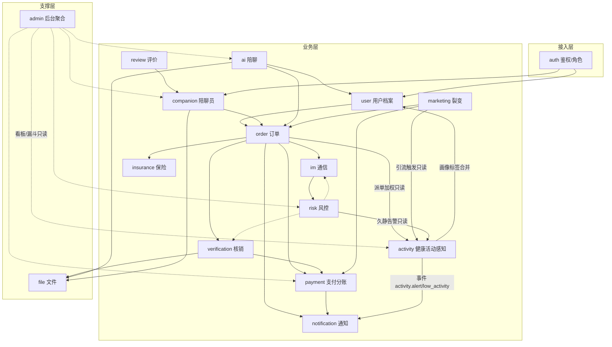
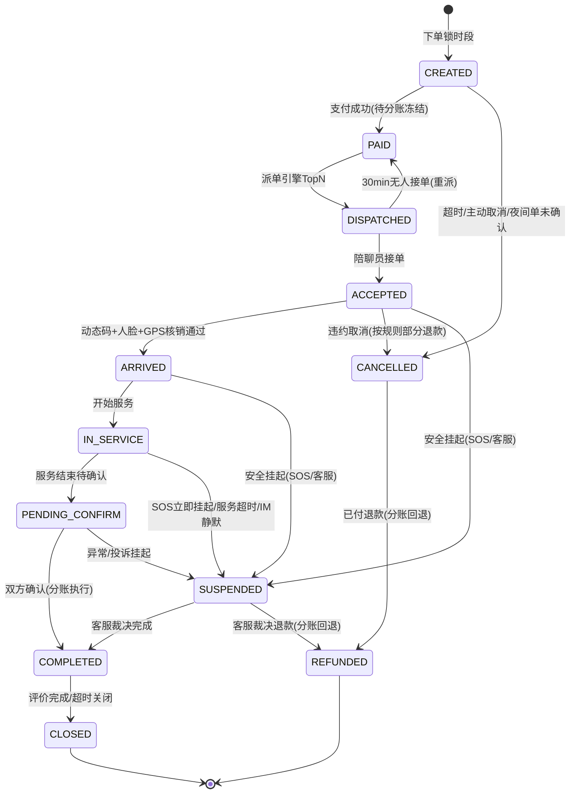
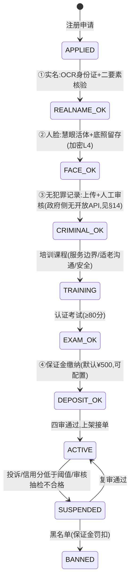
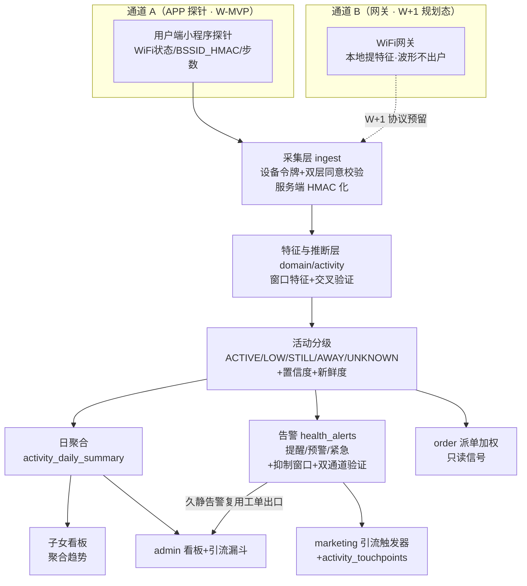

# 邻伴 · 总体架构设计（ARCHITECTURE）

> **项目**：邻伴 · 社区养老陪伴匹配平台（同城真人陪聊 O2O · 老人线 · 广州单城 MVP）
> **版本**：v1.8 ｜ 2026-10 ｜ **作者**：顾图南（Silas Frame）｜ **团队**：rnd-linban（主理人：岑执衡）
> **上游依据**：《邻伴·社区养老陪伴匹配方案》v1.0（2026-09-19）战略稿
> **性质**：架构设计文档。只做设计，不含业务代码实现；代码结构建议到目录级。

---

## 0. 文档导读

| 读者 | 建议重点阅读 |
|---|---|
| 主理人 / 产品 | §1 概览、§7 支付分账、§8 防飞单、§12 里程碑、§13 健康活动感知、§14 风险 |
| 后端开发 | §4 模块划分、§5 数据架构、§6 链路时序、§7 分账、附录 B |
| 小程序开发 | §3 选型、§6 链路、§9 第三方清单 |
| 管理后台开发 | §3.5、§4.1 中 admin/risk 模块、附录 B |
| 运维 / 交付 | §11 部署、§12 里程碑 |

本文所有结论均可回溯到三处来源：**客户拍板决策**（见 §1.2）、**团队技术现状**（React + Vite + Express + TypeScript，Node 部署）、**微信/腾讯云官方能力边界**（见 §9）。凡与上述冲突处，以 §14 开放问题登记，不在正文臆测。

---

## 1. 系统概览与设计约束

### 1.1 产品形态

「邻伴」MVP 是**三端齐发**的同城真人陪聊 O2O 平台：

| 端 | 载体 | 使用者 | 核心职责 |
|---|---|---|---|
| 用户端小程序 | 微信小程序（Taro 4） | 老人（主用）+ 子女（代操作） | 大字语音交互、AI 陪聊、浏览陪聊员、下单支付、订单跟踪、评价 |
| 陪聊员端小程序 | 微信小程序（Taro 4） | 众包陪聊员 | 入驻四审、抢单/派单、日程、导航、到岗核销、收入提现 |
| 管理后台 | Web（React + Vite） | 运营 / 客服 / 财务 / 审核 | 分账管理、裂变配置、数据看板、四审流、投诉风控、AI 抽检 |

服务端一套 API 同时支撑三端，按端鉴权（不同角色、不同权限面）。

### 1.2 设计约束（客户已拍板，按此设计）

1. 6–8 周交付 MVP，三端齐发；选型**求稳不求新**，对齐团队现有栈。
2. 支付走**微信服务商自动分账**：用户付款即进入分账流程，平台抽 5–10%，余款直达陪聊员；分账资质进件约 1–2 周（**W1 必须启动**）。
3. 陪聊员众包 + 严审：实名 + 人脸 + 无犯罪记录 + 培训认证 + 保证金。
4. AI 陪聊：云端 LLM（DeepSeek/通义/豆包）+ ASR/TTS 全语音交互；AI 会话数据沉淀画像，反哺真人匹配（双线转化）。
5. 防飞单六机制、核销真实性、安全合规为**架构层一等公民**，不是补丁（见 §7 §8 §10）。
6. 部署于 Tom 云服务器（47.253.159.62），Node 栈；小程序要求**已备案域名 + HTTPS**。

### 1.3 非功能需求

| 维度 | MVP 目标 | 说明 |
|---|---|---|
| 可用性 | 99.5%（单机部署，允许夜间维护窗口） |  MVP 不追求高可用，但核心链路（支付/分账）必须幂等可重试 |
| 性能 | API P95 < 300ms（非 AI 类）；AI 语音首响 < 3s | 列表类走 Redis 缓存；AI 管道流式优化 |
| 安全 | 全链路 HTTPS；敏感字段落库加密；按等保二级要求建设 | 见 §10 |
| 合规 | 个保法告知同意 + 微信隐私指引 + 内容审核全覆盖 | 人脸/身份证属敏感个人信息，需单独同意 |
| 容量 | 单城试点：注册用户 ≤ 5 万，日订单 ≤ 500，日活会话 ≤ 2 万 | 单机 + Redis 足够，预留水平扩展路径（§11.4） |

### 1.4 架构原则（铁律）

1. **单向依赖**：接入层 → 应用服务层 → 基础设施层；下层对上层零感知。
2. **模块即边界**：业务模块只能通过**声明的接口 / 事件**互相调用，禁止直接 import 对方内部实现（防循环依赖）。
3. **一切资金动作可审计**：支付、分账、退款、提现全部落流水表，任何状态可回放。
4. **一切服务动作可留痕**：签到时间、GPS（模糊化）、动态码、双方确认、服务日志，是结算与风控的共同输入。
5. **第三方全部走适配层**：微信/腾讯云/LLM 统一经 `adapters/` 隔离，可替换、可 mock、可降级。
6. **MVP 不引入分布式**：单机可跑；所有队列/锁/缓存基于 Redis，为未来拆分预留形态而非提前拆分。

---

## 2. 总体架构（C4 文字化分层）

### 2.1 Context 级（系统与外部）

```
                            ┌──────────────────────────┐
                            │        老人 / 子女         │
                            └────────────┬─────────────┘
                                         │ 微信
        ┌──────────────────┐   ┌─────────▼──────────┐   ┌────────────────────┐
        │     陪聊员        │──▶│                    │◀──│  运营/客服/财务      │
        └──────────────────┘   │   邻伴平台 (MVP)    │   └─────────┬──────────┘
                               │                    │             │ 浏览器
   ┌───────────────────┐       │  用户小程序 + 陪聊员 │       ┌─────▼───────────┐
   │   亲邻社区媒体     │       │  小程序 + Web 后台   │       │   管理后台 Web   │
   │ (灯箱/开门App/5V)  │──┐   │  + Express API       │       └─────────────────┘
   └───────────────────┘  │   │  + MySQL + Redis     │
                          │   └─────────┬───────────┘
                          │             │
   ┌───────────────────┐  │   ┌─────────▼───────────┐   ┌────────────────────┐
   │ 微信开放平台/支付   │──┼──▶│  支付 · 分账 · 订阅消息 │   │  腾讯云 (慧眼/OCR/  │
   │ 内容安全 · 手机号   │  │   │  · 内容审核 · 隐私号  │   │  号码隐私/ASR/TTS/  │
   └───────────────────┘  │   └─────────────────────┘   │  SMS/地图/COS)      │
                          │                              └────────────────────┘
   ┌───────────────────┐  │   ┌─────────────────────┐   ┌────────────────────┐
   │ LLM (DeepSeek/通义/│──┘   │  保险公司 (保单/理赔) │   │ 公安/第三方背调     │
   │ 豆包 · 可切换)      │      └─────────────────────┘   └────────────────────┘
   └───────────────────┘
```

外部系统清单与备选见 §9。亲邻社区媒体为**流量与信任入口**，不进入系统调用链（线下触点 + 开门 App 跳转小程序）。

### 2.2 Container 级（部署单元）

```
┌─────────────────────────────────────────────────────────────────────┐
│  客户端层                                                            │
│  ┌────────────────┐ ┌────────────────┐ ┌────────────────┐            │
│  │ 用户端小程序    │ │ 陪聊员端小程序  │ │ 管理后台 Web    │            │
│  │ Taro4+React+TS │ │ Taro4+React+TS │ │ React18+Vite   │            │
│  │ (适老:大字/语音)│ │ (入驻/核销/收入)│ │ +AntD5+axios    │            │
│  └──────┬─────────┘ └───────┬────────┘ └───────┬────────┘            │
└─────────┼───────────────────┼──────────────────┼─────────────────────┘
          │ HTTPS / WSS       │                  │ HTTPS
┌─────────▼───────────────────▼──────────────────▼─────────────────────┐
│  接入层（单机 Nginx 容器）                                            │
│  · 443 HTTPS 终结 · WSS 反代 · 静态资源(admin) · 基础限流             │
└─────────┬───────────────────────────────────────┬───────────────────┘
          │                                          │
┌─────────▼─────────────────────────────────────────▼───────────────────┐
│  应用层：Express API（TypeScript，单容器，PM2 cluster 多核）           │
│  ┌───────────┬───────────┬───────────┬───────────┬────────────┐       │
│  │ 接入中间件 │ 业务模块层 │ 领域内核   │ 基础设施层 │ 适配层      │       │
│  │ auth/限流 │ order等13+2│ 状态机/规则│ db/redis/ │ wx/qcloud/│       │
│  │ 幂等/日志 │ 个模块      │ 分账规则/  │ oss/queue/│ llm/maps/ │       │
│  │ 参数校验  │ (§4)       │ 匹配打分   │ cron      │ insurance │       │
│  └───────────┴───────────┴───────────┴───────────┴────────────┘       │
└─────────┬───────────────────────┬──────────────────────┬─────────────┘
          │                       │                      │
┌─────────▼──────────┐ ┌─────────▼─────────┐ ┌──────────▼──────────┐
│ MySQL 8 容器        │ │ Redis 7 容器      │ │ 腾讯云 COS          │
│ 业务主库            │ │ 缓存/锁/队列/会话  │ │ 留痕文件/证件/录音   │
│ (数据卷持久化)       │ │ (BullMQ 任务)      │ │ (私有读+STS 直传)   │
└────────────────────┘ └───────────────────┘ └─────────────────────┘
```

### 2.3 分层职责与依赖铁律

```
路由/中间件层（app.ts、routes/、middlewares/）
    │  只做：鉴权、参数校验、限流、幂等、日志。不含业务规则。
    ▼
应用服务层（modules/*/service.ts）
    │  只做：业务编排、事务边界、状态机推进。可调用其他模块的 interface。
    ▼
领域内核（domain/）
    │  纯函数/纯规则：分账计算、匹配打分、状态机转移表、信用分规则。零 IO，可单测。
    ▼
基础设施层（infra/）
    │  db(prisma)、redis、oss、queue(bullmq)、cron。只被上层调用，不 import 上层。
适配层（adapters/）
    微信支付/小程序/内容安全、腾讯云、LLM、地图、保险。对外部系统的唯一出口。
```

**跨模块调用契约**：模块间禁止 `import { xService } from '../other'`。跨模块依赖一律表现为：
- **同步查询**：对方模块在 `interfaces.ts` 中导出只读门面（如 `orderInterface.getOrderForPayment()`），由依赖方注入；
- **异步解耦**：领域事件经 BullMQ / EventEmitter（如 `order.completed` → payment 分账执行、notification 评价邀请、ai 画像更新）。

---

## 3. 技术选型与理由

### 3.1 小程序框架：三选一决策

| 维度 | 原生小程序 | **Taro 4（React 版）** ✅ | uni-app（Vue） |
|---|---|---|---|
| 团队心智复用 | ✗ 需学 WXML/setData/Page 体系 | ✅ **React + TS 完全复用** | ✗ Vue 栈团队不熟 |
| 双端代码共享 | ✗ 两份代码 | ✅ monorepo + packages/shared 共享订单模型/IM/语音组件 | ✅ 但栈不对 |
| 微信新能力跟进 | ✅ 第一时间 | ✅ 可 `Taro.invoke` 直调 wx 原生 API 兜底 | ⚠️ 依赖社区封装 |
| 适老化/低端机性能 | ✅ 无编译层、包体最小 | ⚠️ 编译层，需分包+按需控制包体（主包 < 1.8MB 硬约束） | ⚠️ 同左 |
| 6–8 周交付效率 | ⚠️ 模板语法重复劳动多 | ✅ 组件化/hooks 效率高 | ✗ 学习成本 |
| 未来多端（H5/App） | ✗ | ✅ 顺带可获得子女分享 H5 | ✅ |

**决策：Taro 4（React 版）+ TypeScript**。理由：两端均为微信小程序、无跨端诉求，选型权重主要落在**团队效率与工程质量**上——Taro 让团队用最熟悉的 React + TS 写小程序，双端共享订单状态机、IM、语音录制等重组件；微信核心能力（支付、人脸核身、订阅消息、录音）均以 wx.* API 调用，不依赖任何 UI 库，编译黑盒风险被压到最小。
**风控条款**：① 主包严格 < 1.8MB（分包 + 按需注入 + 图片走 CDN/COS）；② 涉及微信最新接口（如人脸核身）直接用 `Taro.invoke('startFacialRecognitionVerify')` 绕过封装滞后；③ 若编译层出现阻塞性 bug，允许单端回退原生（双端仓库独立，互不阻塞）。

### 3.2 后端框架

| 项 | 选择 | 理由 |
|---|---|---|
| 运行时 | Node 20 LTS | Tom 服务器既有 Node 运维习惯 |
| Web 框架 | **Express 4 + TypeScript** | 团队 mediaplaner 同款栈，最熟最稳；中间件生态（zod 校验、rate-limit、pino）齐全。Express 5 已 GA，作为平滑升级项，MVP 不追新 |
| ORM | **Prisma 5 + MySQL 8** | schema 即文档；全链路类型安全（Zod 入参 → Service → DB）降低联调错误；migrate 管理演进；复杂报表 SQL 用 `$queryRaw` 兜底 |
| 参数校验 | **Zod** | 与 TS 类型同源，DTO 一份定义两用 |
| 鉴权 | jsonwebtoken + Redis 黑名单 | access token（2h）+ refresh（30d，可吊销）；三端角色分离守卫 |
| 实时通信 | **ws**（自研轻量 IM 协议） | IM 场景（文本/图片/语音/系统消息/已读回执）用 Socket.IO 反而重；ws + Redis Pub/Sub 为多机预留 |
| 任务队列 | **BullMQ（基于 Redis）** | 分账回调重试、通知发送、AI 会话处理、对账、抽检。**MVP 不引入 RabbitMQ/Kafka** |
| 定时任务 | node-cron | 每日对账、保单到期、信用分结算、待分账超时监控 |
| 日志/监控 | pino + 健康检查端点 + Sentry（可选） | 结构化日志按 requestId 串联；Sentry 前后端错误追踪（免费额度够 MVP） |

### 3.3 数据层

- **MySQL 8 主库**：JSON 列存画像标签/分账明细快照；窗口函数支撑对账统计。
- **Redis 7**：Token 黑名单、验证码、分布式锁（防重下单/抢单互斥）、限流计数、热点缓存（陪聊员列表/系统配置）、BullMQ 底座。
- **对象存储：腾讯云 COS**：留痕文件（人脸签到照、服务记录、证件、AI 录音）私有读 + STS 临时密钥前端直传。备选 MinIO 自建（省 COS 费用，但需自运维）。

### 3.4 是否上消息队列？

**结论：不引入独立 MQ 组件，用 BullMQ（Redis）满足全部异步场景。**
MVP 单机、日订单 ≤ 500，异步诉求仅四类：通知发送、分账回调重试/对账、AI 会话落库与画像更新、抽检任务。BullMQ 提供延迟任务、重试、并发控制，足够且运维成本近零。
**拆分信号**（未来再上 RocketMQ/RabbitMQ）：出现多机部署且要求事件跨服务可靠投递，或 BullMQ 延迟成为瓶颈。

### 3.5 管理后台

React 18 + Vite + TypeScript + **Ant Design 5** + React Router + axios（统一拦截：JWT、错误码、401 刷新）。状态用组件内 + Context（数据看板类请求量小，不上 Redux/Zustand）。

### 3.6 选型总表

| 层 | 选型 | 一句话理由 |
|---|---|---|
| 用户/陪聊员小程序 | Taro 4 + React + TS | 复用团队栈，双端共享重组件 |
| 管理后台 | React 18 + Vite + TS + AntD 5 | 团队最熟，组件库成熟 |
| 后端 | Express 4 + TS + Prisma 5 | 团队现有栈全链路类型安全 |
| 数据库 / 缓存 | MySQL 8 / Redis 7 | 客户指定，Node 生态连接器最成熟 |
| 队列 / 定时 | BullMQ / node-cron | 轻量，不上独立 MQ |
| 文件 | 腾讯云 COS + STS 直传 | 与腾讯云其他服务打包 |
| 部署 | Docker Compose 单机 + Nginx | Tom 服务器既有形态 |

---

## 4. 服务端模块划分与依赖方向

### 4.1 模块清单（14 业务模块 + 2 支撑模块）

| 模块 | 职责 | 关键表（§5） | 暴露给谁 |
|---|---|---|---|
| **auth** | 三端登录（小程序 code2session / 后台账密+TOTP）、Token、角色权限（elder/family/companion/admin/ops/finance/cs） | admins, roles | 全部 |
| **user** | 老人档案（画像标签、偏好、健康/生日提醒、紧急联系人）、子女绑定、适老设置、账号注销 | users, elder_profiles, family_bindings | order, ai, marketing, notification |
| **companion** | 入驻四审流状态机、资料/标签/价格/日程、培训考试、信用分与等级、保证金账户 | companions, applications, certifications, schedules, deposits, credit_logs | order, risk, admin |
| **order** | 下单/锁时段/派单/抢单、订单状态机、超时规则、异常挂起 | orders, order_timeline | payment, verification, review, im, notification, ai |
| **payment** | 微信 JSAPI 下单、**待分账冻结**、分账执行/回退、退款、提现审核、每日对账、抽成配置 | payments, profit_sharing_records, withdrawals, reconciliation_records, system_configs | admin(finance), notification |
| **verification** | 动态码生成/校验、到岗人脸签到（活体+比对）、GPS 模糊化、双方确认、留痕文件、回访任务 | verifications, evidence_files, revisit_tasks | order, payment, risk |
| **im** | 会话管理、消息（文本/图片/语音）、已读、内容审核拦截、隐私号绑定关系管理 | im_conversations, im_messages, privacy_bindings | order, risk, notification |
| **ai** | ASR→LLM→TTS 管道、会话与上下文、情感/话题结构化输出、画像沉淀、AI 抽检 | ai_sessions, ai_messages, ai_profiles | user, order（推荐）, risk |
| **review** | 双向评价、评分聚合、投诉受理 | reviews, complaints | companion, admin, ai |
| **insurance** | 保单登记、订单绑定、到期提醒、理赔入口（MVP 半自动） | insurance_policies | order, notification |
| **marketing** | 孝心时长卡（购买/赠送/核销）、社区团长分销与佣金、老带新奖励、优惠券 | gift_cards, coupons, user_coupons, distributors, commissions | order, payment |
| **notification** | 订阅消息、短信、IM 系统消息、老人健康/生日提醒（用药仅文字提醒） | notification_logs, reminder_settings | 全部（被调用） |
| **risk** | 私聊敏感词风控、飞单举报、黑名单、保证金罚扣、异常订单识别 | risk_events, reports, blacklists, penalty_records | 全部（被调用） |
| **activity** | 健康活动感知：双通道采集归一、活动状态分级（ACTIVE/LOW/STILL/AWAY/UNKNOWN + 置信度/新鲜度）、日聚合、告警生成与抑制、隐私中心（授权/一键关）、派单加权信号 | wifi_devices, activity_signals, activity_daily_summary, health_alerts, activity_consents, activity_consent_scopes, activity_touchpoints, activity_subscriptions | order（派单加权）, marketing（引流触发）, risk（久静告警）, admin（看板漏斗）, notification |
| **admin**（支撑） | 后台 API 聚合：看板、审核工作台、配置中心、分账管理、AI 抽检队列 | （读各模块表） | — |
| **file**（支撑） | COS STS 临时密钥签发、文件元数据、访问审计 | file_meta | verification, ai, companion |

### 4.2 模块依赖图



依赖方向约定：
- **箭头方向 = 允许的调用方向**（上游依赖下游契约，不 import 下游实现）。
- `order` 是编排中枢，被 user/companion/marketing 依赖；**禁止 order 反向 import** 它们——需要用户/陪聊员信息时经 interface 门面读取。
- `payment` 与 `verification` 之间为**条件门闩**关系：verification 产出的"核销完成"事实是 payment 执行分账的前置条件（§7.2），双方通过 `order.completed` 事件解耦，不直接互调。
- `risk` 只被调用、不依赖业务模块（保持可旁路审计）。
- `activity`（§13）**只被下游只读消费**：`order`/`marketing`/`risk`/`admin` 读其只读门面，`activity` 反向只经事件通知 `notification`/`user`，**不 import 上述模块实现**，故无循环依赖。

### 4.3 跨模块通信规则

1. **同步读**：跨模块只允许经对方 `interfaces.ts` 声明的**只读门面**，方法入参/出参为 DTO，禁止传 Prisma Model 实例。
2. **异步事件**（BullMQ 队列或内存 EventEmitter，MVP 同进程用 EventEmitter，重活入 BullMQ）：
   - `order.paid` → im 开通会话 + 绑定隐私号；→ companion 触发派单
   - `order.completed` → payment 执行分账；→ review 发评价邀请；→ insurance 保单生效确认；→ ai 画像更新
   - `order.cancelled/refunded` → payment 分账回退；→ im 解绑隐私号
   - `verification.arrived` → notification 通知子女（服务已开始）
3. **事务边界**：单模块内用 Prisma 事务；跨模块最终一致性靠事件 + 补偿（分账失败重试 ≥3 次进人工工单，绝不静默丢失）。

### 4.4 代码目录结构（目录级）

```
linban-app/
├── docs/                        # 架构/API/数据库设计文档
├── packages/
│   └── shared/                  # 双端+后台共享：订单状态枚举、DTO 类型、错误码、常量
├── apps/
│   ├── miniapp-user/            # 用户端小程序（Taro 4 + React + TS）
│   │   └── src/{pages,components,stores,services,utils}
│   ├── miniapp-companion/       # 陪聊员端小程序（Taro 4 + React + TS）
│   ├── admin-web/               # 管理后台（React 18 + Vite + TS + AntD 5）
│   │   └── src/{pages,components,api,router,hooks}
│   └── server/                  # 后端 API（Express 4 + TS + Prisma 5）
│       └── src/
│           ├── app.ts / routes/ / middlewares/    # 接入层
│           ├── modules/                            # §4.1 十五个模块
│           │   └── <module>/{controller,service,interface.ts,repo,*.schema.ts}
│           ├── domain/                             # 纯规则：状态机/分账/匹配/信用分
│           ├── infra/                              # prisma/redis/oss/bullmq/cron
│           ├── adapters/                           # 微信/腾讯云/LLM/地图/保险 适配器
│           └── common/                             # 错误码/DTO/守卫/工具
├── deploy/
│   ├── docker-compose.yml
│   ├── Dockerfile.server
│   ├── nginx.conf
│   └── backup.sh
└── .github/workflows/           # CI：lint + type-check + build + 镜像推送
```

---

## 5. 数据架构

### 5.1 核心表清单（概要，字段见《DATABASE.md》）

> 可执行单一事实源：`apps/server/prisma/schema.prisma`（45 表，`prisma validate` 已通过）。本清单与 schema 的对应关系以 DATABASE.md 为准；表结构变更须先回改本节，再改 schema。

**数据访问三态纪律**（接口契约的前置约束，完整「模块→表 读写矩阵」由宋砚秋随 API-CONTRACT.md 交付）：
- **A 态（追加型流水，禁 UPDATE/DELETE）**：`profit_sharing_records`、`deposit_transactions`、`order_timeline`、`credit_logs`、`audit_logs`、`penalty_records`——一切资金/信用/状态变更只插不改，历史可回放；
- **R 态（只读投影，经 interface 门面脱敏）**：`companions` 的 `credit_score`/`deposit_balance_fen`/`rating_avg` 等聚合列真实流水在对应 A 态表，端上 DTO 不得直出；
- **X 态（受限访问）**：`evidence_files`/`file_meta`（L4）只经 STS 临时密钥、API 永不返回 objectKey 明文；`risk_events`/`blacklists` 不对外暴露，仅进后台工作台；`elder_profiles` 只出脱敏标签；`*_cipher` 列任何接口不出。

**账号与画像**
- `users`（三端账号：openid/unionid、角色、手机号密文、状态）
- `elder_profiles`（画像标签 JSON：兴趣/孤独度/健康边界/话题热度；提醒偏好；紧急联系人）
- `family_bindings`（子女-老人关系、授权查看范围）

**陪聊员供给**
- `companions`（主档：实名状态、标签、时薪、服务半径、等级、信用分、保证金余额）
- `companion_applications`（四审流状态机 + 每步审核记录）
- `companion_certifications`（培训/考试记录）
- `companion_schedules`（日程/可约时段）
- `credit_logs`（信用分明细：加分/罚扣/事由）
- `deposit_transactions`（保证金收支流水）

**订单与交易**
- `orders`（主表：状态、服务类型/时长、金额、双方 ID、地址、时间窗）
- `order_timeline`（状态流水：每次转移的操作人/时间/事由）
- `payments`（支付单：微信 prepay_id、transaction_id、金额、状态）
- `profit_sharing_records`（分账记录：**冻结/已分账/已回退**、平台抽成、陪聊员应收、微信回单）
- `withdrawals`（提现单：审核流、到账状态）
- `reconciliation_records`（每日对账：本地流水 vs 微信账单差异）

**核销与留痕**
- `verifications`（动态码、人脸比对分数、GPS 模糊坐标、签到时间、双方确认）
- `evidence_files`（OSS 对象键、类型、上传者、访问审计）
- `file_meta`（COS 文件元数据、STS 授权记录、访问审计流水，§4.1 file 模块）
- `revisit_tasks`（事后回访任务与结果）

**通信**
- `im_conversations` / `im_messages`（会话/消息：类型、审核状态、已读）
- `privacy_bindings`（AXB 绑定：号码、有效期、通话记录引用）

**AI**
- `ai_sessions` / `ai_messages`（会话/消息：ASR 原文、LLM 回复、情感标签）
- `ai_profiles`（沉淀画像：兴趣向量、情绪趋势、推荐匹配分）

**健康活动感知（§13，已落地 8 张，详见 §13.8）**
- `wifi_devices`（网关/探针设备与绑定，W+1 硬件，MVP 可空表）
- `activity_signals`（时间窗+特征+置信度+来源通道；原始特征 ≤14 天由 cron sweep 清理）
- `activity_daily_summary`（日聚合：活跃时段分布、活动量、久静次数、居家时长）
- `health_alerts`（告警与处置，自闭环状态流，人工补单时才落 complaints）
- `activity_consents` + `activity_consent_scopes`（双层知情同意主表 + 子女可见范围子表，1:N）
- `activity_touchpoints`（引流触达记录与转化归因）
- `activity_subscriptions`（订阅权益，仅记权益不建资金关系；W+2 独立 payments 通道）
- `wifi_devices`（网关/探针设备与绑定，W+1 硬件，MVP 可空表）
- `activity_signals`（时间窗+特征+置信度+来源通道；原始特征 ≤14 天清理）
- `activity_daily_summary`（日聚合：活跃时段分布、活动量、久静次数、居家时长）
- `health_alerts`（告警与处置，复用 complaints 工单关联，不新建工单表）
- `activity_consents`（双层知情同意与隐私中心状态）
- `activity_touchpoints`（引流触达记录与转化归因）

**评价/营销/保险/风控/后台**
- `reviews`（双向评价：星级、标签、内容、审核状态）
- `complaints`（投诉单：类型、双方、处理流）
- `gift_cards`（孝心时长卡：面额、购买人、受赠人、核销状态）
- `coupons` / `user_coupons`（券模板/用户券）
- `distributors` / `commissions`（社区团长/佣金流水）
- `insurance_policies`（保单号、保额、投保人、与订单绑定、到期）
- `risk_events`（命中规则/处置）
- `reports`（飞单举报：提交人、证据、奖励发放状态）
- `penalty_records`（保证金罚扣/返还流水，§8 机制 5）
- `blacklists`（黑名单：用户/陪聊员/设备）
- `audit_logs`（后台操作审计）
- `admins` / `roles` / `permissions` / `role_permissions`（RBAC 及角色-权限关联）
- `system_configs`（抽成比例、价格保护规则、审核开关、AI 抽检比例）
- `notification_logs` / `reminder_settings`（通知记录/提醒设置）

### 5.2 缓存与键设计（Redis）

| 键 | 用途 | TTL |
|---|---|---|
| `sess:<userId>` | Token 会话/黑名单校验 | 与 token 对齐 |
| `code:<phone>` | 短信验证码 | 5 min |
| `lock:slot:<companionId>:<slot>` | 时段锁（防重下单） | 10 min，成交转订单 |
| `lock:grab:<orderId>` | 抢单互斥 | 5 min |
| `idem:<key>` | 幂等结果缓存 | 24 h |
| `cache:companion:list:<geoHash>` | 附近陪聊员列表 | 5 min |
| `cache:config` | 系统配置热数据 | 5 min + 主动失效 |
| `bull:*` | BullMQ 队列 | — |

### 5.3 敏感数据分级

| 级别 | 数据 | 措施 |
|---|---|---|
| L4 极敏感 | 身份证号、人脸底照/活体视频、轨迹级位置数据 | AES-256-GCM 加密落库（KMS 密钥）；COS 私有；仅审核岗可见，访问记 audit_logs。签到 GPS 按 §6.2 方案**先模糊化（精度衰减至 100–300m）再落库**，模糊化即脱敏处理，不再叠加 AES（DATABASE.md 已按此落地，两处偏差见该文档 §11） |
| L3 敏感 | 手机号、真实姓名、健康相关画像 | 手机号加密；画像脱敏后供匹配（可用不可见） |
| L2 内部 | 订单、分账、评价 | 库内完整，日志脱敏 |
| L1 公开 | 昵称、头像、标签、评分 | 原样 |

---

## 6. 核心链路时序（文字化 + Mermaid）

### 6.1 下单 → 支付 → 待分账冻结 → 派单

```
1. 老人在用户端浏览陪聊员（标签/距离/评分/时薪，Redis 缓存 5min；画像命中优先展示）
2. 选时段 → 服务端 Redis 锁时段 + 预创建订单（CREATED，15min 支付超时）
3. 夜间单守卫（22:00–06:00 下单且 night_order_enabled=true）：
   - 子女账号代下 → 订单进入「待子女确认」，子女端 30min 内确认方可继续支付；
     超时未确认 → 自动取消 + 全额退款（未支付则直接关单，时限自下单起算）
   - 豁免口径 A：下单账号 == 老人本人且 elder_profile.birthday 满足 18+ → 可自确认，跳过子女确认
   - 阈值与开关进 system_configs（night_order_enabled / night_confirm_timeout_min）
4. 计价：时长 × 时薪 − 优惠券 − 时长卡抵扣（marketing 接口）
5. 调起微信支付（服务商 JSAPI，profit_sharing=true 标记可参与分账）：
   - 收款方 = 平台服务商商户号（款项进平台担保户）
6. 支付回调验签 → orders=PAID，payments=SUCCESS
   → profit_sharing_records 写入"待分账冻结"（平台抽成 5–10% + 陪聊员应收，均冻结在微信商户账户）
7. 事件 order.paid：
   a. im 开通会话 + privacy_bindings 绑定 AXB 隐私号（服务完成 + 24h 后自动解绑）
   b. companion 派单引擎：就近 + 标签匹配 + 信用分 + 等级加权打分 → 取 Top N 推送抢单（30min 无接单转人工派单/客服介入）
```

```mermaid
sequenceDiagram
    participant U as 用户端小程序
    participant API as Express API
    participant WX as 微信支付
    participant R as Redis
    participant DB as MySQL

    U->>API: 选时段下单(Idempotency-Key)
    API->>R: SET lock:slot EX 600
    API->>DB: INSERT orders(CREATED)
    API-->>U: 返回金额/订单号
    U->>API: 请求支付(调起 wx.requestPayment)
    API->>WX: JSAPI 下单(profit_sharing=true)
    WX-->>U: 支付参数
    U->>WX: 用户确认支付
    WX->>API: 支付回调(验签+幂等)
    API->>DB: orders=PAID; payments=SUCCESS
    API->>DB: profit_sharing_records=FROZEN(待分账)
    API->>DB: emit order.paid → IM会话+隐私号绑定+派单TopN
```

### 6.2 接单 → 到岗核销 → 服务中 → 完成 → 分账执行 → 评价

```
1. 陪聊员抢单/接单 → orders=ACCEPTED；双方 IM 沟通细节（语音/文本，全量留痕+内容审核）
2. 陪聊员导航到点（腾讯地图）；老人端/子女端收到"已接单+预计到达"
3. 到岗核销（verification，四重事实）：
   a. 陪聊员请求动态码（服务端生成 6 位码，5min 有效，绑定订单+人脸特征摘要）
   b. 老人端出示码 / 陪聊员扫老人码
   c. 人脸签到：慧眼活体检测 + 与入驻底照比对（相似度阈值，如 ≥80）
   d. GPS 模糊化上传（精度衰减至 100–300m，仅记录偏差不暴露门牌）
   → orders=ARRIVED → IN_SERVICE，通知子女"服务已开始"
4. 服务中：IM 留痕；服务日志上传（OSS）；平台按配置抽检。
   安全挂起三触发器（共用 suspendOrderForSafety 助手写 SUSPENDED，order_timeline 的 action 按下划线规范取值）：
   a. 任一端 SOS 一键求助 → 立即挂起：action=sos_suspend、operator=触发方；risk 记 CRITICAL 风控事件 + URGENT 投诉工单 + 紧急联系人短信/子女 IM
   b. 服务超时自动挂起：IN_SERVICE 且超过预约结束 service_overtime_suspend_min（默认 60min）未完成确认 → action=auto_suspend、operator=SYSTEM（附阈值快照）
   c. 客服手动挂起：POST /verifications/suspend → action=suspend、operator=客服账号
   d. IM 静默自动挂起：IN_SERVICE 且 IM 静默 im_silence_suspend_min（默认 30min）→ 同 b 记 auto_suspend
   裁决出口不变：SUSPENDED → COMPLETED / REFUNDED（客服裁决）
5. 服务结束：双方在端上确认（老人确认可语音说"满意"→ ASR 记录）→ orders=COMPLETED
6. 事件 order.completed：
   a. payment 执行分账：调用微信分账接口，一笔将陪聊员应收直达其个人（零钱/银行卡），平台留存抽成；
      分账结果回写 profit_sharing_records=SHARED（失败进 BullMQ 重试 ≥3 次 → 人工工单）
   b. review 推送双向评价邀请 → 评分聚合进 companions
   c. insurance 保单生效确认（服务时段覆盖校验）
   d. ai 用本次会话/服务标签更新 ai_profiles（双线转化输入）
   e. notification 发订阅消息；marketing 按复购规则发复购券
```

```mermaid
sequenceDiagram
    participant C as 陪聊员端
    participant API as Express API
    participant QC as 腾讯云慧眼
    participant WX as 微信支付
    participant DB as MySQL

    C->>API: 抢单
    API->>DB: orders=ACCEPTED + 派单通知
    C->>API: 到达请求动态码
    API-->>C: 6位动态码(5min)
    C->>API: 老人确认码 + 人脸活体(慧眼) + GPS模糊
    API->>QC: 活体检测+人脸比对(底照)
    QC-->>API: 相似度≥阈值
    API->>DB: verifications 落库; orders=IN_SERVICE
    API-->>C: 核销通过
    Note over C,API: 服务中：IM留痕/日志上传/SOS或超时自动挂起SUSPENDED
    C->>API: 服务完成(双方确认)
    API->>DB: orders=COMPLETED
    API->>WX: 执行分账(平台留存+陪聊员直收)
    WX-->>API: 分账回单
    API->>DB: profit_sharing_records=SHARED
    API->>DB: emit order.completed → 评价邀请/保单生效/画像更新/复购券
```

### 6.3 AI 双线转化链路（AI 线 → 真人线）

```
AI 线（7×24，无人值守）：
老人按住说话 → 录音上传 COS → ASR 实时转写 → LLM 生成回复
（人设 prompt + ai_profiles 上下文 + 安全过滤：医疗建议拦截/情绪危机升级人工）→ TTS 合成
（适老音色）→ 返回音频 URL 播放。会话落 ai_messages；情感/话题标签结构化回写 ai_profiles。

双线转化：
① ai_profiles 每周生成"陪伴报告"（子女端可见：孤独指数、兴趣、情绪趋势）
② 匹配引擎输入画像标签 → 真人陪聊员推荐（标签重合 + 距离 + 评分 + 价格匹配 + 信用分）
③ 转化触点：AI 会话内"想和真人聊聊吗"卡片 + 子女端报告页"为爸妈预约"入口 → 进入 6.1 下单链路
④ 防打扰边界：AI 主动推销频次受 system_configs 控制（默认每会话 ≤1 次）
```

### 6.4 IM 与隐私号链路

```
1. 订单支付成功 → 自动建会话（订单维度，禁止脱离订单私聊）
2. 隐私号绑定（腾讯云号码隐私保护 AXB）：
   A=老人侧虚拟号暴露给陪聊员，B=陪聊员侧虚拟号暴露给老人；双方真实号码互不可见
   - 绑定有效期 = 服务完成 + 24h（支持售后沟通窗口），到期自动解绑
   - 通话记录（时间/时长/双方虚拟号）回写 privacy_bindings，供风控取证
3. IM 消息：文本/图片/语音全量审核
   - 文本：微信 msgSecCheck → 命中即拦截并进 risk 人工队列
   - 图片：imgSecCheck；语音：转写抽检（按 system_configs 比例）
4. 私聊风控（§8.2）：手机号串、微信号、"私下/便宜/加V"等模式命中 → 拦截/警告/举报奖励引导
```

### 6.5 订单状态机



### 6.6 陪聊员入驻四审流



---

## 7. 支付与分账设计（核心机制，客户点名）

### 7.1 资金流总原则：平台担保户模式

**所有订单款项 100% 进入平台服务商商户号（担保户）**，陪聊员在服务核销完成前**没有任何途径提前拿到钱**——这是防飞单的财务基石。微信服务商模式下，平台收款后通过「分账」将钱分给陪聊员，抽成留存平台。

### 7.2 "付款即分账"与"核销后才结算"的调和（关键设计）

客户两条要求存在表面张力：①"用户付款即分账、余款直达陪聊员"；②防飞单要求"双向核销完成才结算"。

**解法：微信「待分账冻结」能力，把"分账"拆成两个动作——**

```
付款瞬间（下单支付时 profit_sharing=true）：
  用户付款 → 款项进入平台商户号 → 立即记为"待分账"状态冻结
  · 对用户：钱已付出、进入平台担保（符合"付款即分账流程"）
  · 对陪聊员：看得见"待入账"，但拿不走（防飞单）

双向核销完成（orders=COMPLETED）：
  调用分账执行 → 平台留存 5–10% 抽成 + 陪聊员应收直达其个人微信零钱/银行卡

取消/退款（orders=CANCELLED/REFUNDED）：
  调用"解除剩余待分账资金" → 全额原路退回用户（未动账则无损失）
```

微信侧约束：待分账资金默认 **30 天内**必须处理完毕，超时自动解除回付用户。正常服务周期远小于 30 天；`infra/cron` 每日扫描"已超 7 天未分账"订单告警。

### 7.3 分账比例与计算（domain 层纯函数，可单测）

```
平台抽成 = round(订单实收 × 抽成比例, 2)     # 比例取 system_configs，5–10% 可调，支持阶梯
陪聊员应收 = 订单实收 − 平台抽成
· 优惠券/时长卡抵扣部分不参与分成基数（由平台营销预算承担，避免陪聊员收入被稀释引发私单动机）
· 分账金额以"分"为单位的整数运算，杜绝浮点误差
```

### 7.4 退款与分账回退

| 场景 | 规则 | 分账动作 |
|---|---|---|
| 支付前取消 | 全额退（未动账，直接关单） | 无 |
| 已支付、陪聊员接单前取消 | 全额原路退 | 解除待分账 |
| 陪聊员接单后违约取消 | 按违约金规则部分退（配置化） | 解除待分账后部分退款 |
| 服务中异常挂起裁决 | 客服裁决：完成/部分退/全退 | 按裁决执行 |
| 已完成后退款（售后） | 已分账资金需**分账回退**（微信支持回退已分出资金，从平台账户扣回退用户） | 回退 |

所有退款/回退落 `profit_sharing_records` + `order_timeline`，双表可对账。

### 7.5 提现与对账

- **提现**：陪聊员余额来自"分账直达"（默认模式，无余额沉淀）或"平台收款后结算"（备选模式，见下）。默认模式下提现即微信商户提现到已绑定银行卡，单笔限额 + 人脸/短信二次验证 + T+1 审核（finance 角色）。
- **对账**：每日 03:00 cron 拉取微信账单，与本地 `payments`/`profit_sharing_records` 逐笔核对，差异落 `reconciliation_records` 并告警；分账失败重试 ≥3 次自动升级人工工单。

### 7.6 分账资质路径与备选（W1 启动，阻塞项）

| 路径 | 形态 | 进件要求 | 适用 |
|---|---|---|---|
| **主路径：服务商分账至个人** | 平台服务商商户号收款，分账接口将余款打至陪聊员个人 openid（直达零钱/银行卡） | 服务商 + 分账产品权限 + 陪聊员 openid 授权建立分账关系 | **MVP 首选**：陪聊员零负担，个人即可入驻结算 |
| 备选：分账至特约商户 | 陪聊员进件为平台服务商下特约商户（个体户/小微），分账至其 sub_mchid，由其提现 | 服务商 + 特约商户进件（约 1–2 周/人，体验差） | 主路径资质未批时 |
| 兜底：平台收款 + 手动结算 | 平台收款，陪聊员提现走人工审核转账 | 无 | 仅灰度联调用，**上线前必须切换到主路径**（否则防飞单失效） |

> ⚠️ 这是全项目**最大外部阻塞**：分账进件约 1–2 周且存在不确定性，W1 第一天即启动；若 W4 仍未获批，启用"兜底 + 每周人工分账"灰度，同时加急商务催办。

**工程实现裁定（2026-09 主理人拍板）**：分账执行器（payment 模块内）一律实现为「接口 + 模式开关」，由 `system_configs` 驱动——
- `SPLIT_MODE=wechat_profit_sharing`（默认 mock）：按微信服务商分账协议对接，POC 前以 mock 适配器联调；
- `SPLIT_MODE=manual_settlement_fallback`（兜底）：人工审核转账通道，仅灰度期使用；
- 三条路径共享同一执行接口与 `profit_sharing_records` 三态（FROZEN/SHARED/RETURNED），**POC 结论回来后只切换适配器实现，不动业务代码与表结构**——分账进件/备案作为 Tom 侧外部动作并行推进，不阻塞 Phase 2 开发。

---

## 8. 防飞单机制架构落点

客户点名六大机制，逐条落到模块 / 表 / 第三方：

| # | 机制 | 架构落点（模块） | 数据落点（表） | 第三方 / 配置 |
|---|---|---|---|---|
| 1 | **支付全托管**：款项进平台担保户，双向核销完成才结算，线下收款无利可图 | payment（§7 待分账冻结）+ order 状态机门闩 | payments、profit_sharing_records(FROZEN→SHARED) | 微信服务商分账；抽成比例 system_configs |
| 2 | **隐私号 + 内置 IM**：真实号码互不可见、沟通全留痕 | im（会话/消息）+ adapters/privacy-number | im_conversations、im_messages、privacy_bindings | 腾讯云号码隐私保护 AXB；微信 msgSecCheck |
| 3 | **到岗人脸 + 动态码核销与结算强绑定** | verification（核销事实生产方）→ payment 分账前置校验 | verifications（活体分数/GPS/时间戳）、evidence_files | 腾讯云慧眼（活体+比对）；OSS 留痕 |
| 4 | **平台专属权益**：保险、时长卡余额、AI 数据只认平台账号 | user / ai / marketing / insurance 的账号绑定数据 | elder_profiles、ai_profiles、gift_cards、insurance_policies 全部锚定 user_id | —（产品规则 + 数据归属设计） |
| 5 | **举报奖励 + 保证金/信用分惩罚** | risk（举报/黑名单/罚扣）+ companion（保证金/信用分） | reports、blacklists、penalty_records、credit_logs、deposit_transactions | 奖励金额 system_configs |
| 6 | **价格保护**：私下价比平台价低可举报有奖 | risk 私聊风控（敏感模式识别）→ 人工审核 → 举报有奖 | risk_events、reports | 敏感词库 system_configs 可配 |

### 8.1 分账门闩（机制 1×3 的工程保证）

`payment.executeSharing(orderId)` 的硬性前置校验（缺一不可执行分账）：
1. `orders.status = COMPLETED`（双方确认）；
2. `verifications` 存在通过记录（动态码 + 人脸分数 ≥ 阈值 + GPS 偏差 ≤ 阈值）；
3. `risk_events` 无未决的该订单挂起工单。
任一不满足 → 拒绝分账并告警。此逻辑置于 `domain/` 纯函数 + service 二次校验，双保险。

### 8.2 私聊风控细则（机制 2×6）

IM 消息风控引擎（同步拦截 + 异步分析双通道）：
- **模式识别**：11 位手机号串、微信号（wx/vx/威信+ID）、"私下/私下转/便宜点/加V/红包"、外部 App 链接；
- **处置分级**：疑似 → 消息替换为警示 toast；命中确凿 → 消息拦截 + 双方提醒 + 进 risk 人工队列；累计 3 次 → 陪聊员信用分罚扣 + 限流；
- **价格保护举报**：任一端可提交"私下报价更低"举报，附 IM 截图证据 → 人工核查属实 → 举报奖励（券/余额）+ 被举报方罚扣保证金。
- **合规边界**：隐私协议明示"IM 内容经风控审计"，告知同意后启用（个保法要求）。

### 8.3 保证金与信用分体系（机制 5）

- 保证金：入驻缴纳（默认 ¥500，配置化），专户记录 `deposit_transactions`；飞单/严重违规罚扣，正常退出 30 天无纠纷原路退。
- 信用分：满分 100，规则进 `domain/`：好评 +1/差评 −3/取消 −2/私聊违规 −5/飞单坐实 −20 并清退；<60 限流派单，<40 冻结接单。每日 cron 结算写 `credit_logs`。

---

## 9. 第三方服务清单与备选

| 能力 | 主选 | 备选 | 接入要点 | 优先级 |
|---|---|---|---|---|
| 支付 + 分账 | 微信支付服务商（分账至个人 openid） | 特约商户分账；兜底手动结算（§7.6） | 服务商进件 W1 启动；JSAPI + 回调 + 分账 + 回退四组接口 | P0 |
| 隐私号 | 腾讯云号码隐私保护（AXB） | 阿里云号码隐私保护 | 绑定/解绑/通话记录回写；有效期 = 完成 +24h | P0 |
| 人脸核身/活体 | 腾讯云慧眼 | 阿里云实人认证；微信 wx.startFacialRecognitionVerify（需类目资质） | 入驻底照 + 到岗活体比对，阈值可配 | P0 |
| 实名认证 | 腾讯云 OCR（身份证）+ 二要素核验 | 阿里云 | 入驻四审第①步 | P0 |
| 无犯罪记录 | **无成熟开放 API** → 人工上传 + 平台审核 | 个别城市政务接口（不可依赖） | MVP 材料审核流；登记为开放问题 | P0（人工） |
| ASR | 腾讯云 ASR（一句话/实时） | 讯飞听见 | 老人语音转写；方言适配列入灰度观察 | P0 |
| TTS | 腾讯云 TTS（适老音色） | 讯飞 | 亲和音色 A/B；首包延迟优化 | P0 |
| LLM | DeepSeek（默认，性价比+中文） | 通义千问 / 豆包 | adapters/llm 统一接口，Provider 可热切换；输出安全过滤 | P0 |
| 内容审核 | 微信 msgSecCheck/imgSecCheck/mediaCheck（**免费，小程序必备**） | 自建敏感词兜底 | IM + AI 会话 + 评价 + 头像昵称全覆盖 | P0 |
| 地图 | 腾讯地图小程序 SDK | 高德 | 距离/导航/地理编码；GPS 模糊化在服务端做 | P1 |
| 短信 | 腾讯云 SMS | 阿里云 | 验证码 + 告警兜底 | P1 |
| 对象存储 | 腾讯云 COS（私有 + STS 直传） | MinIO 自建 | 留痕/证件/录音；生命周期管理 | P0 |
| 保险 | 保险经纪/保险公司批量投保 API（如人保/平安渠道） | 保单登记人工化 | **MVP 半自动**：保单登记 + 月结对账，预留 API 适配层 | P1 |
| 错误监控 | Sentry | 自研日志巡检 | 三端统一 | P2 |

---

## 10. 安全与合规设计

### 10.1 数据隐私（老人数据是红线）

- **最小化采集**：只采业务必需（实名/人脸属强监管，仅陪聊员；老人侧不采人脸底照，健康信息仅"提醒边界"级别偏好，不采病历）。
- **告知同意**：隐私协议 + 小程序隐私指引（微信强制配置）；敏感个人信息（身份证/人脸/位置）**单独同意**，不同意不影响基础浏览。
- **可用不可见**：AI 画像脱敏标签化后参与匹配，原始会话文本不出平台；子女查看范围经老人授权（family_bindings 授权级别：基础/服务进度/全部）。
- **加密与访问控制**：L4 数据 AES-256-GCM（KMS 托管密钥）；COS 私有读 + STS 5min 临时密钥；RBAC 到按钮级；所有敏感访问写 audit_logs。
- **删除权与注销**：账号注销 15 天冷静期，到期物理删除/匿名化（订单资金记录按《电子商务法》保留 ≥3 年的法定部分除外，明示告知）。

### 10.2 内容审核（三层）

```
① 机器层（实时）：微信内容安全接口（文本/图片/音视频抽检转写）→ 命中即拦截
② 规则层（实时）：自建敏感词库（老人陪聊场景词库：医疗断言、迷信诈骗、诱导交易、政治敏感）
    + LLM 输出过滤（系统 prompt 硬约束 + 输出侧二次校验）
③ 人工层（异步）：抽检队列（AI 会话按 system_configs 比例，如 5%；IM 命中即审）→ 管理后台工作台
```
AI 特殊边界：**禁止医疗建议**（医嘱/用药方案类问题统一转官方话术 + 建议就医）；检测到情绪危机信号（自杀/虐待关键词）→ 立即停止 AI 自由发挥，推送危机干预话术并告警人工跟进。

### 10.3 服务边界与责任界定

- **书面化**：用户协议 + 服务边界确认书（下单前勾选，存证于 order_timeline）：禁止肢体接触类护理、禁止平台外私下服务、禁止索贿受贿、禁止进入卧室等私密空间（如有需求另约）。
- **平台责任险**：每单关联保单（§9 insurance），覆盖服务时段内双方意外。
- **SOS**：服务中老人端一键求助 → 订单立即 SUSPENDED（suspendOrderForSafety，共用助手，order_timeline 记 action=sos_suspend、operator=触发方）→ 直达风控工单（CRITICAL）+ URGENT 投诉工单 + 紧急联系人短信/子女 IM + 客服 5min 内回拨；客服裁决出口为 COMPLETED / REFUNDED。
- **服务超时/IM 静默自动挂起**：IN_SERVICE 超过预约结束 `service_overtime_suspend_min`（默认 60min）未确认、或 IM 静默 `im_silence_suspend_min`（默认 30min）→ sweep 自动 SUSPENDED（order_timeline 记 action=auto_suspend、operator=SYSTEM，附阈值快照）进客服裁决（阈值进 system_configs）。
- **夜间保护**：22:00–06:00 下单需子女端 30min 内确认（`night_order_enabled`，超时自动取消 + 全额退款）；豁免：老人本人账号且生日字段满足 18+ 可自确认。详见 §6.1 步骤 3。

### 10.4 风控体系（risk 模块）

- 事前：设备指纹 + 注册频控 + 陪聊员准入四审。
- 事中：私聊风控（§8.2）、GPS 偏差检测、异常取消率监控（陪聊员取消率 >30% 自动限流）、高频改价监控。
- 事后：举报有奖、黑名单（用户/陪聊员/设备三维）、保证金罚扣、信用分联动派单权重。
- 财务风控：提现 T+1 + 限额 + 二次验证；退款率异常订单人工复核。

### 10.5 合规清单（MVP 验收项）

| 项 | 要求 | 状态 |
|---|---|---|
| 域名备案 + HTTPS | 小程序 request/upload/download 合法域名、WSS、支付回调域名 | W1 确认备案状态 |
| 微信小程序隐私指引 | 第三方 SDK 清单 + 用途披露 | 随首次提审 |
| 个保法 | 告知同意、单独同意、删除权、跨境（无） | 法务过审协议文本 |
| 等保 | 按二级要求建设（云厂商等保套餐可选） | MVP 后置，架构预留 |
| 金融合规 | 二清风险规避：全程微信分账，平台不碰"资金池"归集 | 架构已保证（§7.1） |

---

## 11. 部署架构建议

### 11.1 MVP：单服务器 Docker Compose（47.253.159.62）

```yaml
# deploy/docker-compose.yml（概要）
services:
  nginx:      # 443 HTTPS 终结 + WSS 反代 + admin 静态 + 基础限流
  api:        # server 镜像，PM2 cluster（--instances max）利用多核，restart: unless-stopped
  mysql:      # mysql:8.0，数据卷 /data/mysql，utf8mb4
  redis:      # redis:7，AOF 持久化，数据卷 /data/redis
  worker:     # 与 api 同镜像，PM2 单实例跑 bullmq worker + cron（或并入 api，MVP 可合并）
  # COS 为云服务不入 compose
```

关键配置：MySQL `max_connections ≥ 200`（Prisma pool + worker）；Nginx 客户端最大 body 100MB（老人语音上传）；API 容器健康检查 `/healthz`；每日 `backup.sh`（mysqldump → 异地 COS 保留 30 天）。

### 11.2 域名备案与 HTTPS（阻塞提醒）

- 小程序**已备案域名**是硬前提：`api.linban.xxx`（API/WSS/回调）+ `admin.linban.xxx`（后台静态）。若备案未完成，W1 立即提交（约 1–2 周，与分账进件并行）。
- HTTPS 证书：Let's Encrypt 自动续期（certbot 容器）或腾讯云免费证书。
- 微信侧配置：request/uploadFile/downloadFile/socket 合法域名、支付回调目录、订阅消息模板（提前报备模板 ID）。

### 11.3 CI/CD（轻量）

GitHub Actions：PR 触发 lint + type-check + build；main 合并 → 构建镜像推送 → SSH 到 47.253.159.62 `docker compose pull && up -d`（蓝绿近似：API 容器滚动重启，MySQL 不动）。数据库迁移 `prisma migrate deploy` 作为部署后置步骤（先备份再迁移）。

### 11.4 演进路线（出现以下信号再扩展，不提前设计）

1. API 多机：WS 加 Redis adapter；MySQL 加只读从库；静态资源进 CDN。
2. 队列压力：BullMQ → RocketMQ/RabbitMQ，事件改可靠投递。
3. 搜索/匹配升级：附近陪聊员从 Redis GeoHash → Elasticsearch；画像匹配引入向量召回。
4. AI 规模化：ASR/TTS 自建（成本拐点）或专线接入；LLM 多 Provider 负载均衡。

---

## 12. 6–8 周里程碑拆分建议

| 周 | 主题 | 交付 | 外部依赖（必须并行） |
|---|---|---|---|
| **W1** | 立项 + 底座 | 需求终审、UI 适老设计规范、monorepo 脚手架、DB schema v1、账号体系、Docker Compose 跑通、CI | **微信分账进件启动**、域名备案确认/提交、小程序隐私指引草稿 |
| **W2–W3** | 用户端 + 支付主链 | 老人/子女浏览、下单锁时段、计价、微信支付联调、订单状态机、管理端基础框架+看板 | 微信支付联调环境 |
| **W3–W4** | 陪聊员端 + 审核 | 入驻四审流、培训考试、保证金、日程、抢单/派单、导航 | 慧眼/OCR 接入；无犯罪记录审核 SOP |
| **W5** | 核销 + 通信 | 动态码、人脸签到、GPS 模糊、双方确认、IM、隐私号绑定、订阅消息 | 号码隐私保护 AXB 开通 |
| **W6** | AI 陪聊 + 画像 | ASR/TTS 管道、LLM 适配层、会话管理、画像沉淀、双线转化入口、AI 抽检 | LLM API 配额；内容审核接入 |
| **W7** | 交易闭环 + 裂变 | 分账执行/回退、提现审核、对账 cron、评价、复购券、孝心时长卡、分销、保险保单登记、风控规则上线 | 保险渠道对接 |
| **W8** | 硬化 + 上线 | 集成测试（全链路）、安全测试（越权/幂等/并发锁）、压测（P95 目标）、灰度（体验版邀测 50 单）→ 提审发布；运营后台培训交付 | 小程序提审（预留 1–2 天审核） |

**排期要点**：① W1 启动的两个外部依赖（分账进件、备案）是唯一可能拖垮整体进度的因素，主理人亲自盯；② 小程序每次提审预留 1–2 天，W8 灰度单量 ≥50 再全量；③ 每周末代码冻结 + 演示，偏差当周消化。

---

## 13. 健康活动感知模块（Wi-Fi 无感感知 + 引流增长引擎）

> **准绳**：`docs/MODULE-ACTIVITY-SENSE.md`（主理人产品/商业/合规口径）。本章是架构落位，与准绳文档一致；如有冲突以准绳为准。
> **来源**：客户 Tom 追加需求（duckwolf.cn《智能家庭守护者》）。本模块是邻伴的「感知层 + 增长层」，**主业仍是陪聊**。
> **交付分级**：W-MVP（通道 A，零硬件）／W+1（通道 B 网关，规划态）／W+2（健康趋势 + 订阅付费）。

### 13.1 数据流（端到端）

```
【通道 A｜APP 探针（零硬件，W-MVP 必做）】
  用户端小程序（老人已装）· 常驻探针
    信号：Wi-Fi 连接状态 / BSSID_HMAC / 网络切换事件 / 前后台驻留时长 / 可选步数与加速度计数
      ↓ HTTPS 上报（设备指纹 + consent_id，批量心跳，非实时流）
【采集层】api /activity/ingest
    · 鉴权：设备令牌 + 双层同意校验（consent_id 未激活 → 直接丢弃并回执，不落库）
    · HMAC 化：BSSID/SSID/MAC 在**服务端入口**做 HMAC-SHA256(pepper)，原始值不落库、不入日志
    · 冷热分层：Redis 存最新窗口（供实时分级），BullMQ 异步落 activity_signals
      ↓
【特征与推断层】domain/activity（纯函数，可单测，不依赖 IO）
    · 窗口特征：连接稳定性、网络切换频次、驻留时长分布、活动计数
    · 交叉验证：订单状态（verification/IN_SERVICE）+ IM 活跃（im）+ 可选步数 + 亲邻门禁触点
    · 输出：活动状态 + 置信度 confidence(0–1) + 数据新鲜度 freshness(秒) + 依据 explain_code
      ↓
【分级】ACTIVE / LOW / STILL / AWAY / UNKNOWN
    · UNKNOWN 优先于一切猜测：数据不足/过期/探针离线 → UNKNOWN，禁止"假装确定"
      ↓
【聚合】activity_daily_summary（日聚合：活跃时段分布、活动量、久静次数、居家时长、出门次数）
      ↓
【告警】health_alerts（久静 / 跌倒疑似 / 夜间异常 / 探针离线超阈）
    · 分级 提醒/预警/紧急 + 抑制窗口 + 双通道交叉验证（见 §13.4）
      ↓
【三个消费端】
  ① 子女端健康看板（聚合趋势，无实时轨迹回放）
  ② order 派单加权（LOW/STILL 老人提高推荐权重，只读信号）
  ③ admin 后台：健康看板 + 引流漏斗（装机→激活→数据可用→告警→首单→复购）
  ④ marketing 引流触发器（三条，见 §13.5）→ 触达记录 activity_touchpoints

【通道 B｜Wi-Fi 网关特征（W+1，硬件与算法规划态）】
  网关本地提取特征（原始波形/CSI **不出户**）→ 上报特征向量 + 房间级事件
  → 复用通道 A 的归一模型与分级（source=CHANNEL_B_GATEWAY）
  MVP 阶段仅做协议与接入位预留（§13.8），不阻塞、不依赖硬件
```



### 13.2 模块划分与依赖方向（零循环）

新增 `activity` 模块，**只被下游消费，不反向依赖下游**：

```mermaid
graph TD
    ACT[activity<br/>感知/分级/聚合/告警/隐私中心]
    ORDER[order 派单加权]
    MKT[marketing 引流触发器]
    RISK[risk 久静告警]
    ADMIN[admin 看板与漏斗]
    NOTI[notification 触达]
    USER[user 画像合并]
    COMP[verification/IM 交叉验证输入]

    ORDER -->|只读门面 getDispatchSignal| ACT
    MKT -->|只读 getFunnelTrigger| ACT
    RISK -->|只读 getStillAlert| ACT
    ADMIN -->|只读 看板/漏斗| ACT
    ACT -->|emit activity.alert| NOTI
    ACT -->|emit activity.low_activity| MKT
    ACT --> USER
    ACT -.->|反向禁止：ACT 不得 import 上述模块实现|
```

**依赖铁律**：
- `activity` **不 import** order/marketing/risk/admin 的实现，只经其 `interfaces.ts` 只读门面读取（与 §4.3 一致）；
- 下游消费 activity 信号一律走**只读门面**（返回 DTO，不返回 Prisma Model），如 `activityInterface.getDispatchSignal(elderId)`；
- activity 产生的动作一律走**事件**（`activity.alert` / `activity.low_activity`），下游订阅，**不反向调用**；
- 交叉验证所需的订单/IM 信息由**采集层入口注入**（ingest 时携带 order_id/IM 上下文），activity 不主动去查 order 表——避免 activity→order 的反向依赖；
- **无循环**：`order → activity`（读）与 `activity ↛ order` 严格单向；`risk → activity`（读）与 `activity → risk`（经事件，非 import）并存但不构成 import 环。

### 13.3 双通道统一归一口径

| 维度 | 通道 A（APP） | 通道 B（网关） | 统一口径 |
|---|---|---|---|
| 采集内容 | 连接状态、BSSID_HMAC、切换事件、驻留、步数 | 房间级活动强度、跌倒疑似、呼吸趋势估计 | 归一到 `activity_signals`（时间窗+特征+置信度+source） |
| 原始数据 | 端上即 HMAC，服务端二次校验 | **原始波形/CSI 不出户**，只上报特征 | 两者均不落原始波形 |
| 分级能力 | 在家/外出、日活动量、作息、夜间异常 | 房间级热力、跌倒、呼吸趋势 | 同一分级枚举与置信度口径 |
| 交叉验证 | 与订单/IM/步数互证 | 与通道 A 互证 | 双通道齐备时置信度上调 |
| 依赖 | 零硬件，W-MVP | 硬件+算法规划态，W+1 | MVP 不依赖硬件 |

**置信度与新鲜度口径（强制字段，防"假装确定"）**：
- `confidence` 取值 **0–1**（非 0–100），由 domain 纯函数 `computeConfidence({ freshnessSec, signalTtlSec, channelCount, crossVerified })` 计算：
  - 0 通道或超 `activity_signal_ttl` → **0**；
  - 单通道 → **0.6**（硬上限 0.6，单通道不得更高）；
  - 双通道 → **0.85**；
  - 数据陈旧 → 按陈旧度**线性衰减至 0.5 倍**；
  - 交叉验证通过 → **×1.3**；
  - 最终**封顶 0.95**；

- `freshness`（秒）：最后一次有效信号距今；超 `activity_signal_ttl` 视为失效 → 分级强制回落 `UNKNOWN`；
- 任何对外文案与接口字段**禁止**输出无置信度的"健康/不健康"结论。

### 13.4 告警与误判处置

| 告警级别 | 触发（示例） | 处置 | 出口 |
|---|---|---|---|
| **提醒** | 单日活动量轻度下降 | 子女看板提示（不打扰） | 无工单 |
| **预警** | 连续 3 日活动量下降 >30%；或久静未达紧急阈 | 子女推送 + 陪聊推荐位（引流触发器①） | 无工单，记 touchpoint |
| **紧急** | 长时间静止超阈；跌倒疑似；探针离线超阈 | **客服外呼 → 必要时紧急联系人/社区**（与 SOS 共用出口） | **复用** `suspendOrderForSafety`（若在单中）+ `complaints`(target_type=ORDER, priority=URGENT)，**不新建工单表** |

**抑制窗口（防告警疲劳）**：
- 同老人同类告警在 `activity_alert_suppress_min`（默认 180min）内不重复推送；
- `预警` 未经人工确认不得自动升级为 `紧急`；
- 子女侧可单条静音（`mute_until`），进入抑制不重复打扰。

**误判处置（双通道交叉验证强制）**：
- **单通道不得直接输出「不健康」结论**（此约束在 domain 层由 `crossVerifySatisfied.required = true` **代码锁死且不读配置**，`activity_cross_verify_required` 仅留痕不可关）——紧急告警至少需二选一交叉验证：① 通道 B 特征佐证；② 订单/IM/步数佐证（如久静期间无订单、IM 静默、步数为 0）；
- 交叉验证不通过 → 降级为 `预警` 并标注"待人工确认"，由客服回访裁定；
- 每次告警与裁定留痕 `explain_code` + `audit_logs`，误报可统计、可优化阈值。

### 13.5 与既有机制的咬合

- **久静告警走现有 SOS/客服出口**：复用 `suspendOrderForSafety` + `complaints`(URGENT)，与 §10.3 SOS 链路同源，**不新建工单表**；
- **告警生命周期自闭环（与 complaints 的衔接，架构裁定）**：`health_alerts` 自身状态流 `OPEN → ACK → CONFIRMED / DISMISSED / ESCALATED` 已覆盖告警全生命周期，**默认不落 complaints**；仅当人工/客服需服务介入时（或 W+1 后需要跨域统计）才落 `complaints`，此时 `complaintant_id` 记处置人（`ack_by`）。**理由**：`complaints.complainant_id` 为 NOT NULL 且 FK→users，而系统告警无真实举报人，记老人 id 属语义误导。W+1 备选方案为 schema 放宽（`complainant_id` 可空 + `complainant_role=SYSTEM`，需宋砚秋动 schema 并回写 DATABASE.md）。
- **派单加权（order）**：activity 只读门面提供 `getDispatchSignal(elderId)` → `{ level, confidence }`；order 派单打分中把 LOW/STILL 作为加权项（**权重口径见 §14.2 待裁定**），保证派单排序仍以陪聊员侧因素为主；
- **引流触发器（marketing）**：三条触发器（活跃下降 / 久静 / 新装体验）由 activity 提供信号，marketing 负责触达文案与优惠，触达记录落 `activity_touchpoints`；
- **画像合并（user/ai）**：日聚合标签可并入老人画像（用于陪聊匹配与 AI 陪聊话题），遵循"可用不可见"；
- **账务隔离（硬要求）**：感知订阅收入进平台营收科目，**不进陪聊分账池**；管理端两个口径分离（陪聊分账 vs 订阅营收），避免污染抽成与对账模型（呼应 §7）。

### 13.6 隐私红线落地（8 条 → 架构机制）

| # | 红线 | 架构机制 |
|---|---|---|
| 1 | 无摄像头/无麦克风/无实时轨迹回放 | 采集层仅接收白名单信号类型（schema 强校验）；子女端只出聚合趋势，无轨迹回放接口 |
| 2 | SSID/BSSID/MAC 只落 HMAC | 采集入口服务端 HMAC-SHA256(pepper)；**原始值不入库、不入日志**（日志脱敏中间件） |
| 3 | 原始特征不出户 | 通道 B 本地提特征，只上报特征向量；原始波形/CSI 不上传（W+1 协议约束） |
| 4 | 双层知情同意 + 老人可见"谁在看我"+ 一键关 | `activity_consents` 双层授权（老人本人 + 子女可见范围）；隐私中心接口；一键关 → 立即停采 + 删未聚合数据 |
| 5 | 健康推断仅参考不作诊断 | 对外文案与接口字段强制"参考指标，非医疗诊断"标注；禁止诊断类表述进 code 枚举与文案模板 |
| 6 | 原始特征留存 ≤14 天 | `activity_signals` TTL cron 自动清理原始特征，只留日聚合与事件（保留策略可配，默认 14 天） |
| 7 | 一键关闭 | 关闭即撤销 consent、停采、清理未聚合，链路不可绕过（ingest 校验 consent） |
| 8 | 人工兜底 | 紧急告警先客服外呼 → 必要时紧急联系人/社区，与 SOS 出口一致 |

**敏感度分级（并入 §5.3）**：活动特征/呼吸趋势等健康类推断属 **L3 敏感**（最小化、聚合后出、审计留痕）；探针设备标识、BSSID_HMAC 属 **L3**（哈希后可存，仍按隐私数据对待）。**无新增 L4**（不采人脸/身份证类原始件）。

### 13.7 W-MVP / W+1 / W+2 交付分级

| 阶段 | 交付内容 | 依赖 | MVP 是否阻塞 |
|---|---|---|---|
| **W-MVP** | 通道 A + 分级 + 老人日报 + 子女看板 + 后台看板 + 引流触发器（软文案）+ 派单加权 + 隐私中心 + 漏斗埋点 | 仅 APP 侧，零硬件 | 是（本模块 MVP 范围） |
| **W+1** | 通道 B 接入协议 + 设备管理(wifi_devices) + CSI 特征上报 + 跌倒/久静告警接入风控工单 | duckwolf 网关硬件与算法（规划态） | 否 |
| **W+2** | 无创健康趋势（呼吸/睡眠）+ 高级版订阅付费闭环 + 机构版多房间 | 订阅支付能力 | 否 |

**MVP 不得依赖任何硬件**——通道 B 仅做协议与接入位预留（ingest 预留 `source=CHANNEL_B_GATEWAY` 字段与鉴权位）。

### 13.8 库表清单（已落地，2026-10 抽验通过：53 模型 / 64 枚举 / 本模块 8 张新表）

> 遵循既有风格：BigInt 存分、时间 UTC、守卫列 active_key。**可执行事实源**：`apps/server/prisma/schema.prisma`；设计说明见 `docs/DATABASE.md`。
> **抽验结论**：订阅表与陪聊资金四表（payments / profit_sharing_records / withdrawals / reconciliation_records）**零关系**（账务隔离达成）；原始信号字段（原始波形/CSI/逐秒轨迹）在 schema 中**不存在**（只存聚合与特征向量）。

| 表 | 用途 | 关键字段 | 敏感度/留存 |
|---|---|---|---|
| **wifi_devices** | 网关/探针设备与绑定（W+1 硬件，MVP 可空表） | id, elder_id, device_type(PROBE/GATEWAY), device_hash(HMAC), bind_at, unbind_at, status, **active_key** | L3；设备哈希留存至解绑 |
| **activity_signals** | 时间窗+特征+置信度+来源通道（统一归一） | id, elder_id, source(CHANNEL_A_APP/CHANNEL_B_GATEWAY), window_start, window_end, feature_json(活动量/切换频次/强度), confidence, freshness_sec, bssid_hmac, consent_id, **active_key** | L3；原始特征 ≤14 天由服务端 cron sweep 清理（留痕 audit_logs） |
| **activity_daily_summary** | 日聚合（活跃时段分布/活动量/久静次数/居家时长/出门次数） | id, elder_id, stat_date, active_slots_json, activity_score, still_count, away_count, home_duration_min, level_of_day, confidence | L3 聚合；长期留存 |
| **health_alerts** | 告警与处置（**自闭环**，W-MVP 不落 complaints） | id, elder_id, alert_type(STILL/FALL_SUSPECT/NIGHT_ABNORMAL/DEVICE_OFFLINE), level(REMIND/WARN/URGENT), status(OPEN/ACK/CONFIRMED/DISMISSED/ESCALATED), confidence, explain_code, mute_until, ack_by, ack_at, order_id?, complaint_id? | L3；状态机自闭环，人工补单时 complainant 用系统服务账号 |
| **activity_consents** | 双层知情同意**主表**（ELDER / FAMILY 两层授权状态） | id, elder_id, consent_layer(ELDER/FAMILY), granted(BOOL), revoked_at, revoked_by, consent_version, **active_key** | L3；同意凭证长期留存（审计） |
| **activity_consent_scopes** | 可见范围**子表**（主表 1:N，子女可见范围逐项授权） | id, consent_id(FK), scope_key, scope_value(可见/聚合可见/不可见), updated_by, updated_at | L3；随主表留存 |
| **activity_touchpoints** | 引流触达记录（触发器触发的触达与转化归因） | id, elder_id, trigger_type(ACTIVITY_DROP/STILL/NEW_INSTALL), touch_channel(PUSH/SMS/IM), touched_at, order_id?, converted(BOOL), incentive_id? | L2；长期留存（归因） |
| **activity_subscriptions** | 订阅权益（**仅记权益，不建资金关系**） | id, elder_id, plan(FREE/PRO), status, start_at, expire_at, **active_key** | L2；W+2 付费闭环后接 payments 独立通道 |

**语义说明（两处关键设计）**：
1. **activity_consents 主表 + activity_consent_scopes 子表**：同意状态（谁授权、是否撤销）与可见范围（子女能看到哪些维度）**分离建模**——撤销授权是全表级操作（停采），范围调整是子表逐项操作（无需重签同意），二者生命周期不同故拆表。
2. **activity_subscriptions 仅记权益**：表内**不含任何金额、支付单号、分账字段**，与陪聊资金四表零外键关系；W+2 付费闭环时走**独立 payments 通道 + 独立科目**（见 §13.12④），不进 `profit_sharing_records`。

**配置表说明**：**不建 activity_insight_configs 表**，全部感知配置并入既有 `system_configs`（键前缀 `activity_*`，共 11 项，见 §13.11）。

**只存聚合不存原始的红线**：`activity_signals` 只存窗口特征向量，**schema 中不存在原始波形/CSI/逐秒轨迹字段**（已抽验）；`activity_daily_summary` 长期留存；BSSID 只存 HMAC。

### 13.9 API 面建议（三端，供霍承钧写入 API-CONTRACT.md）

**用户端（老人）**
- `GET /activity/report/daily?date` → 活动日报（活跃时段/出门次数/久静提示 + 置信度/新鲜度 + "参考指标"标注）。**elderId 不由端上传参，一律从 token 解析**（见下方越权约定）
- `GET /activity/devices` / `POST /activity/devices/bind` → 设备列表与绑定（MVP 仅探针）
- `GET /activity/privacy` → 隐私中心（谁在看我/授权状态）
- `POST /activity/privacy/revoke` → 一键关闭感知与共享。出参 `{ collecting:false, aggregateRetained:true, effectiveAt }`

**用户端（子女代下单）**
> **读写分离（v1.8，与 API-CONTRACT.md §13.6.1 对齐）**：子女端接口按**风险等级**分两处——只读看板与写动作分节列示，写动作（告警 ack）有状态变更、幂等要求与独立越权面，不与只读看板混列。

**① 只读（§13.4 看板小节）**
- `GET /activity/board/elder?elderId&range` → 子女健康看板（日/周趋势聚合，无实时轨迹），需 `family_bindings` ACTIVE + `auth_level` 校验
- `GET /activity/recommend?elderId` → 基于活动的陪聊推荐（含引流触发器软文案，**话术取自 `packages/shared` 固定话术库常量**，W-MVP 不做 AI 生成，见 §13.12⑦ A6）

**② 写动作（§13.6.1 子女响应）**
- `GET /activity/alerts` → 子女查看告警列表（读，但与 ack 同节同越权面）
- `POST /activity/alerts/:id/ack` → 子女响应告警（**写动作**：状态变更 + 幂等 + 独立越权面）

> **越权面约定（架构硬要求）**：所有 activity 读接口统一经一个助手 `assertActivityReadable(elderUserId, req.user)` 校验（复用 user.routes 的 elder_profile 授权模式），失败统一抛 `23004`。老人端接口**不接受 elderId 入参**，一律从 token 解析，杜绝水平越权。

**陪聊员端 / 派单**
- （无新端接口）派单加权由 order 内部调用 `activityInterface.getDispatchSignal`；服务中提示复用订单详情接口的活动摘要字段。
- **纯函数边界（与 order 派单打分对齐）**：信号取值在 IO 层（order service）取，只把分数注入 domain；**既有 `rankDispatchCandidates` 签名保持不动**（保既有出口零破坏），活动加成由**独立排序器 `rankByActivity(items)`** 承担——先按 `baseScore` 分档（`band = floor(baseScore/10)`）→ **半径外候选先过滤** → 组内按 `min(baseScore + bonus, 100)` 降序。权重（加成）从 config 读、不硬编码（见 §13.11、§13.12②）。

**管理端（admin）**
- `GET /admin/activity/dashboard` → 健康活动看板（活跃时段分布/设备在线率/告警处理）
- `GET /admin/activity/funnel` → 引流漏斗（装机→激活→数据可用→告警→首单→复购）
- `GET /admin/activity/revenue` → **订阅营收（与陪聊分账分离口径）**。**权限：`revenue:read` 独立权限点**（v1.8 裁定）——**既不复用 `payment:*`，也不复用 `config:read` / `risk:*`**。理由：Q8 要求营收中心与分账中心严格分离，若权限上复用，则隔离在 RBAC 层就是假的。权限点须同步三处：`prisma/seed.ts` 的 ROLE_PERMISSIONS + `apps/server/src/middlewares/auth.ts` 的 ROLE_PERMISSIONS + admin-web 按钮级权限（W+1 落地进 RBAC 双写面）
- `POST /admin/activity/alerts/:id/ack` → 告警人工确认/升级（复用工单流转）

### 13.10 状态与错误码建议

**活动状态枚举**（与准绳一致）：`ACTIVE / LOW / STILL / AWAY / UNKNOWN`
**告警类型**：`STILL / FALL_SUSPECT / NIGHT_ABNORMAL / DEVICE_OFFLINE`
**告警级别**：`REMIND / WARN / URGENT`；**告警状态**：`OPEN / ACK / CONFIRMED / DISMISSED / ESCALATED`
**来源通道**：`CHANNEL_A_APP / CHANNEL_B_GATEWAY`

**错误码新增号段（2026-10 修订，已核 `packages/shared/src/error-codes.ts` 占用后重排）**：

> 初版建议的 14/15/16xxx **作废**——该三段已被既有域占满（14xxx=order、15xxx=payment、16xxx=verification，且已用至 21xxx）。错误码表是三端共用单一事实源，同段混域会导致端上误分类，故本模块另开新段：

- `22xxx` 感知采集与设备/同意（**6 码**）：22001 未授权采集（同意缺失/版本不符）、22002 设备未绑定、22003 探针离线、22004 特征格式错、22005 信道鉴权失败、**22006 采集已停止（本人已关闭感知）**；
- `23xxx` 活动查询与看板（**5 码**）：23001 数据未就绪、23002 置信度不足、23003 日期范围非法、23004 无访问权限（非本人/未授权子女）、23005 暂无日报；
- `24xxx` 告警处置（**7 码**）：24001 告警不存在、24002 告警已处置、24003 抑制窗口内不可重复推送、24004 交叉验证不足需人工、24005 升级失败、**24006 告警级别与触发条件不匹配（单通道不得直接产出 URGENT）**、**24007 告警状态机不允许该流转**；
- `25xxx` 起留空给 W+1/W+2（网关硬件接入、订阅付费闭环）。

> **合计 18 码**（以 `packages/shared/src/error-codes.ts` 为准）。
> **24006 / 24007 的架构依据**（v1.7 新增，霍承钧实现时补）：① **24006** 把「单通道不得直接产出 URGENT」（§13.4 红线）从注释变成**可捕获的错误码**——违规企图在代码层被拦下并留痕，而非静默降级；② **24007** 因 `health_alerts` 走六态自闭环状态机（§13.12④ Q11 裁定），非法流转需**独立码位**，否则只能复用 10001 通用参数码，三端无法区分「告警流转非法」与「普通参数错误」。

**与既有衔接**：紧急告警复用 `complaints` 工单与 `suspendOrderForSafety`，沿用既有 SOS 相关码；本模块只新增"感知采集/活动查询/告警处置"三类码，不改动陪聊主链路码段。

### 13.11 配置项（权威 11 项，全部并入 system_configs，不建独立配置表）

| 键 | 类型 | 默认 | 说明 |
|---|---|---|---|
| `activity_watch_enabled` | BOOL | **false** | 感知总开关（默认关闭，灰度开启） |
| `activity_signal_ttl` | INT(秒) | **21600** (6h) | 信号有效期，超时分级回落 UNKNOWN。**裁定取 21600 不取 900**：15 分钟会让状态频繁回落 UNKNOWN |
| `activity_still_alert_min` | INT(分钟) | **240** | 久静告警阈值（连续静默时长） |
| `activity_low_trend_window_days` | INT(天) | **3** | 低活跃趋势判定窗口（连续下降天数） |
| `activity_drop_pct_threshold` | INT(%) | **30** | 活动量下降超此比例触发引流触发器① |
| `activity_alert_suppress_min` | INT(分钟) | **180** | 同类告警抑制窗口（防告警疲劳）。**裁定取 180 不取 720**：12 小时会压掉当天第二次真实事件 |
| `activity_signal_retention_days` | INT(天) | **14** | 原始特征留存天数（隐私红线 ≤14），由服务端 cron sweep 执行 |
| `activity_dispatch_bonus_low` | INT(分) | **5** | 派单加成：LOW 老人加成分数（**键名已由 weight 改 bonus**，语义从乘数改为加分数） |
| `activity_dispatch_bonus_still` | INT(分) | **10** | 派单加成：STILL 老人加成分数（改名同上） |
| `activity_cross_verify_required` | BOOL | **true** | 紧急告警强制双通道交叉验证。**代码层锁死 `crossVerifySatisfied.required = true` 且不读本配置**，本项仅作灰度开关留痕（红线不可关） |
| `activity_lead_incentive_newinstall` | INT(分) | **2000** | 新装体验引流触发的首单券额度（¥20；列获客成本科目单独统计，不进分账池） |

> **两处与 DATABASE.md §8 初稿的冲突已裁定**（宋砚秋同步改名改值）：① `activity_signal_ttl` 取 **21600**（不取 900，15 分钟会让状态频繁回落 UNKNOWN）；② `activity_alert_suppress_min` 取 **180**（不取 720，12 小时会压掉当天第二次真实事件）。
> **键名一次性改到位**：原 `activity_dispatch_weight_low/still`（DECIMAL 乘数 1.1/1.2）**改名为** `activity_dispatch_bonus_low/still`（INT 加成分数 5/10），不留语义错位的键名。
> **不建 activity_insight_configs 表**：全部并入既有 `system_configs`，键前缀 `activity_*`。

### 13.12 主理人裁定落地细则（2026-10）

**① Q9 付费墙的刻意偏离：安全兜底不设付费墙**

邻伴与 duckwolf 独立售卖的档位划分有一处**刻意不同**，理由是平台安全责任：

| 层 | 内容 |
|---|---|
| **免费层（¥0）** | 基础活动日报 + 在家/外出判断 + **安全兜底：久静/离线的客服人工处置与外呼**（不设付费墙） |
| **付费层（¥49/月）** | **主动预警**（跌倒疑似 / 异常行为 / 夜间异常）+ AI 健康分析 + 历史回溯 + 多成员管理 |

理由：平台的安全责任不因用户免费而降级——若安全兜底设付费墙，免费用户出事平台不兜底，舆情与合规风险全部归平台。**代码落位**：`health_alerts.level=URGENT`（久静/离线兜底路径）**不得**被任何订阅等级门闩拦截；付费门闩只作用于「主动预警类」（跌倒疑似 / 夜间异常）与分析类功能。

**② Q10 派单加权落法（加分数制，精确到可测试）**

既有实现 `scoreDispatchCandidate` 为五因子加权归一到 0–100（DISPATCH_WEIGHTS：距离 40/ 标签 20 / 信用 20 / 等级 10 / 评分 10）。故采用**加分数**而非乘数（乘数会让总分突破 100，且与「同档内微调」不严格对齐）。落法：

| 环节 | 规则 |
|---|---|
| **base_score** | 现有 `scoreDispatchCandidate` 结果（**五因子权重不动，既有测试与行为完全不变**） |
| **activity_bonus** | LOW **+5**、STILL **+10**；ACTIVE / AWAY / UNKNOWN 为 **0** |
| **排序（核心）** | **先按 base_score 分档**（档 = `floor(base_score / 10)`，0–100 共 11 档）分组，**组内**按 `(base_score + activity_bonus)` 降序。**加成不得跨档**——档位归属始终按 base_score 判定，杜绝「为感知数据而下单」的跨档抢单 |
| **展示与落库分** | `min(base_score + activity_bonus, 100)` |
| **可解释三列** | `base_score`、`activity_bonus`、`activity_bonus_reason`（explain_code：**ACTIVITY_LOW / ACTIVITY_STILL / NONE**），供客服与陪聊员申诉、风控复核 |
| **服务半径** | 硬约束不变：**半径外候选不参与同档比较**（先半径过滤 → 再分档 → 组内加权排序，顺序不可颠倒） |
| **监控下线** | 统计「因活动加成被提升的候选」的陪聊员**拒单率**；若显著高于基线（建议上升 >5pct），该加成维度**下线**（配置关闭，回到无加成基线） |

> 这就是「仅同档内微调」的准确实现方式：**加成只影响同档内的相对次序，永远不改变档位归属**。配置键语义已从乘数改为加分数（见 §13.11）。

**③ Q8 账务隔离落地**：管理端两页彻底分离（分账中心 / 营收中心）；订阅收入不进 `profit_sharing_records`、不参与抽成计算、财务对账分开；新装券（`activity_lead_incentive_newinstall`=2000 分）列**获客成本科目**单独统计，不进分账池。

**⑥ 排序契约 `DISPATCH_BONUS_DEFAULTS.bandSize`（v1.7 补记）**：分档粒度 `bandSize = 10` 是**排序契约（代码常量），不是运营配置**——不进入 `system_configs`、不可后台调整、只导出不做入参。理由：分档粒度一旦可配，加成是否跨档的行为将不可预测、可审计性丧失；锁为常量才能保证「加成不得跨档」（§13.12②）恒成立。与 API-CONTRACT.md §13.5 约定一致。

**⑦ 待 schema 定稿清单（API-CONTRACT.md §13.10 A1–A6，v1.7 登记 / v1.8 更新）**：霍承钧落 `modules/activity` 路由前需闭环以下 6 项，未闭环不落路由——架构侧登记跟踪（**A6 已裁定、schema 无需变更；A1–A5 待宋砚秋落点**）：

| 编号 | 待定项 | 归属 |
|---|---|---|
| A1 | 派单三列（`base_score` / `activity_bonus` / `activity_bonus_reason`）落库位置——并入 `order_timeline` 或新增派单决策快照表 | 宋砚秋 |
| A2 | `complainant_id` 系统服务账号的具体账号口径（Q11 兜底） | 宋砚秋 |
| A3 | `health_alerts.ack_by` 可写性（客服工作台回写权限边界） | 宋砚秋 |
| A4 | `activity_consents` 撤销后清理未聚合数据的回写字段 | 宋砚秋 |
| A5 | `wifi_devices` 设备令牌校验方式（探针心跳鉴权） | 宋砚秋 |
| A6 | 引流推荐软文案的来源与审核口径 | ✅ **已裁定（2026-10，岑执衡）**：**W-MVP 用固定话术库，不做 AI 生成**；落 `packages/shared` 常量（运营可改文案不需发版）。理由：引流软文案会**直接发给老人**，AI 生成内容不可控且无审核链路，话术库可审可改可追溯。**schema 无需变更**；W+1 再评估 AI 生成（前提：加内容审核与人工兜底） |

**④ Q11 告警与 complaints 的衔接（W-MVP 不动 schema + 系统账号兜底）**

健康告警全流程在 `health_alerts` **自闭环**（含状态机 `OPEN/ACK/CONFIRMED/DISMISSED/ESCALATED` + `ack_by`/`ack_at`/处置结论），客服工作台直接读 `health_alerts`。仅在**需要对外追责或赔付**时才人工补单到 `complaints`，补单时用**系统服务账号**兜底 `complainant_id`（避免 W-MVP 改 schema）；`complaintant_id` 记该系统账号，记录于 `audit_logs` 留痕。W+1 备选：schema 放宽（`complainant_id` 可空 + `complainant_role=SYSTEM`）。

**⑤ 两条已裁定的工程事实**

- **A1 留存清理归服务端 cron sweep**：`activity_signals` 原始特征（≤14 天）由服务端定时任务清理，清理动作在 `audit_logs` 留痕（可审计谁在何时清理了哪批数据）。
- **A3 订阅支付在 W+2 优先「独立 payments 通道 + 独立科目」**：`activity_subscriptions` 仅记权益，W+2 付费闭环时不复用陪聊分账链路，另开独立 payments 通道并走独立科目，确保抽成与对账模型不被污染（呼应 §7 账务隔离与 Q8）。
：管理端两页彻底分离（分账中心 / 营收中心）；订阅收入不进 `profit_sharing_records`、不参与抽成计算、财务对账分开；新装券（`activity_lead_incentive_newinstall`=2000 分）列**获客成本科目**单独统计，不进分账池。

---

## 14. 风险与开放问题清单

### 14.1 风险（按严重度排序）

| # | 风险 | 影响 | 缓解 | Owner |
|---|---|---|---|---|
| R1 | **微信分账进件资质延迟/不批**（阻塞资金闭环，直接动摇防飞单根基） | 上线延期或防飞单降级 | W1 启动双路径（分账至个人 / 特约商户）；兜底灰度方案；商务周会跟进 | 主理人 + 商务 |
| R2 | **"分账至个人 openid"能力可用性存疑**（微信对此能力有类目/比例限制，需实测） | 支付链路重构 | W1 用测试商户号做技术验证（POC：下单→冻结→分账至个人 openid 全流程跑通）作为架构 Go/No-Go 检查点 | 后端负责人 |
| R3 | **老人侧无微信/不会用智能机** | 目标用户触达失败 | 子女端代操作为主路径；MVP 预留电话客服入口（可后置到 W7）；线下亲邻触点做首次绑定协助 | 产品 |
| R4 | 服务中安全事故（老人跌倒/突发疾病）责任界定 | 品牌与法律风险 | 协议书面化 + 平台责任险 + SOS 5min 响应 + 服务全程留痕；危机预案进运营 SOP | 运营 + 法务 |
| R5 | LLM 幻觉/不当内容（医疗误导、诈骗话术） | 合规事故 | 三层审核 + 医疗问题拦截话术 + 人工抽检 + 免责声明 | 后端 + 运营 |
| R6 | 单机部署数据安全（等保未过） | 合规瑕疵 | L4 加密 + 审计日志 + 备份先行；等保二级列 MVP 后第一个月事项 | 运维 |
| R7 | 小程序类目资质（养老/陪护类目可能需特许资质文件） | 提审被拒 | W1 研究类目要求，提前准备材料；必要时切换"生活服务"类目 + 业务描述规避 | 小程序负责人 |
| R8 | 6–8 周三端齐发范围蔓延 | 延期 | §12 按周冻结；W8 只做硬化不加需求；需求变更走主理人 | 主理人 |
| R9 | **健康活动感知误判**（久静=出门而非不适；单通道噪声） | 告警疲劳→触达失效，或错误干预伤害信任 | 强制双通道交叉验证（§13.4，单通道不得下"不健康"结论）；告警分级+抑制窗口；紧急先人工确认；误报可统计可调阈值 | 产品 + 后端 |
| R10 | **隐私舆情**（「装个 APP 就被监视」） | 伤害核心卖点与信任 | 无摄像头声明 + 老人隐私中心可见「谁在看我」+ 一键关 + 原始特征不出户（§13.6）；BSSID 只落 HMAC | 产品 + 法务 |
| R11 | 通道 B（网关/算法）进度不可控 | W+1 延期 | MVP 零硬件、通道 B 仅协议预留（§13.7）；通道 A 独立可用，不被硬件绑架 | 架构 |

### 14.2 开放问题（需主理人/客户拍板）

| # | 问题 | 建议默认值 |
|---|---|---|
| Q1 | 分账进件主体：以哪个公司资质申请服务商？陪聊员分账至个人是否需其先实名微信支付？ | W1 商务确认；默认分账至个人 openid（需陪聊员授权） |
| Q2 | 无犯罪记录证明的采信标准（平台人工审 vs 政务接口）？ | MVP 人工审核 + 承诺书 + 保证金兜底 |
| Q3 | 老人健康/生日提醒的边界文案（合规话术） | 仅中性提醒（"该喝水啦"），禁医疗断言 |
| Q4 | 保险产品选型（保额/保费/免赔）与投保节奏（按单 vs 包年） | 按单投保、保额 50 万起的渠道货比三家 |
| Q5 | 夜间订单（22:00–06:00）是否开放？ | 默认不开放，system_configs 控制 |
| Q6 | 亲邻 5V 数据与平台画像的打通边界（合规红线） | 仅单向：亲邻提供社区/区域级标签，不回传老人个人数据 |
| Q7 | 域名备案主体与证书责任方 | 随 R1/W1 一并确认 |
| Q8 | **订阅收入在管理端如何呈现**（§13.5 账务隔离） | ✅ **已裁定（2026-10，岑执衡）**：采纳建议——管理端两页彻底分离（分账中心 / 营收中心）；订阅收入不进 `profit_sharing_records`、不参与抽成计算、财务对账分开 |
| Q9 | **免费层 vs 高级层功能边界**（¥0 vs ¥49/月） | ✅ **已裁定（2026-10，岑执衡）**：采纳并加一处**刻意偏离**——**安全兜底（久静/离线的客服人工处置与外呼）必须留在免费层，不设付费墙**（平台安全责任不因用户免费而降级；否则免费用户出事平台不兜底，舆情与合规风险全归平台）。免费层=基础日报+在家/外出判断+**安全兜底人工处置**；付费层（¥49/月）=主动预警（跌倒疑似/异常行为/夜间异常）+ AI 健康分析 + 历史回溯 + 多成员管理。**此划分与 duckwolf 独立售卖档位有一处不同，原因是邻伴承担平台安全责任**（详见 §13.12） |
| Q10 | **派单加权具体权重口径**（LOW/STILL 加成） | ✅ **已裁定（2026-10，岑执衡）**：采用**加分数制**——base_score 沿用既有 scoreDispatchCandidate（五因子不动），activity_bonus LOW **+5** / STILL **+10**；**先按 base_score 分档（floor(base/10)，11 档）分组，组内按 base+bonus 降序，加成不得跨档**；展示落库分 min(base+bonus,100)；落库三列 base_score / activity_bonus / activity_bonus_reason（ACTIVITY_LOW / ACTIVITY_STILL / NONE）可审计可申诉；**服务半径硬约束不变**（半径外不参与同档比较）；监控：加成候选拒单率上升 &gt;5pct 则该维度下线。配置键改名为 `activity_dispatch_bonus_low/still`（INT 5/10）。完整落法见 §13.12② |
| Q11 | **告警是否落 complaints 工单表** | ✅ **已裁定（2026-10，岑执衡）**：W-MVP **不动 complaints schema**——健康告警全流程在 `health_alerts` 自闭环（状态机 + ack_by/ack_at/处置结论），客服工作台直接读 health_alerts；仅需对外追责或赔付时人工补单，补单用**系统服务账号**兜底 complainant_id（audit_logs 留痕）。W+1 备选 schema 放宽（见 §13.12④） |

---

## 附录 A. 项目目录结构（目录级）

见 §4.4（代码目录）与 §11.1（部署目录）。`docs/` 已产出/后续产出：`ARCHITECTURE.md`（本文档）、`DATABASE.md`（建表 DDL 与 schema 说明，已交付）；后续按序产出 `API-CONTRACT.md`（接口契约）、`RISK-RULES.md`（风控规则库）。

## 附录 B. API 规范（概要）

- 前缀 `/api/v1`；三端同源不同权（守卫按角色拆分中间件链）。
- 认证：`Authorization: Bearer <accessToken>`（2h）+ refresh 轮换；后台敏感操作（财务/超管）二次 TOTP。
- 统一响应：`{ code: 0, data, requestId }`；错误：`{ code, message, requestId }`（code 表见 common/error-codes.ts）。
- 幂等：写接口强制 `Idempotency-Key` 头，Redis 24h 去重（支付/下单/分账/提现）。
- 分页：`page` + `pageSize`（后台）/ cursor（IM 历史消息）。
- 限流：按 IP + 按用户双维度（登录 5/min；下单 10/min；AI 会话按套餐配额）。

## 附录 C. 关键配置项（system_configs）

| 键 | 默认 | 说明 |
|---|---|---|
| `commission_rate` | 0.05 | 平台抽成比例 5–10%，支持阶梯规则 |
| `deposit_amount` | 50000 | 陪聊员保证金（分，即 ¥500；金额类配置一律以「分」为单位，杜绝单位歧义） |
| `dynamic_code_ttl` | 300 | 动态码有效期（秒） |
| `face_match_threshold` | 80 | 人脸比对通过阈值 |
| `gps_max_deviation` | 2000 | 签到 GPS 与订单地址最大偏差（米） |
| `dispatch_timeout_min` | 30 | 派单无人接单转人工时长 |
| `privacy_number_valid_hours_after_done` | 24 | 隐私号服务后保留时长 |
| `night_order_enabled` | false | 夜间订单开关 |
| `ai_sample_rate` | 0.05 | AI 会话人工抽检比例 |
| `report_reward` | 2000 | 飞单举报属实奖励（分） |
| `credit_limit_threshold` | 60 | 信用分低于此值限流派单（§8.3） |
| `credit_freeze_threshold` | 40 | 信用分低于此值冻结接单（§8.3） |
| `service_overtime_suspend_min` | 60 | IN_SERVICE 超预约结束时长触发安全挂起（分钟） |
| `im_silence_suspend_min` | 30 | IN_SERVICE 期间 IM 静默时长触发安全挂起（分钟） |
| `night_confirm_timeout_min` | 30 | 夜间单子女确认时限（分钟），超时自动取消+全额退款 |
| `split_mode` | wechat_profit_sharing | 分账执行模式：wechat_profit_sharing / manual_settlement_fallback（§7.6 裁定） |
| `cancel_penalty_rate_bp` | 1000 | 接单后取消的违约金比例（基点，1000bp=10%），补偿陪聊员；改动人须留审计。**口径为基点整数（INT），与 `commission_rate` 的 DECIMAL 比例小数不同口径，勿混**——误填 10（=10bp=0.1%）将使违约金静默降为1/100 |
| **健康活动感知（§13，权威 11 项详见 §13.11）** | | |
| `activity_watch_enabled` | false | 感知总开关（默认关闭，灰度开启） |
| `activity_signal_ttl` | 21600 (6h) | 感知信号有效期（秒），超时分级回落 UNKNOWN |
| `activity_still_alert_min` | 240 | 久静告警阈值（连续静默分钟数） |
| `activity_low_trend_window_days` | 3 | 低活跃趋势判定窗口（连续下降天数） |
| `activity_drop_pct_threshold` | 30 | 活动量下降超此比例（%）触发引流触发器① |
| `activity_alert_suppress_min` | 180 | 同类告警抑制窗口（分钟），防告警疲劳 |
| `activity_signal_retention_days` | 14 | 原始特征留存天数（隐私红线 ≤14） |
| `activity_dispatch_bonus_low` | 5 | 派单加成：LOW 老人加成分数（Q10 已裁定；组内微调不跨档） |
| `activity_dispatch_bonus_still` | 10 | 派单加成：STILL 老人加成分数（Q10 已裁定；同） |
| `activity_cross_verify_required` | true | 紧急告警强制双通道交叉验证（**代码锁死不可关**，配置仅留痕） |
| `activity_lead_incentive_newinstall` | 2000 | 新装体验引流触发的首单券额度（¥20；列获客成本科目单独统计，不进分账池） |

---

**文档结束**｜ 顾图南（Silas Frame）｜ rnd-linban｜ 2026-10｜ 架构设计 v1.8
后续文档（API-CONTRACT / RISK-RULES）由后端与数据侧基于本文档派生；接口与表结构变更须先回改本文档对应章节（§4/§5），保持单一事实源。数据库可执行事实源为 `apps/server/prisma/schema.prisma`，设计说明见 `docs/DATABASE.md`。

---

## 修订记录

| 版本 | 日期 | 内容 | 触发来源 |
|---|---|---|---|
| v1.0 | 2026-09 | 初版 | 岑执衡派单 |
| v1.1 | 2026-09 | ① §5.1 补 penalty_records / file_meta / role_permissions 三表，新增「数据访问三态纪律」；② 全文引用统一《DATABASE.md》，§5.1 声明 schema.prisma 为可执行事实源；③ 附录 C 修正 deposit_amount 单位（50000 分）；④ §5.3 背书 GPS 模糊化即脱敏；⑤ §7.6/附录 C 录入分账模式开关裁定 SPLIT_MODE；⑥ §6.1/§6.2/§6.5/§10.3/附录 C 同步主理人裁定③（安全挂起：ACCEPTED/ARRIVED/IN_SERVICE → SUSPENDED 三边 + SOS/服务超时/IM 静默三触发器）与裁定④（夜间单子女确认守卫及豁免口径） | 宋砚秋表清单同步、岑执衡裁定②③④ |
| v1.2 | 2026-10 | ① 新增 §13「健康活动感知模块（Wi-Fi 无感感知 + 引流增长引擎）」：数据流、activity 模块划分与零循环依赖、双通道统一口径、告警与误判处置、8 条隐私红线落地、W-MVP/W+1/W+2 分级、库表清单、API 面、状态与错误码（§13.1–13.11）；② §4.1 新增 activity 模块（14 业务模块 + 2 支撑）；③ 原 §13 风险与开放问题重编号为 §14，新增 R9–R11 与 Q8–Q10；④ 附录 C 新增 10 项 activity 配置键；⑤ §6.2/§10.3 action 命名统一为下划线（sos_suspend/auto_suspend/suspend） | 岑执衡派单（客户 Tom 追加需求 duckwolf Wi-Fi 感知）；命名收敛自霍承钧 4:1 依据 |
| v1.3 | 2026-10 | §13 评审回写（霍承钧实证 `error-codes.ts` 占用后重排号段）：① **错误码号段作废重排**——14/15/16xxx 已被 order/payment/verification 占满且已用至 21xxx，改用 22xxx 感知采集 / 23xxx 活动查询 / 24xxx 告警处置，25xxx 留空 W+1/W+2（§13.10）；② §13.9 补越权硬要求（老人端接口 elderId 一律从 token 解析，统一 assertActivityReadable 助手 + 23004）；③ 补一键关闭出参语义 `{ collecting:false, aggregateRetained:true, effectiveAt }`，与账号注销（15天冷静期）明确区分；④ §13.9 补派单纯函数边界 `rankDispatchCandidates(..., { activityScoreOf? })`，权重归一化不硬编码；⑤ §13.5 裁定 complaints 衔接：`health_alerts` 状态流自闭环，仅人工介入时落工单（新增 Q11）；⑥ 权重口径由乘数改加分数（LOW +5 / STILL +10，和恒 100） | 霍承钧评审（号段冲突实证 + API 面四条修正） |
| v1.8 | 2026-10 | 回写主理人两条已裁+ A6 裁定（**不含 schema 变更项**，A1–A5 待宋砚秋落点后再核）：① **A6 裁定入档**——W-MVP 引流软文案用**固定话术库、不做 AI 生成**，落 packages/shared 常量（运营可改文案不需发版），理由：软文案直接发给老人、AI 生成不可控且无审核链路，话术库可审可改可追溯；**schema 无需变更**，W+1 再评估 AI 生成（前提：加内容审核与人工兜底）；② **§13.9 子女端读写分离**（对齐 API-CONTRACT.md §13.6.1）——子女告警查询与 ack 从只读看板小节移出，单列为「写动作」：ack 有状态变更、幂等要求与独立越权面，与只读看板非同一风险等级；③ **§13.9 营收权限收紧**——`GET /admin/activity/revenue` 改用独立权限点 `revenue:read`，**不复用 payment:* / config:read / risk:***，理由：Q8 要求营收中心与分账中心严格分离，权限上复用则 RBAC 层隔离是假的；权限点须同步三处（prisma/seed.ts ROLE_PERMISSIONS + apps/server/src/middlewares/auth.ts ROLE_PERMISSIONS + admin-web 按钮级权限），W+1 落地进 RBAC 双写面 | 岑执衡裁定（A6 固定话术库、子女响应面拆分、revenue:read 独立权限） |
| v1.7 | 2026-10 | 回填服务端增量（霍承钧实现后同步）：① **§13.10 错误码补至 18 码**——`22xxx` 增 **22006采集已停止（本人已关闭感知）**（6 码）、`24xxx` 增 **24006 告警级别与触发条件不匹配（单通道不得直接产出 URGENT）** 与 **24007 告警状态机不允许该流转**（7 码），并记架构依据：24006 把§13.4 红线从注释变为可捕获错误码、24007 因 health_alerts 六态自闭环（Q11）需独立码位以免复用 10001通用码；② **§13.12⑥ 补记排序契约 `DISPATCH_BONUS_DEFAULTS.bandSize`**——分档粒度 10 是代码常量非运营配置，不入 system_configs、不可后台调整（分档粒度可配将使「加成不得跨档」不可预测、丧失可审计性）；③ **§13.12⑦ 登记待 schema 定稿清单 A1–A6**（API-CONTRACT.md §13.10），A1–A5 归属宋砚秋、A6 归属产品，作为modules/activity 路由落地的前置门槛；④ 复核 computeConfidence 边界（channelCount=2 且 crossVerified=false 取 0.85×衰减因子、不乘1.3），与 §13.3 逐档规则一致，无出入 | 霍承钧实现同步（18 码 / bandSize 契约 / A1–A6） |
| v1.6 | 2026-10 | 与服务端实现逐条对齐（霍承钧核对）：① **§13.3 置信度口径写实**——明确 `confidence` 为 0–1（非 0–100），补`computeConfidence({freshnessSec, signalTtlSec, channelCount, crossVerified})` 逐档规则（0通道/超TTL→0；单通道 0.6 硬上限；双通道 0.85；陈旧线性衰减至 0.5 倍；交叉验证 ×1.3；封顶 0.95）；② **§13.9 排序器表述更正**——既有 `rankDispatchCandidates` 签名保持不动（保既有出口零破坏），活动加成由独立排序器 `rankByActivity(items)` 承担（先分档 → 半径外先过滤 → 组内按 min(base+bonus,100) 降序）；③ **§13.4 与两处配置表补「代码锁死」语义**——`crossVerifySatisfied.required = true` 在 domain 层锁死且不读配置，`activity_cross_verify_required` 仅作灰度留痕、红线不可关；④ §4.1 activity 模块关键表补齐为实际落地 8 张（含 activity_consent_scopes 与 activity_subscriptions） | 霍承钧实现核对（computeConfidence / rankByActivity / crossVerifySatisfied） |
| v1.5 | 2026-10 | 主理人两封裁定收口：① §14.2 Q8/Q9/Q10/Q11 全部标「已裁定（2026-10，岑执衡）」并记结论；② **Q10 落法改加分数制**（岑执衡核scoreDispatchCandidate 为五因子归一到 0–100 后裁定）：base_score 沿用既有五因子、activity_bonus LOW +5/STILL +10、**先floor(base/10) 分 11 档再组内排序、加成不得跨档**、展示落库 min(base+bonus,100)、落库三列 base_score/activity_bonus/activity_bonus_reason(ACTIVITY_LOW/ACTIVITY_STILL/NONE)、半径外不参与同档比较、拒单率上升 >5pct 下线维度；配置键改名 `activity_dispatch_bonus_low/still`（INT 5/10，语义由乘数改为加分数）；③ **Q11 补系统服务账号兜底**（health_alerts 自闭环，人工补单时 complainant_id 记系统服务账号 + audit_logs 留痕）；④ **§13.8 库表改为实际落地 8 张**（新增 activity_consent_scopes 子表与 activity_subscriptions 订阅表；**删除 activity_insight_configs**，配置并入 system_configs），并记抽验结论（53 模型/64 枚举、订阅表与陪聊资金四表零关系、原始信号字段不存在）、consents 主表+范围子表语义、订阅表仅记权益；⑤ **§13.11 配置统一为权威 11 项**（补 activity_watch_enabled=false；signal_ttl=21600 与 alert_suppress_min=180 两处冲突裁定理由入档；类型改 BOOL/INT）；⑥ 记A1 留存清理归服务端 cron sweep + audit_logs 留痕、A3 订阅支付 W+2 走独立 payments 通道 + 独立科目；⑦ §5.1 表清单同步 8 张 | 岑执衡裁定（Q10 加分数落法、Q11 系统账号兜底、码段与配置统一、库表抽验通过） |
| v1.4 | 2026-10 | 回写主理人 Q8/Q9/Q10 裁定：① §14.2 三项标「已裁定（2026-10，岑执衡）」并记结论；② **新增 §13.12 裁定落地细则**——Q9 安全兜底（久静/离线人工处置与外呼）**必须留免费层不设付费墙**（平台安全责任不因免费降级，与 duckwolf 档位刻意偏离，URGENT 级不得被订阅门闩拦截）；Q10 加权两条硬要求（服务半径硬约束不因加权放宽，先半径过滤后加权排序；加权可解释可审计——落 base_score/boost_factor/boost_reason_code 供申诉与风控复核）+ 监控下线机制（加权候选拒单率上升 >5pct 则下线该维度）；③ 附录 C 配置默认值回写 `activity_dispatch_weight_low=1.1`、`activity_dispatch_weight_still=1.2`、`activity_lead_incentive_newinstall=2000`（¥20 首单券，列获客成本科目单独统计）；④ 标注 Q10 乘数制与既有 dispatch 加分数体系的换算待实现方定稿 | 岑执衡裁定 Q8/Q9/Q10 |
