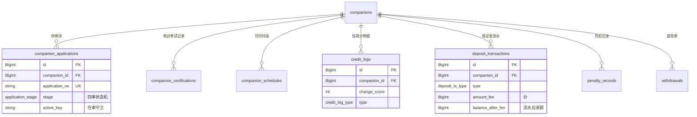
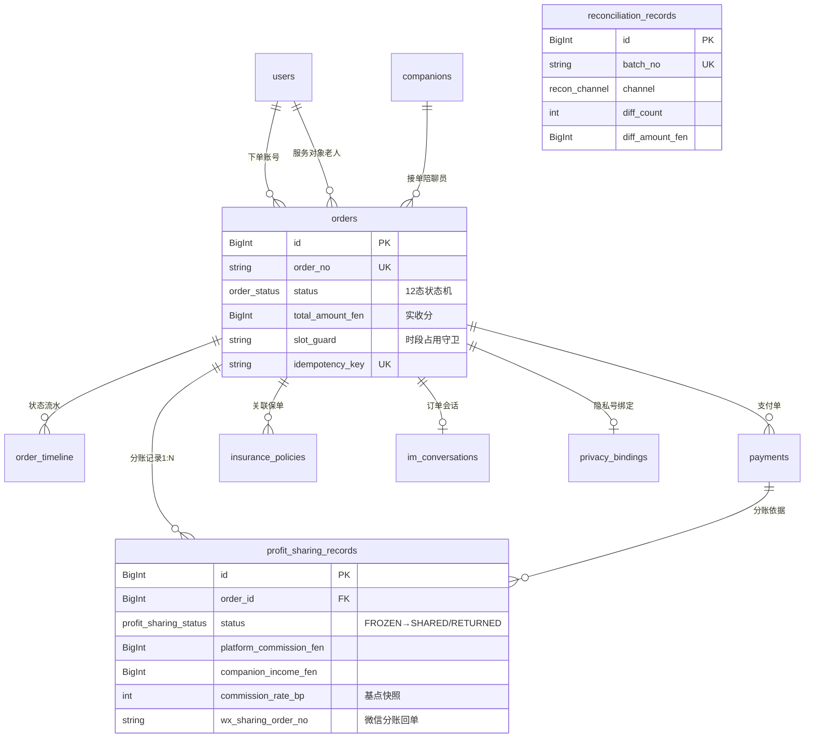
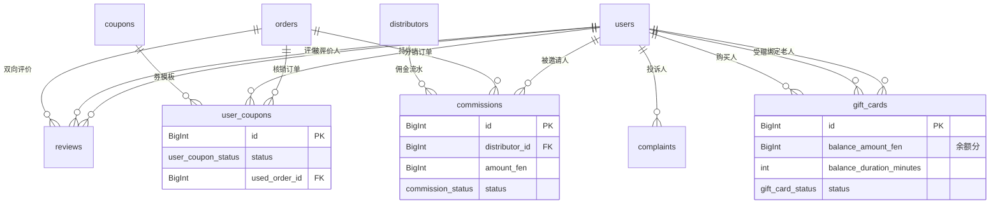
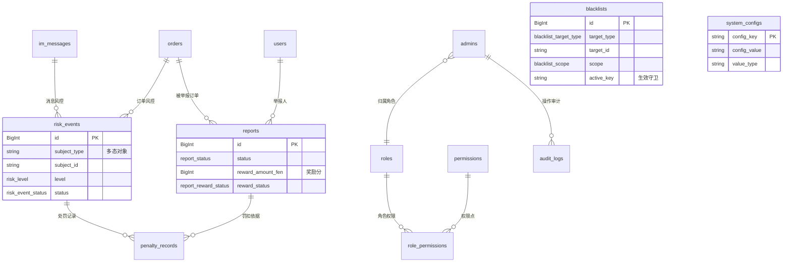
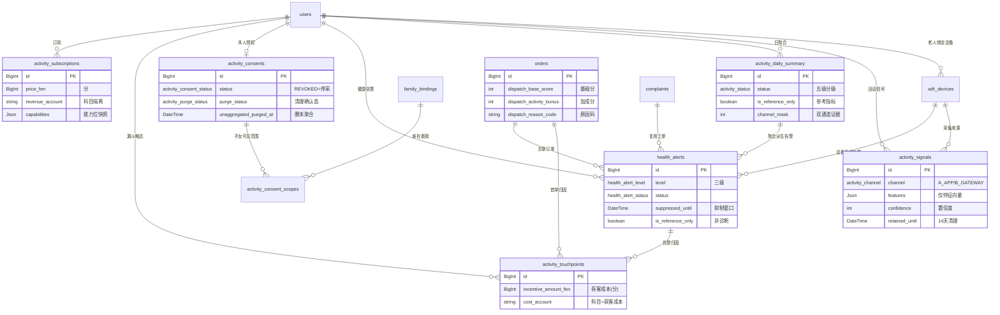

# 邻伴 · 数据库设计（DATABASE DESIGN）

> **项目**：邻伴 · 社区养老陪伴匹配平台（同城真人陪聊 O2O · 老人线 · 广州单城 MVP）
> **版本**：v1.9 ｜ 2026-10 ｜ **作者**：宋砚秋（Cyrus Ledger）｜ **团队**：rnd-linban（主理人：岑执衡）
> **上游依据**：《邻伴·总体架构设计 ARCHITECTURE》v1.8（顾图南）+ `docs/MODULE-ACTIVITY-SENSE.md`（域六准绳 PRD）+ 主理人 2026-10 裁定①②③④⑤。表名、状态机枚举、配置默认值均以架构文档为单一事实源；本文不新增架构未定义的模块与状态。
> **主交付物**：`apps/server/prisma/schema.prisma`（**54 张表 / 66 个枚举**，已通过 `prisma validate` / `prisma generate` / 四端 `tsc --noEmit`）。本文档解释设计决策，字段定义以 schema 文件为准。

---

## 0. 三份文档的分工与读者入口（2026-10 补）

**这一节是为了消除「找错文档」的成本** —— 本项目三份文档各有职责，而承钧、映棠、我此前从不同入口找同一件事（承钧从 §13.4.5 找 seed 数据、映棠从契约 §13.9 找社区口径、我从 §13.6 写裁定），入口分叉导致过一次重复劳动。

| 文档 | 定位 | 谁该在什么时候读 |
|---|---|---|
| **`DATABASE.md`（本文）** | **数据事实源**：表结构、字段语义、索引、配置种子、迁移链 | **改 schema 前必读**；写/审数据库相关代码前必读 |
| **`API-CONTRACT.md`** | **前后端接口事实源**：端点、请求/响应 DTO、错误码 | **写任何端点前必读**；前端对接前必读 |
| **`ARCHITECTURE.md`** | **设计决策与背景**：为什么这么设计、域划分、隐私红线 | **改动前理解意图**；不确定「为何如此」时查 |

**三条流转规则（踩过的坑）**：
1. **改表结构** → 先改 `schema.prisma`，再回改本文档 + `ARCHITECTURE.md §5.1`，并补§13 变更记录（本文档）。
2. **加配置项** →三处必须同值：`packages/shared/src/constants.ts`（事实源）、本文档 §8（SQL）、`ARCHITECTURE.md` 附录 C。**已有门禁覆盖**（`npm run doc:check:configs` 五段）。
3. **DDL 变更后必跑** `npm run prisma:migrate:check`（离线漂移门禁，**退出码非 0 即阻塞**）—— 见 §13.5 迁移链操作约定。

---

## 1. 表清单总览（**54 张**，按域分组）

| 域 | 表 | 数量 |
|---|---|---|
| 账号与画像 | `users`、`elder_profiles`、`communities`、`family_bindings` | 4 |
| 陪聊员供给 | `companions`、`companion_applications`、`companion_certifications`、`companion_schedules`、`credit_logs`、`deposit_transactions`、`penalty_records` | 7 |
| 订单与交易 | `orders`、`order_timeline`、`payments`、`profit_sharing_records`、`withdrawals`、`reconciliation_records` | 6 |
| 核销与通信 | `verifications`、`file_meta`、`evidence_files`、`revisit_tasks`、`im_conversations`、`im_messages`、`privacy_bindings` | 7 |
| AI 陪聊 | `ai_sessions`、`ai_messages`、`ai_profiles` | 3 |
| 评价/营销/保险 | `reviews`、`complaints`、`gift_cards`、`coupons`、`user_coupons`、`distributors`、`commissions`、`insurance_policies` | 8 |
| 风控与后台 | `risk_events`、`reports`、`blacklists`、`audit_logs`、`admins`、`roles`、`permissions`、`role_permissions`、`system_configs`、`notification_logs`、`reminder_settings` | 11 |
| 健康活动感知（域六） | `wifi_devices`、`activity_signals`、`activity_daily_summary`、`health_alerts`、`activity_consents`、`activity_consent_scopes`、`activity_touchpoints`、`activity_subscriptions` | 8 |

覆盖关系：架构 §5.1 清单全量收录；另补 3 张架构其他章节明确出现的表——`penalty_records`（§8 防飞单机制 5）、`file_meta`（§4.1 file 模块）、`role_permissions`（§5.1 RBAC 的 M2M 关联，隐含表）。域六 8 张为客户 Tom 追加的「老人健康活动感知（Wi-Fi 无感感知）」模块新增，来源 `docs/MODULE-ACTIVITY-SENSE.md`（见 §13 变更记录 #6/#7）。域六第二轮（主理人裁定①–⑤）全部以「既有表加列」方式落地，**未新增表，表数保持 53**。

> **⚠️ 表数变更（v1.5 起）**：A7 老人归属社区落盘时**新建了第 54 张表 `communities`**（主理人裁定采纳方案 B，见 §13 变更记录 #11），故当前为 **54 张 / 66 枚举**。域六归属「账号与画像」域（老人档案的归属锚点）。

---

## 2. 设计原则

### 2.1 金额：一律 BigInt 存「分」，杜绝浮点
- 所有金额/时薪/保证金/佣金/保费/违约金字段均为 `BigInt`，单位为**分**（如 `hourly_rate_fen`、`total_amount_fen`、`platform_commission_fen`）。
- 抽成比例不用浮点列：`profit_sharing_records.commission_rate_bp` 以**基点（basis points）**整数快照（500 = 5%），与架构 §7.3「分账金额以分为单位整数运算」对齐；`system_configs.commission_rate` 以字符串 `"0.05"` 存储（DECIMAL 语义），应用层换算为 bp 参与计算。
- 非金额的连续量才用 `Decimal`：地理坐标 `Decimal(10,7)`、评分 `Decimal(2,1)`——不涉及资金，不违反整数原则。
- Prisma `BigInt` 在 TS 侧序列化为 `string` 或 `number`（≤2^53 安全），API 出参统一转字符串透传，避免 JSON 精度丢失。

### 2.2 状态机字段规范
- 状态一律用 Prisma `enum`（落库为 VARCHAR，应用层枚举收敛），**枚举值与架构 §6.5 订单状态机（12 态）、§6.6 四审流（10 态）、§7 分账三态严格一致，不自创**：
  - `order_status`：CREATED / PAID / DISPATCHED / ACCEPTED / ARRIVED / IN_SERVICE / PENDING_CONFIRM / COMPLETED / SUSPENDED / CANCELLED / CLOSED / REFUNDED
  - `application_stage`：APPLIED / REALNAME_OK / FACE_OK / CRIMINAL_OK / TRAINING / EXAM_OK / DEPOSIT_OK / ACTIVE / SUSPENDED / BANNED
  - `profit_sharing_status`：FROZEN / SHARED / RETURNED
- 状态转移表（允许的 from→to）置于 `domain/` 纯函数（架构 §2.3），DB 层只存结果；`order_timeline` 逐次留痕，任何订单状态可回放。
- 分账失败**不引入新状态**：记录保持 FROZEN，`retry_count` 累加，≥3 次升级人工工单（`manual_ticket_no`），与架构 §6.2/§7.5 一致。

### 2.3 审计字段
- 全表统一 `created_at DateTime @default(now())` + `updated_at DateTime @updatedAt`（毫秒精度 `DATETIME(3)`）。
- 业务主档（`orders` 等）带 `created_by BigInt?`；服务动作留痕表（`order_timeline`/`verifications`/`credit_logs`）用语义更强的 `operator_type` + `operator_id`（谁在什么角色下做的）。
- **流水表只插入、不更新**：`payments`/`profit_sharing_records`/`deposit_transactions`/`order_timeline`/`credit_logs`/`audit_logs`/`commissions` 的状态推进通过插入新事实或受控的状态列完成，核心资金表禁止物理删除——「一切资金动作可审计，任何状态可回放」（架构铁律 3）。

### 2.4 软删策略
- **软删仅用于账号与用户内容类**：`users`/`elder_profiles`/`companions`/`reviews` 带 `deleted_at`。注销走 15 天冷静期 → 到期匿名化（架构 §10.1）。
- **资金与服务留痕表永不软删**（法定保留 ≥3 年除外条款已明示告知）：`orders`/`payments`/`profit_sharing_records`/`order_timeline`/`verifications`/`audit_logs` 等只增不改。
- 内容「下架/撤回」用状态表达而非删行：`im_messages.status=REVOKED`、`reviews.status=HIDDEN`、`blacklists.status=LIFTED`。

### 2.5 字符集与排序规则
- 全库 `utf8mb4` + `utf8mb4_0900_ai_ci`（MySQL 8 默认，支持 emoji 与生僻字，老人昵称/语音转写文本无截断风险）。部署 compose 中 mysql 服务显式声明，连接串带 `charset=utf8mb4`。

### 2.6 时区策略：**存 UTC，展示层转 +8**
- 所有时间列语义为 **UTC**（`DATETIME(3)`）；容器内 MySQL `time_zone='+00:00'`，Prisma 连接串 `?timezone=UTC`；Node 侧不混用本地时间。
- 唯一例外：`orders.service_date` 用 `DATE` 存**广州本地服务日期**（按当地日切分，避免 UTC 换算把 23:30 的单切到次日）；`companion_schedules` 的 `"HH:mm"` 字符串同样按本地时间语义存储与比较。
- 展示层（三端/后台）统一转 `Asia/Shanghai`。

### 2.7 命名规范
- **表名/列名 = snake_case，且 Prisma 模型名直接采用下划线小写名**（`model users`、字段 `user_id`），不加 `@map`/`@@map`——生成的 DDL 与架构 §5.1 表清单逐字一致，下游文档/脚本零翻译成本。
- 主键统一 `id BigInt @id @default(autoincrement())`（InnoDB 索引局部性优于随机 UUID，体积 8B vs 16B）；**业务单号独立唯一列**（`order_no`/`payment_no`/`sharing_no`/`withdrawal_no`/`complaint_no`/`report_no`/`task_no`/`batch_no`/`card_no`/`policy_no`），对外暴露单号、对内用自增 ID。
- 加密字段后缀 `_cipher`（AES-256-GCM 密文 base64）；盲索引字段后缀 `_hmac`（HMAC-SHA256 hex）；COS 对象字段 `object_key`；金额字段后缀 `_fen`；布尔开关无 `is_` 前缀（`night_order`）。
- 枚举值 UPPER_SNAKE，与架构图标注逐字一致。

### 2.8 MySQL「仅一条生效」守卫列模式
MySQL 8 无过滤唯一索引（partial index）。「同一对象同时仅一条生效」的语义用**可空守卫列 + 普通唯一索引**实现：
- `orders.slot_guard`：占用中存 `'L'`；CANCELLED/REFUNDED 终态置 `NULL` 释放时段 → 唯一索引 `(companion_id, service_date, slot_start, slot_guard)` 兜底防重单，且取消后时段可重新售出（MySQL 唯一索引中多个 NULL 互不冲突）。
- `family_bindings.active_key`、`companion_applications.active_key`、`blacklists.active_key` 同理（生效=`'A'`，历史=`NULL`）。

### 2.9 其他
- JSON 列仅存半结构画像/配置/差异明细（`interests`、`diff_detail`、`hit_detail`），**不作为查询键**（MySQL JSON 无普通索引，必要时用生成列，MVP 不涉及）。
- 关联完整性：有明确生命周期的引用建外键关系（Prisma relation）；多态引用（`risk_events.subject_id`、`blacklists.target_id`、`file_meta.uploader_id`）不建 FK，由服务层保证，文档显式标注。

---

## 3. ER 关系图（按域拆分 6 张，避免单图过密）

### 3.1 账号与画像域

```mermaid
erDiagram
    users ||--o| elder_profiles : "老人档案"
    users ||--o| companions : "陪聊员主档"
    users ||--o{ family_bindings : "子女发起绑定"
    users ||--o{ family_bindings : "被绑定老人"
    users ||--o{ notification_logs : "接收通知"
    users ||--o{ reminder_settings : "提醒设置"
    users ||--o| ai_profiles : "AI画像"
    users ||--o| distributors : "团长身份"
    users {
        BigInt id PK
        string openid UK
        string phone_cipher "L3加密"
        string phone_hmac UK "盲索引"
        user_role role
        user_status status
    }
    elder_profiles {
        BigInt id PK
        BigInt user_id FK_UK
        json interests "画像标签"
        string emergency_contact_phone_cipher "L3"
    }
    family_bindings {
        BigInt id PK
        BigInt family_user_id FK
        BigInt elder_user_id FK
        auth_level auth_level
        string active_key "守卫列"
    }
```

### 3.2 陪聊员供给域



### 3.3 订单与交易域



### 3.4 核销与通信域

```mermaid
erDiagram
    orders ||--o{ verifications : "核销事实"
    verifications ||--o{ evidence_files : "留痕证据"
    file_meta ||--o{ evidence_files : "文件元数据"
    file_meta ||--o{ im_messages : "图片语音对象"
    im_conversations ||--o{ im_messages : "会话消息"
    orders ||--o{ revisit_tasks : "回访任务"
    users ||--o{ ai_sessions : "AI会话"
    ai_sessions ||--o{ ai_messages : "AI消息"
    verifications {
        BigInt id PK
        verification_type type "ARRIVAL/COMPLETION"
        string dynamic_code "6位动态码"
        int face_score "人脸比对分"
        Decimal gps_lat "模糊坐标"
        int gps_deviation_m "偏差米"
    }
    im_messages {
        BigInt id PK
        BigInt conversation_id FK
        string client_msg_id "端上幂等"
        im_review_status review_status
    }
    privacy_bindings {
        BigInt id PK
        BigInt order_id FK_UK
        string axb_bind_id UK "腾讯云绑定"
        privacy_binding_status status
    }
```

### 3.5 评价与营销域



### 3.6 风控与后台域



> 注：`file_meta`/`evidence_files`/`revisit_tasks` 已在 3.4 出现；`withdrawals` 见 3.2；`companions`↔`orders` 见 3.3。各图仅画本域强关系，跨域弱引用（多态 subject 等）以文字标注。

### 3.7 健康活动感知域（域六，PRD MODULE-ACTIVITY-SENSE）



> 关键设计约束（PRD §5/§6）：
> - `activity_subscriptions` **与 `orders`/`payments`/`profit_sharing_records`/`commissions` 无任何关系**——订阅收入走 `revenue_account` 独立科目，不进陪聊分账池（图中刻意不画连线即为此意；DDL 层已反查确认零外键）。
> - `health_alerts` 处置**自闭环**（`OPEN → ACKNOWLEDGED → PROCESSING → RESOLVED / DISMISSED / ESCALATED`），W-MVP 不落 `complaints`；仅需对外追责/赔付时人工补单，`complaint_id` 保持可空。订单侧挂起复用既有 `suspendOrderForSafety` 链路，不新建工单表。
> - `activity_consent_scopes` 挂 `family_binding_id` 而非裸 user_id：绑定解除即失效，避免越权可见。
> - 派单可解释四列落 `orders` 主表（不新建快照表、不塞 `order_timeline`——理由见 §13.2 A1）。
> - 获客成本走 `activity_touchpoints.cost_account`，与分账池科目隔离（DDL 层确认 `activity_touchpoints` 不与任何资金表建关系）。

---

## 4. 索引设计说明

### 4.1 四个重点索引（团队指定验证点）

**① orders 时段防重（派单正确性生命线）**
```prisma
@@unique([companion_id, service_date, slot_start, slot_guard])
```
- 配合 Redis `lock:slot:<companionId>:<slot>`（架构 §5.2）做第一道防线；DB 唯一索引做**兜底**，Redis 锁失效/重启/脏读时不产生重复占用单。
- `slot_guard` 守卫列实现「占用中唯一、取消后可重售」：CANCELLED/REFUNDED 时置 NULL。**代价**：COMPLETED/CLOSED 的历史单不释放（'L' 保留），但其 service_date 已过去，不影响未来售出；如需「改期」功能再引入改期流水，MVP 不做。

**② companions 派单查询（就近 + 质量加权）**
```prisma
@@index([status, geo_hash])        // 主路径：ACTIVE × geohash 前缀范围扫描
@@index([status, credit_score])    // 限流/冻结扫描（<60 限流派单、<40 冻结）
@@index([status, level])           // 等级加权
@@index([status, hourly_rate_fen]) // 价格档位筛选
```
- 派单引擎先按 Redis GeoHash 缓存取附近候选（`cache:companion:list:<geoHash>` 5min），DB 索引作为缓存未命中回源与一致性校验；`geo_hash` 前缀范围查询（`LIKE 'ws8er%'`）走该联合索引的 status 等值 + geo_hash 范围。
- 标签/评分等 JSON 与派生值不过索引，在候选集（Top N）内内存打分，与架构 §6.1「就近+标签+信用分+等级加权打分取 Top N」一致。

**③ profit_sharing_records 状态扫描（资金安全）**
```prisma
@@index([status, created_at])      // 「已超 7 天未分账」告警（§7.2）
@@index([order_id])                // 订单维度回放
@@index([wx_transaction_id])       // 与微信账单核对
```
- 每日 cron：`WHERE status='FROZEN' AND created_at < NOW()-7d` 命中索引区间；微信侧待分账资金 30 天强制解付，7 天告警留足处置窗口。

**④ im_messages 会话分页（读性能热点）**
```prisma
@@unique([conversation_id, client_msg_id]) // 端上重发幂等
@@index([conversation_id, id])             // 游标分页（覆盖索引）
@@index([conversation_id, created_at])     // 时间范围拉取（首屏/跳转）
```
- 历史消息走游标：`WHERE conversation_id=? AND id < ? ORDER BY id DESC LIMIT n`（附录 B：IM 历史用 cursor）。`(conversation_id, id)` 两列均在索引内，回表仅取需要的 n 行；`id` 自增单调，天然时间序。

### 4.2 其余关键索引一览

| 表 | 索引 | 理由 |
|---|---|---|
| `orders` | `(user_id, created_at)` | 我的订单列表（最新在前） |
| `orders` | `(companion_id, status, service_date)` | 陪聊员端「我的接单」按状态/日期筛选 |
| `orders` | `(status, dispatch_deadline_at)` | 派单 30min 超时转人工扫描 |
| `orders` | `(status, created_at)` | 支付 15min 超时关单、待分账超时 cron |
| `payments` | `(status, created_at)`、`(wx_transaction_id)` | 掉单补偿扫描、对账关键字 |
| `notification_logs` | `(status, created_at)` | 失败重试队列扫描 |
| `notification_logs` | `(target_user_id, created_at)` | 用户消息中心 |
| `user_coupons` | `(status, expired_at)`、`(user_id, status)` | 过期作废 cron、可用券列表 |
| `gift_cards` | `(status, expires_at)`、`(recipient_phone_hmac)` | 到期扫描、未注册受赠人绑定 |
| `privacy_bindings` | `(status, expired_at)` | 隐私号到期自动解绑 cron（§6.4） |
| `reminder_settings` | `(enabled, next_send_at)` | 每日提醒 cron 取待发任务 |
| `insurance_policies` | `(status, end_at)` | 保单到期提醒 |
| `reviews` | `(reviewee_id, created_at)` | 评分聚合进 companions 的增量窗口 |
| `reviews` | `(order_id, reviewer_role)` UK | 每单每方向一条评价 |
| `companion_applications` | `(stage, created_at)` | 后台审核工作台按阶段取件 |
| `companion_applications` | `(companion_id, active_key)` UK | 同一陪聊员仅一条在审申请 |
| `risk_events` | `(status, level, created_at)` | 风控工作台队列（高等级优先） |
| `risk_events` | `(subject_type, subject_id)` | 对象维度历史查询 |
| `reports` / `complaints` | `(status, created_at)` | 处理队列 |
| `audit_logs` | `(admin_id, created_at)`、`(target_type, target_id)` | 审计追溯 |
| `im_messages` / `ai_messages` | `(review_status, created_at)` | 内容审核队列扫描 |
| `ai_sessions` | `(status, last_message_at)` | 活跃会话回收 |
| `blacklists` | `(target_type, target_id, scope, active_key)` UK | 生效黑名单唯一 |
| `file_meta` | `(biz_type, biz_id)`、`(uploader_id, created_at)` | 业务取证文件检索 |
| **域六** `wifi_devices` | `(elder_user_id, device_type, active_key)` UK | 同老人同类型设备仅一条生效（守卫列模式） |
| **域六** `wifi_devices` | `(status, last_heartbeat_at)` | 设备离线扫描（DEVICE_OFFLINE 告警源） |
| **域六** `wifi_devices` | `(token_expires_at)` | 设备令牌轮换扫描（架构 A5） |
| **域六** `activity_signals` | `(retained_until)` | **留存清理 sweep 扫描**（红线⑥ ≤14 天，物理删除的时间索引） |
| **域六** `activity_signals` | `(elder_user_id, window_start)` | 日聚合扫描 |
| **域六** `activity_daily_summary` | `(elder_user_id, summary_date)` UK | 一人一日一行聚合 |
| **域六** `health_alerts` | `(status, level, triggered_at)` | 告警看板与处置队列 |
| **域六** `health_alerts` | `(type, suppressed_until)` | 抑制窗口判定 |
| **域六** `activity_consents` | `(status, revoked_at)`、`(purge_status)` | 撤销行查询 + **待清理行扫描**（裁定④） |
| **域六** `activity_touchpoints` | `(cost_account, touchpoint_at)` | **获客成本科目统计**（单均带新成本，与分账池隔离） |
| **域六** `user_coupons` | `(source, received_at)` | 引流券发放量按来源统计 |

### 4.3 索引取舍原则
- **不为低基数字段单独建索引**（如 `gender`、`night_order`）；一律以「查询形状」设计联合索引，等值列在前、范围/排序列在后。
- 写多读少的流水表（`order_timeline`/`credit_logs`/`deposit_transactions`）只保留查询必需索引，控制写放大（MVP 单机、日单 500，写压力极小，但仍不为「假想的查询」预留索引）。
- 枚举状态列不单独建索引，均以 `(status, <第二列>)` 联合形态出现，服务 cron 的状态扫描。

---

## 5. 资金表设计（客户点名核心：一切资金动作可审计）

### 5.1 六张资金表总览

| 表 | 职责 | 状态机 | 幂等键 |
|---|---|---|---|
| `payments` | 微信 JSAPI 支付单，款项进平台担保户 | PENDING→SUCCESS→REFUNDED / CLOSED / FAILED | `idempotency_key` + `wx_out_trade_no` UK |
| `profit_sharing_records` | 待分账冻结/执行/回退 | FROZEN→SHARED / RETURNED | `idempotency_key` + `sharing_no` |
| `withdrawals` | 陪聊员提现审核流（备选结算模式） | PENDING_REVIEW→APPROVED→PROCESSING→SUCCESS / REJECTED / FAILED | `idempotency_key` + `withdrawal_no` |
| `reconciliation_records` | 每日对账批次与差异 | PENDING→RUNNING→MATCHED / DIFF→RESOLVED | `(batch_date, channel)` UK |
| `deposit_transactions` | 保证金专户流水 | PENDING→SUCCESS / FAILED | `idempotency_key` + `tx_no` |
| `commissions` | 团长分销佣金流水 | PENDING→SETTLED→PAID / CANCELLED | `idempotency_key` + `commission_no` |

### 5.2 payments（支付单）
- 关键字段：`amount_fen`（分）、`profit_sharing=true`（服务商分账标记）、`wx_out_trade_no`（我方商户订单号，UK，微信侧去重依据）、`wx_prepay_id`、`wx_transaction_id`（微信支付单号，**对账关键字**）、`paid_at`、`refund_amount_fen`/`refunded_at`/`wx_refund_id`。
- 回调处理：验签 → 按 `wx_out_trade_no` 查单 → **幂等推进**（已 SUCCESS 直接 ack，重复回调不产生第二笔状态变更）→ 更新 orders=PAID → 写入分账冻结记录。全部在同一事务或「事务 + 事件补偿」内完成（架构 §6.1）。

### 5.3 profit_sharing_records（分账记录，1:N 于 orders）
- **冻结**（支付回调时）：写一行 `status=FROZEN`，`frozen_amount_fen`=订单实收，`platform_commission_fen`=round(实收×bp)，`companion_income_fen`=实收−抽成，`commission_rate_bp` 为当时配置快照（后续调配置不影响历史单，审计可回放）。
- **执行**（orders=COMPLETED 且分账门闩校验通过，§8.1）：调微信分账 → 回单落 `wx_sharing_order_no` + `shared_at`，状态→SHARED。失败不推进状态，`retry_count` 累加，≥3 次写 `manual_ticket_no` 进人工工单，BullMQ 重试不静默丢失。
- **回退/解冻**（CANCELLED/REFUNDED/售后退款）：已分账资金走微信分账回退（`wx_return_no`、`return_amount_fen`、`return_reason`）；未分账资金走「解除剩余待分账」。同一订单发生**多次回退时每次追加一条 RETURNED 记录**——与 orders 保持 1:N，全部资金动作可回放（架构 §7.4「所有退款/回退落 profit_sharing_records + order_timeline，双表可对账」）。
- **分成基数**：优惠券/时长卡抵扣部分不进入分成基数（`orders.coupon_deduct_fen`/`gift_card_deduct_fen` 由平台营销预算承担），与 §7.3 一致——公式：抽成 = round(total_amount_fen × bp)，陪聊员应收 = total_amount_fen − 抽成。

### 5.4 withdrawals（提现）
- 默认「分账直达个人」模式下本表低频（备选模式启用）。字段含银行卡号密文、开户名密文（L3）、`face_verified`/`sms_verified` 二次验证、T+1 finance 审核（`reviewer_id`/`reviewed_at`）、`wx_batch_no` 批次号（与微信商户提现对账）。

### 5.5 reconciliation_records（对账）
- 每日 03:00 cron（架构 §7.5）按渠道（支付/分账/退款/提现）各产一个批次：本地流水聚合（`local_count`/`local_amount_fen`）vs 微信账单（`wx_count`/`wx_amount_fen`），差异逐笔进 `diff_detail` JSON，`status=DIFF` 即告警；差异处理完 `RESOLVED`。
- MVP 简化决策：不建 `reconciliation_items` 明细表（不在 §5.1 清单内），差异明细以 JSON 承载 + 告警通知 finance；单日差异笔数预计 < 10，JSON 足够。后续差异量大再拆表。

### 5.6 deposit_transactions（保证金专户流水）
- `balance_after_fen`（流水后余额）使**任意时点余额可回放校验**；`companions.deposit_balance_fen` 为缓存值，两者每日 cron 交叉核对，不一致即告警（缓存漂移可自愈）。
- 罚扣联动：`penalty_records` 执行 → 同事务写 `deposit_transactions(PENALTY)` + `credit_logs`；退出（RETIRED）30 天无纠纷 → `deposit_transactions(OUT)` 原路退（`wx_transaction_id` 回填）。

### 5.7 commissions（分销佣金）
- 订单完成 → PENDING；月结/周结 → SETTLED；打款 → PAID（`wx_transaction_id`）；订单退款 → CANCELLED。`distributors.pending/settled_commission_fen` 为缓存，与流水表互校。

### 5.8 账务隔离：三类资金口径互不混同（域六落地，主理人裁定②/Q8）

平台内存在**三种性质完全不同**的钱，混同即污染抽成与对账模型。三者在 schema 层用「表关系 + 科目字段」双重隔离：

| 口径 | 承载表 | 科目字段 | 与分账池关系 |
|---|---|---|---|
| **陪聊分账** | `payments` → `profit_sharing_records` → `withdrawals` | `commission_rate_bp`（基点快照） | 基准（分账池本体） |
| **订阅收入** | `activity_subscriptions`（`price_fen` BigInt 分） | `revenue_account='SUBSCRIPTION_REVENUE'` | **零关系**（DDL 层已反查：`activity_subscriptions` 无任何外键指向资金表） |
| **获客成本** | `activity_touchpoints`（`incentive_amount_fen` BigInt 分） | `cost_account='ACQUISITION_LEAD_INCENTIVE'` | **零关系**（`activity_touchpoints` 不与任何资金表建关系） |

- 订阅收入与获客成本**都不进 `profit_sharing_records`、不参与抽成计算**，管理端「分账中心 / 营收中心」两页分离（架构 §13.12③）。
- 获客成本（引流新装券，¥20）性质是**获客支出**而非补贴，用 `cost_account` 与补贴池、与分账池三方区分；`@@index([cost_account, touchpoint_at])` 支持「单均带新成本」统计（PRD §4 归因指标）。
- 券发放侧用 `user_coupons.source='ACTIVITY_LEAD'` 标识来源，`user_coupons.activity_touchpoints` 反向关系把券与触达事件绑定（归因链：触达 → 发券 → 首单）。
- W+2 支付能力接入时，优先「**独立 payments 通道 + 独立科目**」方案，不复用陪聊分账链路（A3 裁定倾向，架构 §13.12⑤）。

---

## 6. 敏感数据加密方案（架构 §5.3 分级落地）

### 6.1 分级与字段映射

| 级别 | 数据 | 落库方案 |
|---|---|---|
| **L4 极敏感** | 身份证号 | `companions.id_card_cipher`（AES-256-GCM）+ `id_card_hmac` 盲索引（同一身份证仅一账号） |
| L4 | 人脸底照/活体视频 | **内容只进 COS 私有桶**，DB 仅存 `file_meta.object_key` + `access_level=L4`；每次访问写 `audit_logs`，仅审核岗角色可见 |
| L4 | 位置轨迹 | GPS **全精度不落库**：服务端模糊化至百米级后才写 `verifications.gps_lat/gps_lng` + `gps_deviation_m`（仅偏差，不暴露门牌）；订单地址 `orders.address_cipher` 加密 |
| **L3 敏感** | 手机号 | `users.phone_cipher` + `users.phone_hmac`（UK，支持密文等值检索）；短信渠道 `notification_logs.target_phone_cipher`；团长 `distributors.phone_cipher/phone_hmac` |
| L3 | 真实姓名 | `companions.real_name_cipher`、`withdrawals.account_name_cipher`、紧急联系人姓名/电话 `_cipher` |
| L3 | 银行卡号 | `withdrawals.bank_account_cipher` |
| L3 | 健康相关画像 | `elder_profiles` JSON 画像字段**脱敏标签化**后供匹配（可用不可见），原文不出平台 |
| L2 | 订单/分账/评价 | 库内完整，日志脱敏 |
| L1 | 昵称/头像/标签/评分 | 原样 |

### 6.2 加密算法与密钥管理
- **算法**：AES-256-GCM（认证加密，防篡改）。密文格式：base64( `版本号1B ‖ IV(12B) ‖ 密文 ‖ Tag(16B)` )，存储于 `_cipher` 字段（`VarChar(512)`，最长场景=地址密文，预留 `VarChar(1024)`）。
- **密钥**：KMS 托管主密钥（CMK），应用侧经 SDK 派生数据密钥（信封加密）；`infra/oss` 同级封装 `common/crypto.ts` 提供 `encrypt(plaintext)→ciphertext` / `decrypt(ciphertext)→plaintext` / `hmacIndex(plaintext)→hex` 三个纯函数，业务代码不直接碰密钥。
- **盲索引**：`phone_hmac = HMAC-SHA256(盲索引密钥, normalizedPhone)`，hex 64 位。支持「手机号登录/绑定/查重/受赠人匹配」在密文态等值查询；`normalized` = 去空格/区号归一（+86）。注意：HMAC 不支持模糊/范围检索（如「同号段搜索」），业务无此需求。
- **密钥轮换**：密文首位版本号支持双密钥期（加密用新密钥、解密按版本号选密钥）；轮换脚本按表批量重加密，期间服务不中断。轮换窗口与备份窗口错开。

### 6.3 COS 文件策略
- DB 只存 `object_key`（如 `verification/2026/09/21/<uuid>.jpg`），**不存文件内容、不存可逆推内容**；`file_meta.sha256` 做完整性校验。
- COS 私有读 + STS 5min 临时密钥前端直传（架构 §3.3）；`file_meta.access_count`/`last_access_at` 提供访问热度，L4 文件每次访问另写 `audit_logs`（谁、何时、看了哪个对象）。

### 6.4 健康活动感知模块字段分级（域六，PRD §6 隐私红线）

**总原则：本模块最高敏感级为 L3，无 L4。** 人脸/身份证等 L4 数据不参与本模块；网络标识与健康推断均已去标识化（只存 HMAC 或聚合值），故不引入 L4 存储与 KMS 密钥。

| 数据 | 字段 | 分级与措施 |
|---|---|---|
| MAC / SSID / BSSID | `wifi_devices.device_mac_hmac` / `ssid_hmac` / `bssid_hmac`、`activity_signals.ssid_hmac` / `bssid_hmac` | **L3 · 原文永不落库**（红线②）：只存 HMAC-SHA256 盲索引（hex 64）；`bssid_hmac` 仅用于识别「是否同一个家」，**禁止反查**；因已是不可逆哈希，不占用 `_cipher` 密文列 |
| 活动特征向量 | `activity_signals.features`（JSON）、`event_flag`、`confidence`、`data_freshness_seconds` | **L3 · 短期留存**：仅特征，**禁存通道 B 原始波形/CSI**（红线③，原始数据不出户只在网关本地处理）；`retained_until` 到期由 sweep 清理（红线⑥） |
| 日聚合推断 | `activity_daily_summary.active_slots` / `activity_score` / `still_count` / `home_dwell_minutes` / `status` | **L3 · 聚合非轨迹**（红线①）：只存分布与计数，不存实时轨迹；`is_reference_only=true` 强制标注「参考指标，非医疗诊断」（红线⑤） |
| 健康告警 | `health_alerts.type` / `level` / `confidence` / `conclusion` | **L3 · 参考推断**：`is_reference_only=true`；升级为 URGENT 前须人工确认（PRD §8 告警疲劳缓释） |
| 授权与可见范围 | `activity_consents.*` / `activity_consent_scopes.viewer_level` | **L3 · 可审计**：`policy_version` 留存同意文本版本；REVOKED 后 `collect_stopped_at`（停采）+ `unaggregated_purged_at`（删未聚合）+ `purge_status`（清理确认态）表达红线⑦已执行闭环 |
| 漏斗与订阅 | `activity_touchpoints.metadata`、`activity_subscriptions.*` | **L2 内部**：不含健康明细；订阅金额为 L2 资金字段（BigInt 分，独立科目） |
| 获客成本 | `activity_touchpoints.incentive_amount_fen` / `cost_account` | **L2 资金字段**：金额 BigInt 存分，科目 `ACQUISITION_LEAD_INCENTIVE` 与分账池隔离；不进 `profit_sharing_records` |

**加密与 KMS 复用**：本模块如需对 `features`/`metadata` 等 JSON 做落库前加密，复用 §6.2 的 `common/crypto.ts` 信封加密（同一 KMS CMK），不在本模块另立密钥体系。`activity_consents` 的授权变更、子女查看 L3 推断数据等敏感访问，写 `audit_logs`（红线④可审计）。

**设备令牌（架构 A5）**：`wifi_devices.device_token_hash` 只存 HMAC-SHA256 盲索引，明文令牌仅在探针与服务端内存中瞬时存在；`token_issued_at`/`token_expires_at` 支持轮换与吊销（吊销即 `status=REVOKED` + `active_key=NULL`）。

### 6.5 感知订阅能力位（主理人裁定① / Q9 付费墙口径）

`activity_subscriptions.capabilities` 为 **JSON 能力位快照**（`tier` 决定默认能力集，`capabilities` 记录**实际生效**的开关，允许机构层定制/试用/补偿覆盖）。**安全兜底不设付费墙**是刻意偏离（架构 §13.12①）：平台安全责任不因用户免费而降级。

| 能力位 | FREE | PRO（¥49/月） | INSTITUTIONAL | 说明 |
|---|---|---|---|---|
| `safety_fallback` | ✅ | ✅ | ✅ | **久静/离线的客服人工处置与外呼**——免费层能力，不设付费墙（不得被任何订阅等级门闩拦截） |
| `daily_report` | ✅ | ✅ | ✅ | 基础活动日报 |
| `home_away` | ✅ | ✅ | ✅ | 在家/外出判断 |
| `active_alert` | ❌ | ✅ | ✅ | **主动预警**（跌倒疑似 / 异常行为 / 夜间异常）——付费门闩只作用于此类 |
| `ai_health_analysis` | ❌ | ✅ | ✅ | AI 健康分析 |
| `history_retro` | ❌ | ✅ | ✅ | 历史回溯 |
| `multi_member` | ❌ | ✅ | ✅ | 多成员管理 |
| `multi_room` | ❌ | ❌ | ✅ | 多房间集中监测（机构层） |

- 门闩判定的**唯一权威是 `capabilities` 快照**（`tier` 只是默认来源）——这样「试用/补偿/机构定制」等例外不必改代码。
- 降级判定：紧急告警（`level=URGENT`，久静/离线兜底路径）**不得**被任何等级门闩拦截；付费门闩只作用于「主动预警类」与分析类功能。
- 能力位清单在 shared 侧常量化，DB 只存快照；`revenue_account` 与能力位解耦——付费能力开启不改变收入科目，收益统计走 §5 独立口径。

---

## 7. 大表策略：增长预估与归档（im_messages / ai_messages / notification_logs）

### 7.1 增长预估（单城容量模型：5 万注册用户、日 500 单、日活 AI 会话 2 万）

| 表 | 日增行 | 年增行 | 单行均长 | 年增容量 |
|---|---|---|---|---|
| `im_messages` | ~2 万（500 单 × ~40 条） | ~730 万 | ~1.5KB | ~11 GB |
| `ai_messages` | ~30 万（2 万会话 × ~15 条，含 ASR/TTS 元数据） | ~1.1 亿 | ~2KB | ~220 GB |
| `notification_logs` | ~1 万（订单事件 + 提醒 + 短信） | ~360 万 | ~0.8KB | ~3 GB |

> 三张表占全库写入量 99% 以上，是唯一需要治理的对象；`orders`/`order_timeline`/`payments` 等交易表 3 年总量 < 5GB，无需治理。

### 7.2 MVP 归档策略（简化：不做分区表，按月归档）
- **归档作业**（node-cron 每月 1 日）：把早于阈值的热数据 `INSERT INTO <table>_archive SELECT ... WHERE created_at < ?` 后删除原行，分批 5000 行/批，低峰期执行；归档表与主表同 DDL、独立库表（可后续迁冷存储/导出 COS）。
- **保留阈值**：`im_messages` 90 天（覆盖售后窗口 24h + 投诉处理周期）；`ai_messages` 60 天（画像已由 `ai_profiles` 沉淀，原文仅供抽检复核）；`notification_logs` 180 天。
- **查询兼容**：分页查询默认只查热表；跨归档边界的查询（如客服翻 3 个月前的 IM 记录）走「热表 + 归档表 UNION」的只读仓库方法，由 `im` 模块封装，业务无感知。
- **风控/审计豁免**：命中 `risk_events` 或被投诉/举报引用的 `im_messages` 行（`risk_event_id IS NOT NULL`）**不归档**，保证取证链完整。

### 7.3 演进路径（信号触发，不提前设计）
- 单表 > 5000 万行或归档作业耗时 > 30min → 改 MySQL RANGE 分区（按月 `PARTITION BY RANGE`）+ 归档即 `DROP PARTITION`（秒级，替代 INSERT+DELETE）。
- `ai_messages` 若因 ASR/TTS 元数据继续膨胀 → 大字段（`content`/`asr_text`）拆行外存储（COS + object_key），主表只留索引与摘要。

### 7.4 域六留存与清理（PRD 红线⑥⑦，与归档策略区别）

**被清理的表与周期**（区别于 §7.2 的「归档」：本模块是**隐私红线要求的删除**，不是性能归档）：

| 表 | 处置 | 周期/条件 | 库表落点 |
|---|---|---|---|
| `activity_signals` | **物理删除**原始特征（不留归档副本） | `retained_until < now()`，即窗口结束 + `activity_signal_retention_days`（≤14 天，硬上限） | 字段 `retained_until` + `@@index([retained_until])` 供 sweep 扫描；`purged_at` 记录清理时刻留痕 |
| `activity_daily_summary` | **保留**（不清理） | 日聚合是老人/子女可见的唯一长期依据 | PRD §6 只要求删原始特征 |
| `health_alerts` | **保留** | 告警与处置结论属安全兜底证据，随订单留存周期 | 与 §2.4 软删策略一致 |
| `activity_consents` / `activity_consent_scopes` | **保留**（授权与撤回证据） | 直至账号注销匿名化 | 红线④可审计；撤销行另以 `purge_status` 表达清理确认态（裁定④） |
| `activity_touchpoints` | 保留（体量小，漏斗归因需要） | 随账号生命周期 | — |

- **执行归属**：服务端 cron sweep（`infra/cron`，与既有 `order-timeout`/`coupon-expire` 同级队列），**不做 MySQL 事件调度**（红线要求删除必须可审计、可控、可暂停；DB 事件在单机容器模型下不可观测）。清理批次写 `audit_logs`（表名、行数、时间窗、操作者 cron 身份）。**A1 已由主理人裁定为服务端 sweep**。
- **与一键关闭的联动**（红线⑦）：`activity_consents.status=REVOKED` 时，`collect_stopped_at` 停采 → `unaggregated_purged_at` 前完成 `activity_signals` 中该老人未聚合数据的**立即删除**（不等 14 天），日聚合按策略保留以供回溯。**清理确认态（裁定④）**：撤销后 `purge_status` 走 `NOT_STARTED → RUNNING → CONFIRMED`（`unaggregated_purged_at` 落值）/ `FAILED`（`purge_error` 留原因待重试），`@@index([purge_status])` 供 sweep 扫待清理行；用户可在隐私中心看到「已撤销且未聚合数据已删除」的确认态。
- **规模预估**：单机 MVP 试点下 `activity_signals` 约 2 万行/日（1 万装机家庭 × 5min 窗 × 约 2 通道），年增约 730 万行、约 2KB/行 → 年增约 1.5GB；14 天热数据窗口仅约 700MB，无需分区，`retained_until` 索引 + 批量删除（单批 5000 行）足够。装机量 10 倍时再评估 RANGE 分区（按 `window_end` 月分区，`DROP PARTITION` 替代 DELETE）。

---

## 8. 种子数据（system_configs，共 28 项）

初始迁移后执行以下种子（金额单位为**分**，布尔以小写字符串存储）。
**`value_type` 列口径互斥，不可混用**（主理人 2026-10 核验）：比例类走 `DECIMAL`（`0.05` 表示 5%），整数阈值与基点走 `INT`，基点类须带 `_bp` 后缀（`cancel_penalty_rate_bp`），开关走 `BOOL`（小写字符串），模式串走 `STRING`。**基点整数与比例小数是两套口径**：`commission_rate=0.05`（DECIMAL，5%）与 `cancel_penalty_rate_bp=1000`（INT，基点，1000=10%）不可互相换算或合并列。

```sql
INSERT INTO system_configs (config_key, config_value, value_type, description) VALUES
('commission_rate',                          '0.05',  'DECIMAL', '平台抽成比例 5–10%，支持阶梯规则（应用层换算基点 500）'),
('deposit_amount',                           '50000', 'INT',     '陪聊员保证金（分）＝¥500；架构附录 C 标注 500(分) 与 §6.6/§8.3 的 ¥500 矛盾，按 ¥500=50000 分落值，见 §11 Q1'),
('dynamic_code_ttl',                         '300',   'INT',     '到岗动态码有效期（秒）'),
('face_match_threshold',                     '80',    'INT',     '人脸比对通过阈值（0–100）'),
('gps_max_deviation',                        '2000',  'INT',     '签到 GPS 与订单地址最大偏差（米）'),
('dispatch_timeout_min',                     '30',    'INT',     '派单无人接单转人工时长（分钟）'),
('privacy_number_valid_hours_after_done',    '24',    'INT',     '隐私号服务完成后保留时长（小时），到期自动解绑'),
('night_order_enabled',                      'false', 'BOOL',    '夜间订单开关（22:00–06:00 需子女确认）'),
('ai_sample_rate',                           '0.05',  'DECIMAL', 'AI 会话人工抽检比例'),
('report_reward',                            '2000',  'INT',     '飞单举报属实奖励（分）＝¥20'),
('credit_limit_threshold',                   '60',    'INT',     '信用分低于此值限流派单（§8.3）'),
('credit_freeze_threshold',                  '40',    'INT',     '信用分低于此值冻结接单（§8.3）'),
('service_overtime_suspend_min',             '60',    'INT',     '服务中订单超过预约结束时间多少分钟未完成确认且 IM 静默，则自动挂起待客服核实（team-lead 裁定③）'),
('im_silence_suspend_min',                   '30',    'INT',     '自动挂起判定附加条件：订单 IM 多少分钟无互动（与服务超时阈值同时满足才挂起，team-lead 裁定③）'),
('night_confirm_timeout_min',                '30',    'INT',     '夜间单（22:00–06:00）子女确认时限（分钟，自下单起算），超时自动取消并全额退款（team-lead 裁定④）'),
('split_mode',                               'wechat_profit_sharing', 'STRING', '分账执行模式（§7.6）：wechat_profit_sharing=主路径服务商自动分账（默认）；manual_settlement_fallback=兜底人工结算（仅灰度联调，上线前必须切回）'),
('cancel_penalty_rate_bp',                    '1000',  'INT',     '接单后取消的违约金比例（基点，1000bp=10%），补偿陪聊员；改动人须留审计（team-lead 裁定，2026-10）。口径为**基点整数**，与 commission_rate 的 DECIMAL 比例小数不同口径，勿混'),
('activity_watch_enabled',                   'false', 'BOOL',    '健康活动感知模块总开关（灰度前 false，上线由运营开启）'),
('activity_signal_ttl',                      '21600', 'INT',     '信号/心跳新鲜度上限（秒，默认 6h）：超此未更新则状态判为 UNKNOWN，禁止「假装确定」（PRD §3）。主理人裁定取 21600 不取 900：15 分钟会让状态频繁回落 UNKNOWN'),
('activity_still_alert_min',                 '240',   'INT',     '久静告警阈值（分钟）：连续无活动超此值触发 STILL_TOO_LONG（PRD §4/§8）'),
('activity_low_trend_window_days',           '3',     'INT',     '活跃下降判定窗口（天）：连续下降超阈值触发 LOW_TREND 并启动引流（PRD §4 触发器①）'),
('activity_drop_pct_threshold',              '30',    'INT',     '活动量下降超此百分比（%）触发引流触发器①与 LOW_TREND 预警（PRD §4）'),
('activity_alert_suppress_min',              '180',   'INT',     '同类型告警抑制窗口（分钟），防告警疲劳（PRD §8）。主理人裁定取 180 不取 720：12 小时会压掉当天第二次真实事件'),
('activity_signal_retention_days',           '14',    'INT',     '原始活动特征留存天数（PRD 红线⑥硬上限 14，配置只允许下调不得上调）'),
('activity_dispatch_bonus_low',              '5',     'INT',     '派单加成分数：老人活动状态 LOW 时 +5 分（Q10 定稿为加分数制，键名由 weight 改 bonus；仅 floor(base/10) 同档内生效，不得跨档）'),
('activity_dispatch_bonus_still',            '10',    'INT',     '派单加成分数：老人活动状态 STILL 时 +10 分（Q10 加分数制；服务半径硬约束不因加成放宽；ACTIVE/AWAY/UNKNOWN 不加权）'),
('activity_cross_verify_required',           'true',  'BOOL',    '紧急告警是否强制双通道交叉验证（PRD 红线，建议锁 true；交叉不通过降级为预警待人工确认）'),
('activity_lead_incentive_newinstall',       '2000',  'INT',     '新装体验引流触发的首单券额度（分）＝¥20；列获客成本科目单独统计，不进分账池');
```

说明：
- 第 1–10 项为架构附录 C 原样收录；第 11–12 项为 §8.3 阈值「<60 限流、<40 冻结」的配置化落地（主理人 Q6 批准）；第 13–15 项为 team-lead 裁定③④的运行期阈值 `service_overtime_suspend_min`/`im_silence_suspend_min`/`night_confirm_timeout_min`（§13 变更记录 #5）；第 16 项 `split_mode` 为实现期新增（§13 变更记录 #1）；第 17 项 `cancel_penalty_rate_bp` 为取消违约金比例（team-lead 裁定，2026-10 后台可配）；第 18–28 项为域六健康活动感知模块配置（§13 变更记录 #6），共 11 项，**与架构 §13.11 及附录 C 逐值同值**。
- **顺序口径（2026-10 修正）**：上表顺序现已与 `packages/shared/src/constants.ts` 的 `SYSTEM_CONFIG_DEFAULTS` **声明顺序逐位一致**（该对象共 **28** 项），以便逐行 diff 比对。此前 §8 的 13–17 位与 18 位起（`split_mode` 位置、`activity_watch_enabled` 与 `activity_signal_ttl` 先后）与 shared 声明顺序**不一致**，本轮已重排对齐并经脚本校验（键名/值/`value_type`/顺序**全等**，双向差集为空）。⚠️ **新增配置时须同步调整 §8 行序**，否则三处虽值仍同、但顺序漂移会让人工 diff 比对失效。
  - 当前关键锚点：`service_overtime_suspend_min`(13) → `im_silence_suspend_min`(14) → `night_confirm_timeout_min`(15) → `split_mode`(16) → `cancel_penalty_rate_bp`(17) → `activity_watch_enabled`(18) → `activity_signal_ttl`(19)。
- **`value_type` 口径互斥（主理人 2026-10 核验）**：`DECIMAL` 用于比例小数（`commission_rate=0.05`＝5%）；`INT` 用于整数阈值与**基点**（`cancel_penalty_rate_bp=1000`＝1000bp＝10%）。**基点整数与比例小数是两套口径，禁止互相换算或合并为同一列** —— 两者的换算系数为 1000（1bp=0.01%），而服务层读取方（`order.service.ts` 的 `getCancelPenaltyRateBp()`）按基点整数消费，若误填 `10`（意为 10bp=0.1%）将使违约金静默降为 1/100。带 `_bp` 后缀的键一律 `INT`。
- 域六配置与红线的关系：`activity_signal_retention_days=14` 是 PRD 红线⑥的**硬上限**（配置只允许下调）；`activity_signal_ttl=21600` 决定数据新鲜度判定——超期未更新则状态落 `UNKNOWN`，落实「禁止假装确定」（PRD §3）；`activity_watch_enabled=false` 为模块总开关，灰度期由运营在后台开启。
- **配置裁定记录（2026-10，岑执衡）**：① `activity_signal_ttl` 取 **21600**（不取 900）；② `activity_alert_suppress_min` 取 **180**（不取 720）；③ 派单加权键由 `activity_dispatch_weight_low/still`（DECIMAL 乘数 1.1/1.2）**一次性改名为** `activity_dispatch_bonus_low/still`（INT 加成分数 5/10，Q10 定稿为加分数制），不留语义错位的键名。
- `deposit_amount` 的单位矛盾处理：附录 C 表注释为「（分）」且值 500，与 §6.6「默认 ¥500」、§8.3「默认 ¥500」冲突；按 ¥500 = 50000 分落库（否则入驻缴 ¥5，明显违背业务意图），已由架构侧背书关闭（§11 Q1）。
- 第 14–16 项不涉及资金与新状态：自动挂起走既有 `orders.status=SUSPENDED` 出口（须落 `order_timeline`，`operator_type=SYSTEM`），夜间确认超时走 CANCELLED→REFUNDED 既有链路（分账回退追加 RETURNED 记录，§5.3）；判定逻辑为 domain 纯函数 + cron sweep。
- **可执行种子（单一事实源）**：上述 SQL 为规格说明；实际由 `apps/server/prisma/seed.ts` 执行，值取自 `packages/shared/src/constants.ts` 的 `SYSTEM_CONFIG_DEFAULTS`（同值、upsert 幂等、后台热更新过的行不被覆盖）。三处（本文 SQL / shared 常量 / seed.ts）必须同值，变更时同步。
- 配置读取：`cache:config` Redis 热缓存（5min + 主动失效，架构 §5.2），后台修改即失效；修改动作写 `audit_logs`。
- 其余初始数据（RBAC 四角色 admin/ops/finance/cs 及 16 个权限点、超管账号、举报奖励券模板 COUPON_REPORT_REWARD）由 `prisma/seed.ts` 一并落库，结构与本设计的 `roles`/`permissions`/`role_permissions`/`admins`/`coupons` 表对应。
- 夜间单「成年老人自确认豁免」口径**已裁定关闭**（主理人 2026-09，口径 A + 约束）：仅当「下单账号 == 被服务老人本人账号」且 `elder_profiles.birthday` 满 18 岁时豁免子女确认（老人自确认）；子女代下单一律走子女 30 分钟确认。无 schema 变更、不需新增配置键；`elder_profiles.birthday` 字段已就轨，空值分支按「不豁免」处理。

---

## 9. 迁移策略（prisma migrate 工作流）

### 9.1 工作流
1. **开发期**：`prisma migrate dev --name <change>` 生成 SQL 迁移文件，随 PR 评审（迁移文件必须可重复执行且评审「先备份后迁移」提示）。
2. **CI**：PR 触发 lint + type-check + `prisma validate` + `prisma migrate diff` 空跑校验（防止漂移）。
3. **生产部署**（架构 §11.3）：镜像滚动更新 API 容器 → **部署后置步骤** `prisma migrate deploy`。顺序：`backup.sh` 全量备份（mysqldump → 异地 COS 保留 30 天）→ migrate deploy → 健康检查 → 失败即回滚容器 + 从备份恢复。
4. **回滚**：迁移前快照表（`_snapshot_<ts>`）或依赖备份恢复；破坏性变更必须先在独立 PR 完成「停代码引用」合并并观察一个发布周期。

### 9.2 零停机注意事项（expand → backfill → contract）
- **加列**：一律可空、无默认值依赖旧代码；回填脚本分批（`LIMIT` 游标，单批 ≤5000 行，低峰期）；回填完成后再在新版本加 `NOT NULL`/默认值（MySQL 8 支持 `ALGORITHM=INSTANT` 加列，元数据级操作，不锁表）。
- **删列/改语义**：先合并「不再读写」的代码并部署，下一版才 `DROP COLUMN`；两个版本间隔 ≥1 个发布周期。
- **枚举变更**：Prisma 枚举在 MySQL 落 VARCHAR，**新增值安全**（无需 DDL）；删除/改名枚举值前必须先清空存量数据并停用代码引用，再改 schema。
- **加索引**：大表用 `CREATE INDEX ... ALGORITHM=INPLACE, LOCK=NONE`（MySQL 8 在线加索引）；Prisma 生成的迁移脚本在生产执行前人工Review `ALGORITHM`（MVP 数据量小，全表锁也可接受，但保留规范）。
- **JSON 列**：不设默认值（MySQL JSON 默认值限制），由应用层保证写入。
- **时段防重唯一索引**上线时需先清理存量重复占用单（预计为 0，因 Redis 时段锁先于 DB 生效），脚本预检通过后才建索引。

---

## 10. 容量估算（单城 5 万用户 / 日 500 单 / 日活会话 2 万）

| 表 | 3 年行数预估 | 单行均长 | 3 年容量 | 治理 |
|---|---|---|---|---|
| `users` | 15 万 | ~1KB | ~150MB | — |
| `elder_profiles` | 15 万 | ~2KB | ~300MB | — |
| `orders` | 55 万 | ~2.5KB | ~1.4GB | — |
| `order_timeline` | 650 万 | ~0.4KB | ~2.6GB | — |
| `payments` | 55 万 | ~1KB | ~550MB | — |
| `profit_sharing_records` | 60 万 | ~1KB | ~600MB | — |
| `verifications` | 135 万 | ~1KB | ~1.4GB | — |
| `im_conversations` | 55 万 | ~0.3KB | ~165MB | — |
| `im_messages`（热 90 天） | 180 万 | ~1.5KB | ~2.7GB | 按月归档 |
| `ai_sessions` | 2200 万 | ~0.5KB | ~11GB | — |
| `ai_messages`（热 60 天） | 1800 万 | ~2KB | ~36GB | 按月归档 |
| `notification_logs`（热 180 天） | 180 万 | ~0.8KB | ~1.5GB | 按月归档 |
| `reviews` | 110 万 | ~1KB | ~1.1GB | — |
| `audit_logs` | 220 万 | ~0.5KB | ~1.1GB | — |
| 其余表合计 | < 300 万 | — | < 1GB | — |

**结论**：热数据 3 年总量约 **60GB**（其中 AI 会话表占大头），归档表另计；单机 MySQL 8（架构 §11.1 已定单服务器 Docker Compose）完全承载，**MVP 不需要分库分表/读写分离**。瓶颈预警线：磁盘 70% 或单表 5000 万行时启动 §7.3 演进。连接池：`max_connections ≥ 200`（Prisma pool + worker，架构 §11.1）；API P95 < 300ms 目标下，以上索引设计可覆盖全部高频查询形状。

---

## 11. 待确认问题清单（已全部裁定，2026-09 主理人终审 + 架构师背书）

> 状态说明：**已关闭** = 已有明确结论并落入本设计；无遗留分歧。

| # | 问题 | 最终裁定 | 状态 |
|---|---|---|---|
| Q1 | 附录 C `deposit_amount` 单位矛盾：标注「500（分）」vs §6.6/§8.3「¥500」 | 按 **50000 分**（¥500）落种子；架构附录 C 已修正并新增「金额类配置一律以分为单位」说明 | 已关闭（架构背书） |
| Q2 | 文档命名：架构引用《database-design.md》vs 交付文件 `DATABASE.md` | 统一为 `docs/DATABASE.md`，架构 §5.1/附录 A/文末引用已回改 | 已关闭（架构背书） |
| Q3 | schema 路径：架构 §4.4 目录树为 `apps/server/` | 落 `apps/server/prisma/schema.prisma`，主理人授权以架构目录树为准 | 已关闭 |
| Q4 | `users` 单角色假设（ELDER/FAMILY/COMPANION 三选一） | **MVP 确认单角色**；跨角色账号（既是子女又是陪聊员）拆两个账号注册，产品可接受 | 已关闭（主理人裁定） |
| Q5 | `service_type` 仅定义 CHAT/ACCOMPANY | **MVP 只开 CHAT**；ACCOMPANY 枚举预留、后台不开入口；陪诊/代办等类型后续按需扩展 | 已关闭（主理人裁定） |
| Q6 | 新增配置项 `credit_limit_threshold=60` / `credit_freeze_threshold=40` | **批准纳入种子**（§8 已含 12 条，含此 2 项；已同步后端） | 已关闭（主理人批准） |
| Q7 | GPS 模糊坐标是否仍需 AES 加密 | **不叠加 AES**：签到 GPS 先模糊化（100–300m）再落库，模糊化即脱敏；架构 §5.3 已回改 | 已关闭（架构背书） |
| Q8 | 默认「分账直达个人」模式下 `withdrawals` 表定位 | **表设计保留，实现延后至 W7+**（备选结算模式启用时才高频使用） | 已关闭（主理人裁定） |
| Q9 | `companions.level` 用 Int（1–5）而非枚举 | **Int 确认**；等级规则未在架构定义，Int + 后台配置更灵活 | 已关闭（主理人裁定） |

**附带决议**：模块→表读写矩阵 + 三端 DTO 红线清单不强制随 Phase 1 交付；API-CONTRACT.md 编制需要时随附（格式已与架构师预对齐：三态标注 R/A/X + 典型消费端列 + 按端拆分红线清单）。

---

## 12. 与架构文档的对应关系（追溯表）

| 架构章节 | 本文/ schema 落点 |
|---|---|
| §4.1 模块关键表 | §1 表清单总览（全量收录，另补 §8 penalty_records、§4.1 file_meta、RBAC role_permissions） |
| §5.1 核心表清单 | schema.prisma 53 个 model（表名逐字一致） |
| §5.2 缓存键 | §4.1 索引配合说明（时段锁唯一约束兜底、idem/cache 与表幂等键对应） |
| §5.3 敏感数据分级 | §6 加密方案（L4/L3 字段映射） |
| §6.5 订单状态机 | `order_status` 枚举 + `orders.status` + `order_timeline` |
| §6.6 四审流 | `application_stage` 枚举 + `companion_applications` 每步审核列组 |
| §7 支付分账 | `payments`/`profit_sharing_records`/`withdrawals`/`reconciliation_records`（§5） |
| §8 防飞单六机制 | 分账门闩字段、隐私号表、核销表、罚扣/信用流水（§5.6、schema 注释） |
| §10 安全合规 | §6 加密、§2.4 软删/注销、audit_logs |
| 附录 C 配置 | §8 种子数据（27 项，含域六 11 项 `activity_*`） |
| 附录 B 幂等/分页 | 各表 `idempotency_key`、im_messages 游标索引（§4.1④） |
| **§13 健康活动感知** | §3.7 域图 + §6.4 字段分级 + §6.5 能力位 + §7.4 留存清理 + §5.8 账务隔离 + §13.2 架构 A1–A6 答复 + §13.3 枚举全量对照与待放行 DDL |
| **§13.11 配置（11 项）** | §8 种子第 17–27 项（逐值同值，含派单加分数口径）；三处校验结论见 §13.3.5 |
| **§13.12 落地细则** | §13.2 A1–A6 逐项答复；Q9 付费墙 → §6.5 能力位表；Q8 账务隔离 → §5.8；A1 清理归属 → §7.4；A3 W+2 倾向 → §5.8 |
| **§13.12⑦ 待定清单** | §13.2 全部闭环（A1–A6，A6 归产品）；A2 已落 `users.is_system` + `user_role.SYSTEM`（见 §13.3.1） |
| **枚举单一事实源** | §13.3.4 schema ↔ shared 全量对照（65/65 逐字一致）+ `enum-mirror.test.ts` CI 门禁 |

## 13. 变更记录（Change Log）

> 规则：schema 的任何字段/索引/枚举变更，先回改 ARCHITECTURE.md §5.1，再改 `apps/server/prisma/schema.prisma`，跑 `prisma validate`，最后登记于此（来源 + 理由 + 影响面）。

| # | 日期 | 变更 | 来源 | 影响面 | 状态 |
|---|---|---|---|---|---|
| 1 | 2026-09 | `system_configs` 种子新增第 13 项 `split_mode`（默认 `wechat_profit_sharing`，STRING） | 实现期 review 发现：`packages/shared` 的 `SPLIT_MODE` 与 `src/adapters/split-executor.ts` 已引用 `system_configs.split_mode`（架构 §7.6 兜底模式开关，R1 风险缓解需要后台可改），但种子集缺失该项 | 仅种子数据 +1 行；schema 无结构变更（system_configs 为 KV 表）；`shared/constants.ts` 的 `SYSTEM_CONFIG_DEFAULTS` 需同步补 1 项（随霍承钧当前 seed 批次一并落地，共 4 键；seed.ts 落地后以代码为准，§8 第 13 项保持不变） | **已批准**（主理人 2026-09 确认：落实架构 §7.6 已决两模式开关，非新决策） |
| 2 | 2026-09 | 实现期 schema 一致性 review：逐字比对 `schema.prisma` 全 45 模型与本文档 | 主理人派单（霍承钧交付报告第六节所列 6 项修正：user_coupons.coupon_id 关系化 / risk_events·reports.handler_id / revisit_tasks.planned_at·result_note / users.elder_profile·companion 关系名 / complaints·reports 必填列 / 移除伪 idempotency_key） | **零差异**：该 6 项在 v1.0 交付版中均已存在且与文档一致，schema 文件未发生改动（mtime 与交付时点一致） | 已关闭（无回写需要） |
| 3 | 2026-09 | `service_type` 枚举注释更新为「MVP 只开 CHAT；ACCOMPANY 预留、后台不开入口」；`system_configs` 注释随种子扩展两次更新（13 项 → 16 项构成） | 主理人 Q5 裁定 + 变更 #1/#5 | 仅注释，无结构变更 | 已生效 |
| 4 | 2026-09 | §11 九项待确认全部裁定关闭（Q4/Q5/Q6/Q8/Q9 主理人裁定，Q1/Q2/Q3/Q7 架构背书） | 主理人终审 + 顾图南回改 | 文档记录 | 已生效 |
| 5 | 2026-09 | `system_configs` 种子新增 3 项（第 14–16 项）：`service_overtime_suspend_min=60`、`im_silence_suspend_min=30`、`night_confirm_timeout_min=30` | 霍承钧提案（task #20），对应 team-lead 裁定③（IN_SERVICE 自动挂起阈值，架构 §10.3 夜间保护可调时限的落实）与裁定④（夜间单确认超时） | 仅种子数据 +3 行；schema 无结构变更（KV 表）；自动挂起走既有 SUSPENDED 出口并落 order_timeline（operator_type=SYSTEM），夜间超时走 CANCELLED→REFUNDED 既有链路 | **已闭环**（2026-09 验收：shared 常量 16 项与 §8 逐值同值，描述文案按代码终版对齐；timeline 留痕 auto_suspend/sos_suspend/suspend 三分支与合取条件纯函数已落实，184/184 单测覆盖，prisma validate 通过） |
| 6 | 2026-10 | **新增域六「健康活动感知（Wi-Fi 无感感知）」8 张表 + 12 个枚举**：`wifi_devices`、`activity_signals`、`activity_daily_summary`、`health_alerts`、`activity_consents`、`activity_consent_scopes`、`activity_touchpoints`、`activity_subscriptions`；配置新增 6 项（第 17–22 项）；文档新增 §3.7 域图、§6.4 字段分级、§7.4 留存与清理 | 主理人派单（客户 Tom 追加模块），准绳 `docs/MODULE-ACTIVITY-SENSE.md`；表结构以本文档为准，ARCHITECTURE.md §13 由顾图南并行补 | 表总数 45→**53**；隐私红线逐条落位（②SSID/BSSID/MAC 仅 HMAC、③通道B 原始波形不落库、⑤`is_reference_only` 参考指标、⑥`retained_until` ≤14 天清理、⑦REVOKED 双时间戳停采+删未聚合、④双层同意含「谁在看我」）；告警处置复用 `complaints`、挂起复用既有链路，未新建工单表；订阅表与陪聊资金四表零关系（账务隔离） | 已落地，prisma validate + migrate diff 空跑通过；3 项开放问题待主理人裁定（见 §13.1） |
| 7 | 2026-10 | **§8 种子配置由 22 项扩到 27 项**（主理人已代改 §8，本行只记变更记录）。新增 5 项 activity 配置：`activity_drop_pct_threshold=30`(INT)、`activity_dispatch_bonus_low=5`(INT)、`activity_dispatch_bonus_still=10`(INT)、`activity_cross_verify_required=true`(BOOL)、`activity_lead_incentive_newinstall=2000`(INT)；2 项值裁定修正：`activity_signal_ttl` 900→**21600**(INT 秒)、`activity_alert_suppress_min` 720→**180**(INT 分钟)；派单键 `activity_dispatch_weight_low/still`（DECIMAL 乘数 1.1/1.2）**一次性改名为** `activity_dispatch_bonus_low/still`（INT 加成分数 5/10）——Q10 定稿为加分数制，键名与语义必须对齐，不留「weight 键名装 bonus 值」的错位 | 主理人裁定（配置 22→27 项 + 派单键 weight→bonus 改名） | 仅种子数据（`system_configs` 为 KV 表），**schema 无结构变更**；`packages/shared/src/constants.ts` 的 `SYSTEM_CONFIG_DEFAULTS` 已为 27 项且与 §8 **逐值同值**（脚本逐键比对，零差异，键名集合双向差集为空）；架构 §13.11 权威 11 项 + 附录 C 同值 → **三处 27 项逐值一致** | 已闭环：三处校验零差异（详见 §13.3.5） |
| 8 | 2026-10 | **本轮 schema 变更集（域六）**。① `user_role` 枚举加 `SYSTEM` 值 + `users` 表加 `is_system Boolean @default(false)`（A2 系统服务账号闭环；`complaints.complainant_id` 是指向 users 的必填 FK，独立 `system_accounts` 表方案不成立）；② `orders` 派单三列定稿 `dispatch_base_score` Int @default(0) / `dispatch_activity_bonus` Int @default(0) / `dispatch_reason_code` String? @db.VarChar(32)，**删 `dispatch_weight_factor` Decimal(5,2)**（乘数语义已作废，留列会误导后来人以为加成是乘出来的；`dispatch_reason_code` 注释改为 bonus_reason 语义，与 `ACTIVITY_EXPLAIN` 七个依据码是两个码表，注释写错会误导）；③ `activity_signals` 加 `@@unique([device_id, window_start])`（同设备同窗口只留一条，DB 层兜底）**+ 窗口对齐约束**（`window_start` 为 `DateTime(3)` 毫秒精度，同窗口上报抖动落不同毫秒会让唯一键放行两条 → 日聚合重复计数；写入前须向下对齐到 `window_minutes` 整数倍边界，实现位置 `ingest.sanitize.ts` 的 `alignWindowStart`，顺序固定为**先对齐 → 再 HMAC 化 → 再落库**） | 主理人裁定（A2 账号落点、乘数列作废、唯一索引 + 窗口对齐） | 表数不变（**53**）；枚举 **65**（`user_role` 加值不增枚举数）；`users` +1 列、`orders` +3 列、`activity_signals` 索引升级——**均为可空/带默认值的新增列，零破坏性变更**；未触碰资金六表结构与索引 | 已落地：`prisma validate` 通过 + `prisma migrate diff` 空跑 exit=0（DDL 53 表 / 159 索引）；`alignWindowStart` 已实现且单测覆盖（5/15/60 分钟网格、跨日边界、非法 `window_minutes` 抛错、同窗口毫秒抖动对齐后等值）。**`@@unique` 与 NULL 多行**（team-lead 问项）：MySQL 8 与 PG 的唯一索引**均允许多行 NULL**（NULL 互不相等）→ 未绑定设备的老信号多条共存不冲突，**保留 nullable 正确**；边界：`@@unique` 仅在 `device_id` 非空时生效，ingest 闸 3 保证落库时 `device_id` 恒非空，可空是为解绑 `ON DELETE SET NULL` 留余地 |
| 9 | 2026-10 | **RBAC 变更（营销域权限面 + 超管匹配规则修正）**。① `prisma/seed.ts` `PERMISSIONS` 补 `marketing:read` + `marketing:*`——**营销后台权限面原本完全空白**（12 个营销端点无任何权限点，苏映棠查出的真缺口）；② 角色权限调整：ops 加 `marketing:*`/`marketing:read`/`risk:read`，finance 加 `risk:read`/`marketing:read`，cs 加 `marketing:read`；③ `apps/server/src/middlewares/auth.ts` 的 `ROLE_PERMISSIONS` 同步（**RBAC 双写面两处已一致**）；④ **修一个会让后台整体不可用的 bug**：原 `adminPermGuard` 是精确匹配 `rolePerms.includes(p)`，而 admin 权限是 `['*']` → `['*'].includes('risk:read')` 为 false，**超管访问任何后台端点都会被拒**；且持 `risk:*` 的角色访问 `risk:read` 也被拒 → 改为三档匹配：**精确命中 / 模块级通配（`risk:*` 覆盖 `risk:read`）/ 超管 `*` 通过全部** | 主理人派单 + 苏映棠（营销后台缺口） | `permissions` 表 +2 行；`role_permissions` 关联行调整；**无 schema 结构变更**（`permissions`/`roles`/`role_permissions` 表结构不变）；修的是**授权判定逻辑**（代码侧），不涉资金与业务数据 | 已落地：RBAC 双写面（seed.ts + middlewares/auth.ts）已一致；`adminPermGuard` 三档匹配规则已生效。**RBAC 双写面共三处**：`prisma/seed.ts`（种子权限点与角色分配）、`apps/server/src/middlewares/auth.ts`（`ROLE_PERMISSIONS` 运行期判定）、`apps/admin-web`（按钮级权限显隐）——**三处都要改**，漏一处即「后端放行但前端按钮不显」或反之。**权限点命名空间约定**：`activity:read` / `activity:alert:handle` / `activity:funnel:read` / **`revenue:read`**（独立存在，不混进 `activity:` 命名空间——Q8 要求营收与分账严格分离，混放会让人误以为它属感知模块） |
| 10 | 2026-10 | **本轮已放行的 3 项 DDL 落盘**（主理人逐条核过磁盘原文后放行）。① `activity_touchpoints` 增触达渠道与转化标记：新增枚举 `activity_touch_channel`（**七值**：`PUSH`/`SMS`/`IM`/`MEDIA_SCREEN` 门禁广告屏/`MEDIA_STICKER` 单元门贴纸/`DISTRIBUTOR` 团长地推/`OPENING_APP` 开门 App 跳转）——媒体触点是 Tom 核心获客场景，必须能单独聚合 ROI，否则「哪个小区门禁屏带来的首单最多」答不了；`touch_channel` 与 `source_channel`（**采集通道** A/B）语义不同、**不可复用同一列**；另增 `converted Boolean @default(false)`（语义定死：**该触点最终归因到了一笔订单**，非「被点开」中间态）+ `converted_at` + `@@index([touch_channel, touchpoint_at])`（渠道 ROI 聚合，不能塞 `metadata` JSON：无法建索引，聚合会退化成全表扫 JSON）。② `activity_signals` 删冗余 `@@index([device_id, window_start])`——与 `@@unique([device_id, window_start])` **列完全相同**，唯一索引已能服务「按设备查窗口」，两份索引 = 双份写放大 + 存储双倍。③ `wifi_devices` 增 `window_minutes Int @default(5)` **设备级固化窗口粒度**——对齐网格由 `window_minutes` 决定，若同一设备能上报 5 分钟与 60 分钟两种粒度，起点会落到两套坐标系 → 同一物理时刻被切成两个窗口 → 幂等唯一键只防「完全相同」，防不了「不同坐标系下的同一时刻」；`activity_signals.window_minutes` 落库值须等于设备配置值 | 主理人放行（逐条核磁盘原文后）+ 本人 a–g 盘点与 f 项残余风险发现 | 表数不变（**53**）；枚举 **65→66**（新增 `activity_touch_channel`）；`activity_touchpoints` +3 列 +1 索引、`activity_signals` -1 索引、`wifi_devices` +1 列——**均为可空/带默认值的新增列 + 一个索引删除，零破坏性变更**；未触碰资金六表结构与索引、未改 `profit_sharing_records` 语义 | 已落地：`prisma validate` 通过（53 model / **66 enum**）+ `prisma migrate diff` 空跑 exit=0（DDL **53 表 / 159 索引 / 76 枚举列**）；DDL 层复核：`activity_signals` 现仅剩 `UNIQUE INDEX device_id_window_start_key`（冗余普通索引已删）、`activity_touchpoints` 四索引齐备、`wifi_devices.window_minutes` 落 `INTEGER NOT NULL DEFAULT 5` |
| 11 | 2026-10 | **A7 老人归属社区 —— 案 B 落盘（主理人裁定采纳方案 B，收窄范围）**。① 新建 `communities` 表（社区主数据）：`community_code String @unique @db.VarChar(32)`、**`community_name String @unique @db.VarChar(128)`（主理人裁定：name 必须 @unique——这是 JOIN 可靠的前提，别学 `distributors.community_name` 那种无约束 VarChar）**、`city`/`address`/`lng`/`lat`（`Decimal(10,6)`，6 位小数 ≈ 11cm）、`distributor_id BigInt?`（挂靠团长，可空：一个团长管多个小区）、`created_at`/`updated_at`；`@@index([distributor_id])`（团长反查所管社区）。② `elder_profiles.community_id BigInt?` 外键 → `communities.id` + `@@index([community_id])`（按社区筛老人，看板高频）。③ `activity_touchpoints.community_id BigInt?` 外键 + `@@index([community_id, touchpoint_at])`（**漏斗侧**——媒体触点投放 ROI 要按小区出数，不能绕订单反查）。④ `verifications.community_id BigInt?` 外键 + `@@index([community_id, created_at])`（**签到侧**——到岗核销按小区出服务量/巡检覆盖率）。⑤ `distributors` 补反向关系 `communities communities[]`（`communities.distributor_id` 的对端）。**订单侧 `orders` 不加 `community_id` 快照**（主理人裁定：orders 是合同快照，未来合同口径变更风险不可控；订单侧只在读取时 JOIN 拿当前社区名） | 主理人裁定（采纳方案 B + 收窄范围 + name @unique）+ 本人两案对比（§13.4） | 表数 **53→54**；枚举 **66 不变**；新增 1 表 + 3 处可空外键列 + 3 个索引——**零破坏性变更**（新增列全可空、生产库零老人数据故无存量迁移成本）；未触碰资金六表结构与索引、未改 `orders` 合同快照语义 | 已落盘：`prisma validate` 通过（54 model / 66 enum）+ `prisma generate` 成功 + server/admin-web/shared 三处 `tsc --noEmit` 全 exit=0；迁移 `20261022040000_a7_communities` 已生成并经迁移链漂移校验（exit=0）。**遗留三处非 schema 改动待承钧/映棠处理**（见 §13.4.5）：`admin.service.ts` 三处 `community: null` 改真读、`HealthBoardPage.tsx` 社区下拉改读 `communities`、`seed.ts` 落 7 条社区种子 |
| 12 | 2026-10 | **迁移链 P0 补齐（上线阻塞）**。① 新增 `prisma/migrations/20261022000000_baseline_init/migration.sql`（**baseline 迁移**，覆盖落盘时的全部 53 model + 66 enum，1566 行，53 个 `CREATE TABLE` + 89 个 `ALTER TABLE ADD CONSTRAINT`；配套 `prisma/migrations/migration_lock.toml`（`provider = "mysql"`））→ schema **从空库可完整重建**。② 新增 `prisma/migrations/20261022040000_a7_communities/migration.sql`（A7 增量，见变更记录 #11）。③ **删掉 `package.json` 里恒真的自比脚本** `prisma:migrate:diff --from-schema-datamodel prisma/schema.prisma --to-schema-datamodel prisma/schema.prisma`（同文件跟自己比，**永远退出 0**，不能算验证通过），改为 `prisma:migrate:diff` = 官方 `--from-migrations` 比对（需 `SHADOW_DATABASE_URL` 影子库，走 Node 包装器保证跨平台，**缺影子库时明确 exit 2 报错而非静默通过**）；④ 新增 `prisma:migrate:check` = 离线结构级漂移校验（`scripts/check-migration-drift.mjs`：把迁移链逐条解析合成「末态结构」与「当前 schema 从空库重建的结构」比对表/列/索引/外键/NOT NULL，**不需要数据库**，CI 可直接跑）。**当前 schema 的落库方式结论**：**线上无迁移历史**——`migrations/` 目录在本轮之前根本不存在，且仓库内无任何 `db push` / 手写 SQL 脚本、无 `.env`（只有 `.env.example`）、无 MySQL 实例（`Get-Service` 无 mysql 服务、3306 无监听）、无 Docker、无 CI 配置（无 `.github/`）、**连 git 仓库都没有**（`fatal: not a git repository`）——即这 53 个 model **从未在任何真实 MySQL 上落过库**，schema 是「设计态」而非「已落库态」，**不存在 `db push` 留下的历史**（该结论对生产尤其重要：生产若已建库，那必然是 `db push` 或手写 SQL 推的，两者都无迁移历史可回滚，必须按本 baseline 重建） | 主理人派单（迁移链是 P0 上线阻塞，并要求明确回答「当前 53 个 model 是怎么落库的」） | **无 schema 结构变更**（仅新增迁移文件与脚本）；不影响运行期逻辑 | 已落盘：baseline 迁移已生成并**逐字节等于** `prisma migrate diff --from-empty --to-schema-datamodel prisma/schema.prisma --script` 的输出（可比对）；迁移链漂移校验 `npm run prisma:migrate:check` **exit=0**；**反向验证**：人为注入一列未写迁移的 `drift_probe_col` 后校验 **exit=1 并精确指出该列** → 证明该门禁非恒真 |
| 13 | 2026-10 | **§8 种子配置由 27 项补至 28 项**（主理人放行）。新增第 17 项 `cancel_penalty_rate_bp=1000`（**`value_type='INT'`，基点口径**：1000bp = 10%），位置在 `split_mode` 之后、`activity_watch_enabled` 之前，与 `packages/shared/src/constants.ts:116` 的声明顺序一致。同时**在 §8 显式标注 `value_type` 口径互斥**：`DECIMAL` 用于比例小数（`commission_rate=0.05`＝5%）、`INT` 用于整数阈值与**基点**（`cancel_penalty_rate_bp=1000`）、带 `_bp` 后缀者一律 `INT`。**基点整数与比例小数是两套口径，禁止互相换算或合并同列** —— 若误填 `10`（意为 10bp=0.1%）将使违约金静默降为 1/100；服务层 `order.service.ts:98` 的 `getCancelPenaltyRateBp()` 按基点整数消费 | 主理人放行（原 §8 冻结，本轮因三处不一致而解冻）+ 本人核对 `constants.ts:116-120` 的 `valueType: 'INT'` | 仅文档（§8 种子表）；**schema 无结构变更**（`system_configs` 为 KV 表）；`shared/constants.ts` **未改**（该项本就存在），本次只把 §8 从 27 补齐到 28，消除「本文 SQL / shared 常量 / seed.ts」三处不一致 | 已闭环：`SYSTEM_CONFIG_DEFAULTS` 实测 **28** 项，本文 §8 SQL **28** 项，键名集合与值逐项比对**零差异**；`prisma/seed.ts` 实跑落库 28 systemConfigs |
| 14 | 2026-10 | **§13.5 迁移链操作约定 + §13.6 `community_name` 全称口径**（主理人裁定，长期有效，勿重开）。§13.5 三条纪律：① **baseline 只生成一次**，且必须在所有 schema 变更定稿后生成，此后 DDL 变更一律走增量迁移（**顺序不可颠倒**：先落 DDL 再生成 baseline 会使增量报「表已存在」）；② 每次 DDL 变更后必跑 `npm run prisma:migrate:check`（离线漂移门禁，不连库，**退出码非 0 即阻塞**）；③ **真机验证必须在真 MySQL 上跑 `migrate deploy` + `migrate status` + `migrate diff --from-url` 三条**，~~本项目已在开发期用 `mysql-memory-server@1.17.0` 起的真实 MySQL 8.0.36 跑通一次~~ **【2026-10-22 更正：该表述不实——`mysql-memory-server` 从未安装（不在任何 package.json、不在 node_modules、不在 lock 文件），「真机验证」没有可查证痕迹。截至本轮，本项目从未在任何真实 MySQL 上执行过迁移】** **生产部署前必须在目标库实跑**（`sql_mode`/`innodb_default_row_format`/字符集/时区均可能影响 DDL 与 `DATETIME(3)` 语义；**开发机跑通 ≠ 生产跑通**），此条交 Tom 的部署前检查。§13.6 记录 `community_name` 存**含行政区前缀的全称**、`city` 存「广州市」、**不加 `district` 列**（主理人裁「路 A」）的四条理由 | 主理人裁定（§13.5 三条纪律 + §13.6 口径）+ 本人提案 | **无 schema 结构变更**、无种子变更（纯文档纪律固化） | 已落盘：`docs/DATABASE.md` v1.6；§13.6 明确了 admin-web mock `ACTIVITY_COMMUNITIES` 的全称写法**保持不变、前端零改动**，避免下一任主理人重开此议题 |
| 15 | 2026-10 | **`user_coupons` 加 `value_snapshot Int?`（主理人放行；schema +迁移 + 核销双分支均已落盘）**。背景：`user_coupons` 原先**只有 `coupon_id`、没有面值快照**，核销走 `coupon_deduct_fen`（`order.routes.ts:141` / `order.service.ts:227`）需**实时 JOIN `coupons` 模板读 `value`**——改模板面额 = 用户**已领取**的券面额跟着一起变（运营把 ¥50 改成 ¥100，所有存量已领券瞬间变¥100，直接资损且用户无感知）。这是技术性不可协商，故后台 `PUT /admin/coupons/:id` 对 `claimed_count > 0` 的券改 `value` 一律回 `10001`。加 `value_snapshot` 后，「改面额只影响新领取」即可支持：存量券读快照不受影响。单位随 `coupon.type` 变（`FULL_REDUCTION`=减免分 / `DURATION`=抵扣分钟） | 主理人放行（原为苏映棠记入偏差清单的 schema 缺口，「纪律不是护栏，字段才是」） | 表数不变（**54**）；枚举不变（**66**）；`user_coupons` +1 **可空**列——**零破坏性变更**；未触碰资金六表结构与索引 | **已落盘（schema + 迁移 + 逻辑三件齐）**：① schema `schema.prisma:1491` `value_snapshot Int?` + 契约 §5.7.6.1；② 迁移 `20261022100000_user_coupons_value_snapshot`（加列，`migrate deploy` exit=0）；③ 核销**快照优先 + null 回退**双分支 `order.service.ts:248-266`，回退打结构化日志（`event: coupon-value-snapshot-null`）统计待回填；单测 `coupon-deduct.test.ts`（22 断言）+ `coupon-deduct-wiring.test.ts`（20 断言）。**迁移的发现方式值得记**：`npm run prisma:migrate:check` 报 `[FAIL] 表 user_coupons 列缺失：value_snapshot integer` —— **离线门禁当场拦住了 DDL 与迁移不同步**，不需真库、不撞时间窗（所以「攒着一起落」在本项目无成本必要性）。<br>**⚠️ 「迁移已落」≠「回填已执行」——上线前必须分清**：回填迁移 `20261022110000_user_coupons_value_snapshot_backfill`（04:54）已落盘（`JOIN coupons` 批量 UPDATE、`WHERE value_snapshot IS NULL` 幂等、**模板 value 为 NULL 时保持 NULL 而非填 0**——填 0 会把「快照缺失」变成「面额为 0」，两种问题处置完全不同），**但存量券的 UPDATE 尚未执行**。**上线检查项**：`SELECT COUNT(*) FROM user_coupons WHERE value_snapshot IS NULL` 必须为 **0**，不为 0 说明仍有券走回退分支（运营改模板面额会导致这些券的金额同步变化 → 资损）。执行后回退分支日志应随之降为 0。 |
| 16 | 2026-10 | **补齐 `ARCHITECTURE.md` 附录 C（三处同值的第三处）+ 门禁扩为五段**（顾图南终版复核报出）。① **附录 C 原先缺 3 键**：`credit_limit_threshold=60`、`credit_freeze_threshold=40`（§8.3阈值配置化，主理人 Q6批准）、「cancel_penalty_rate_bp=1000`（基点INT）；② **键名错**：写的是 `SPLIT_MODE`（大写），shared 实际是 `split_mode`（小写）—— 因大小写不匹配，机器比对把它算作「附录C 有而 shared 无」+「shared 有而附录 C 缺」双向缺失；③ **顺序错**：与 shared 声明顺序不一致。**修复后 28/28 键集双向差集为空、顺序逐位一致、默认值逐项一致**。④ **`verify-doc-configs.ts` 由三段扩为五段**：**段 4** 校验附录 C 键集 + 顺序 + **默认值逐项**（只比键集是不够的—— 反向验证实测把 `cancel_penalty_rate_bp` 由 1000 改 10 而键集不变时，只比键集的版本会 PASS 放行）；**段 5** 扫 `DATABASE.md`/`API-CONTRACT.md` 的状态性词汇（「刻意未落」「待落」「未实现」「TODO」「待承钧」「待映棠」「待补」等），就近（±6 行）匹配迁移名并核对 `prisma/migrations/` 是否已有该目录，**暴露「文档声称未做、磁盘已做」这类矛盾** —— 这正是两道迁移门禁的盲区（它们只比「迁移链 vs schema」，看不见「文档承诺 vs 磁盘」）。**段 5 为弱规则：只报 WARN 不计入退出码**，因为「刻意未落」有时是纪律（攒着一起落）、有时是漏迁移，机器分不清 | 顾图南终版复核报出+ 主理人派单修 | **无 schema 结构变更**、无种子变更（纯文档 + 门禁脚本）；附录 C 属 `ARCHITECTURE.md`（顾图南署名文件），经主理人明确派给宋砚秋补 | 已落盘：`npm run doc:check:configs` 五段全PASS exit=0。**段 4 反向验证**：把附录 C `cancel_penalty_rate_bp` 由 1000 篡改为 10 → `[FAIL] cancel_penalty_rate_bp: 附录 C 默认值="10" vs shared="1000"` exit=1，恢复后 exit=0。**段 5 已能报出 §13 变更记录 #15 那处「迁移刻意未落」但迁移已在磁盘的矛盾**（WARN，不阻塞），等承钧核销双分支逻辑验收后由主理人通知再改文案 |
| 17 | 2026-10 | **门禁体系收口：配置域单一事实源（段 6）+ 恒真断言清除 + admin-web `typecheck` 覆盖范围修复**。① **配置域分组上收 `@linban/shared`**：新增 `CONFIG_DOMAIN_GROUPS`（6 组 / 28 键，唯一权威）+ `CONFIG_GROUP_KEYS` + `configDomainGroupOf` + `CONFIG_LABELS` / `FEN_CONFIGS` / `BP_CONFIGS`；服务端 `admin.routes.ts` 三处改派生（zod `Object.keys(CONFIG_DOMAIN_GROUPS)`、删本地 `GROUP_KEYS` 字面量、删 `GROUP_ALIAS` 别名层），前端 `config-meta.ts` 改 re-export（**零字面量**）。**修的是 2026-10 那个 P0**（服务端 zod 硬编码 4 值 → 运营点 6 组里其余 4 组直接 400）。② **`verify-doc-configs.ts` 扩为六段**（新增段 6 配置域单一事实源，6.1~6.7 七条断言）。③ **删掉一条恒真断言**：`config-changelog-group.test.ts` 原 `expect(GROUP_NAMES).toContain(groupName)` —— `GROUP_NAMES` 就是 `Object.keys(CONFIG_DOMAIN_GROUPS)` 而 `it.each(GROUP_NAMES)` 的参数必来自它，**永远成立 = 等于没断言**；已替换为**跨端一致性**三条（前端下拉从 `CONFIG_GROUPS` 派生 / 前端下拉集合 === 服务端 zod 取值域 / `config-meta.ts` 是 re-export 无本地字面量）。④ **admin-web `typecheck` 覆盖范围修复**：`tsc -b --noEmit` 在 TS 5.6 报 TS6310（build mode 不支持 `--noEmit`），改为 `tsc --noEmit -p tsconfig.json && tsc -b tsconfig.node.json`；**第二段不可省** —— `-p` 不构建 references，光跑第一段会让 `vite.config.ts` 完全脱离类型检查（与「scripts/ 不在 include」同类缝隙）。`tsconfig.json` 显式设 `tsBuildInfoFile` 到 `node_modules/.tmp`，避免根目录堆积。⑤ **新增 `docs/GATE-DECISIONS.md`**：记门禁的**取舍**（区别于文件头的「能力边界」）；**段 6.8 探针不得变成门禁**（主理人裁定第 3 点）—— 断言 `scripts/probes/` 下的文件不得被任何 `package.json` 的 script 引用，把「探针不能变成门禁」从靠人记住变成可执行断言；**号段形态说明 + 调用点标注**（主理人硬要求）—— `BIZ_NO_PREFIX` 16 键每条写明「形态（落库表.列名）+ 调用点（file:line，2026-10-22 实测）」，无调用点的 `policy`/`commission` **写清「为什么不需要」**（保险产品线规划中 / 佣金随分账走），并进 6.7-b 白名单（白名单逐条有理由，与 `constants.ts` 形态说明互为两处副本） | 主理人派单（配置域单一权威上收）+ 主理人核验后追加四项（恒真断言清除 / typecheck 拆分 / tsBuildInfoFile / 门禁决策留痕）+ 主理人裁定「段 5 `:789` 噪音**不豁免**」 | **无 schema 结构变更**、无种子变更（纯代码 + 门禁 + 文档）；未触碰资金六表结构与索引；**`rating_avg` Decimal 精度未改**（主理人撤回该派单）；**`BIZ_NO_PREFIX` 的 `policy` / `commission` 未动**（主理人裁定预留是对的） | **已落盘**：`npm run doc:check:configs` 六段全 PASS exit=0（段 5 三条 WARN、6.6 / 6.7-b 两条 WARN 均为已裁定保留项）；`npm run prisma:migrate:check` exit=0（迁移链 54 表 === schema 54 表）；server vitest **34 文件 / 721 用例全绿**；server / shared / admin-web 三处 `tsc --noEmit` exit=0。**反向验证证据**：段 6.1 删键 → `[FAIL] 未归组的配置键 1 个: deposit_amount` exit=1；段 6.4 zod 改回硬编码 → `[FAIL] 🔴 4/6 个组会被 zod 判非法` exit=1；跨端断言把前端下拉改写死 → 红并精确指出 `ConfigChangelogPage.tsx`；`config-meta.ts` 恢复本地字面量 → 红并精确指出双写面回归；`vite.config.ts` 注入类型错误 → `npm run typecheck` exit=1 且错误指向 `vite.config.ts(41,7)`（证明第二段真的在检查它），撤探针后回绿；段 6.8 给 `package.json` 加指向探针的 script → `[FAIL] 6.8 探针被 npm script 引用 1 处` exit=1，撤掉后回绿；**6.7-b 加严**（主理人裁定「登记未使用也必须为 0（除白名单）」）—— 加白名单外死键 `probeDeadKey` → `[FAIL] 6.7-b 登记未使用…` exit=1，撤掉后回绿 |

### 13.1 域六开放问题（主理人已裁定，2026-10）

| # | 问题 | 主理人裁定 | 落地情况 |
|---|---|---|---|
| A1 | **留存清理的实现归属**：服务端 cron sweep vs MySQL 事件调度 | **服务端 cron sweep**（与既有 cron 同级，`audit_logs` 留痕，可观测可暂停） | `activity_signals.retained_until` + `@@index([retained_until])` 供 sweep 高效扫描；清理批次写 `audit_logs`（架构 §13.12⑤ 复述） |
| A2 | **`activity_consents` 与 users/family_bindings 的建模**：单表混粒度 vs 主表+范围子表 | **主表 + 范围子表**（未撤销行 = 谁在看我，绑定解除即失效防越权），确认本设计建模正确 | `activity_consents`（老人一人一条，`elder_user_id @unique`）+ `activity_consent_scopes`（按 `family_binding_id` 逐人可见档，`@@unique([consent_id, family_binding_id])`） |
| A3 | **订阅账务隔离字段**：是否需要独立收款流水通道 | 现阶段**只记权益不建资金关系**；W+2 接支付能力时优先「独立 payments 通道 + 独立科目」，避免污染陪聊分账语义 | `activity_subscriptions` 仍与 `orders`/`payments`/`profit_sharing_records`/`commissions` **零关系**（DDL 层已反查确认）；`revenue_account='SUBSCRIPTION_REVENUE'` 独立科目；W+2 倾向记入 §13 变更记录 #7（架构 §13.12⑤ 复述） |

### 13.2 架构「待 schema 定稿清单 A1–A6」逐项答复（架构 §13.12⑦ 登记，归属宋砚秋）

> 架构侧在 v1.7 登记了 6 项「霍承钧落 `modules/activity` 路由前需闭环」的待定项，归属数据库设计。逐项答复如下，均已落 schema（v1.3）。

| 编号 | 待定项 | 我的定论（落库位置与口径） | 落点 |
|---|---|---|---|
| A1 | 派单三列（`base_score` / `activity_bonus` / `activity_bonus_reason`）落库位置——并入 `order_timeline` 或新增派单决策快照表 | **并入 `orders` 主表**（不新建快照表、不塞 `order_timeline`）。理由：① 这三列是「本次派单这一瞬间的决策结果」，与订单是一对一生命周期绑定，订单详情/申诉页面查 `orders` 即可拿到，不需要再 join 流水表；② `order_timeline` 是**只追加的状态流水**（每状态转移一行），往里塞决策快照会污染「按状态转移回放」的语义，且无法按订单取到「当前那一次」的快照（同一订单可能多次派单）；③ 派单是订单域的**内部决策**，不产生资金动作，不属资金流水表，故不新建 `order_dispatch_decisions` 这类表——若后续风控要统计「因活动加成被提升的候选拒单率」，应落日志/分析表而非事务库。**列名带 `dispatch_` 前缀**（与 `orders` 既有 `dispatch_deadline_at`/`dispatched_at` 风格一致；裸 `base_score` 在订单表上语义不明确）。**契约映射**：API-CONTRACT §13.5 写的 `base_score`/`activity_bonus`/`activity_bonus_reason` 是**领域字段名**，落库列名为 `dispatch_base_score`/`dispatch_activity_bonus`/`dispatch_reason_code`（主理人已裁定补映射行）。**不加索引**（派单是「读候选 + 写决策」，非「按加成查历史」）。 | `orders.dispatch_base_score`（Int @default(0)，基础分，0–100）<br>`orders.dispatch_activity_bonus`（Int @default(0)，加成分，LOW +5 / STILL +10）<br>`orders.dispatch_reason_code`（VarChar(32) 可空，bonus_reason 语义：`ACTIVITY_LOW`/`ACTIVITY_STILL`/`NONE`；**非** `ACTIVITY_EXPLAIN` 那七个依据码）<br>（原拟 `dispatch_weight_factor` Decimal(5,2) 乘数列 —— **已删**，乘数语义作废） |
| A2 | `complainant_id` 系统服务账号的具体账号口径（Q11 兜底） | **落 `users` 表 + `is_system` 标记 + `user_role` 增 `SYSTEM` 值**（不建独立 `system_accounts` 表：少一张表少一套鉴权，且 `complaints.complainant_id` 是 `NOT NULL` FK→`users.id`，系统账号必须是 `users` 行才能被 FK 关联）。**已闭环**（2026-10 落盘）。要点：① `users.is_system Boolean @default(false)` 标记系统服务账号——置 true 的账号**不可登录**（`authMiddleware` 拒绝）、**不得被业务接口选为操作人**、**不计入任何用户数/陪聊员数/活跃统计口径**（查询侧一律带 `is_system=false` 过滤），每次被引用须写 `audit_logs` 留痕（Q11「可审计谁在何时以系统身份处理了哪条告警」）；② `user_role` 增 `SYSTEM` 值——**不用 `role='ELDER'` 临时值**（会污染老人角色统计口径），`SYSTEM` 独立成值后角色统计天然可排除；③ `complaints.complainant_role` 是 `String(16)` 非枚举，`'SYSTEM'` 长度合规可直接写入 → **`complaints` 表零改动**（符合架构 Q11「W-MVP 不动 complaints」）。 | `users.is_system Boolean @default(false)`<br>`user_role` 枚举增 `SYSTEM`<br>`complaints`（**零改动**，`complainant_role` 写 `'SYSTEM'`）<br>`health_alerts.ack_by_role`（已有，USER/ADMIN/SYSTEM 三值） |
| A3 | `health_alerts.ack_by` 可写性（客服工作台回写权限边界） | **`ack_by` 跨域存 id，不建 FK**（受理人可能来自 `users` 域——子女端确认已知晓，也可能来自 `admins` 域——客服工作台受理；两套 id 空间不同，无法用单列 FK 表达），另立 `ack_by_role` 区分来源域（`USER`/`ADMIN`/`SYSTEM`）。**可写性由应用层 RBAC 保证，不由 schema 保证**：`ack` 写权限限定后台 `risk:*` 角色与子女端本人（越权面统一经 `assertActivityReadable` 校验），每次回写须落 `audit_logs`。库表侧只负责「留痕可追责」。 | `health_alerts.ack_by BigInt?`<br>`health_alerts.ack_by_role String?`（USER/ADMIN/SYSTEM）<br>`health_alerts.ack_at DateTime?` |
| A4 | `activity_consents` 撤销后清理未聚合数据的回写字段 | **新增 `purge_status` 枚举 + `purge_error`**，与既有 `unaggregated_purged_at` 组成「清理确认态」三元组：撤销与清理解耦（撤销即时停采，清理异步执行），`purge_status` 表达 `NOT_STARTED`（待清理）→ `RUNNING`（清理中）→ `CONFIRMED`（清理完成，`unaggregated_purged_at` 有值）/`FAILED`（失败，`purge_error` 留原因待重试）。主理人裁定④要求的「已撤销且未聚合数据已删除」确认态由此表达；`@@index([purge_status])` 供 sweep 扫待清理行。 | `activity_consents.purge_status activity_purge_status @default(NOT_STARTED)`<br>`activity_consents.purge_error String?`<br>新增枚举 `activity_purge_status`（NOT_STARTED/RUNNING/CONFIRMED/FAILED） |
| A5 | `wifi_devices` 设备令牌校验方式（探针心跳鉴权） | **设备令牌只存哈希不存明文**：`device_token_hash` 存 HMAC-SHA256 盲索引（hex64，与 §6.2 同一 KMS/pepper 体系），探针持明文令牌，心跳上报明文 → 服务端 HMAC 后比对（`hmacIndex` 已在 `common/crypto` 落地）；`token_issued_at`/`token_expires_at` 记签发与过期，`@@index([token_expires_at])` 供轮换扫描。另加 `active_key` 守卫列：同一老人同类型设备仅一条生效（`@@unique([elder_user_id, device_type, active_key])`，§2.8 守卫列模式）。 | `wifi_devices.device_token_hash String?`（@db.VarChar(64)）<br>`wifi_devices.token_issued_at` / `token_expires_at`<br>`wifi_devices.active_key String?` + `@@unique([elder_user_id, device_type, active_key])` |
| A6 | 引流推荐软文案的来源与审核口径 | **归属产品，不归数据库**。库表侧只提供承载：`activity_touchpoints.metadata`（JSON）落触达上下文（文案位/渠道/触达时间），`event_type` 落漏斗阶段；文案本体（模板、审核状态、版本）**不入库**——它是运营配置而非业务事实，应进 CMS/配置中心。**主理人已裁**：W-MVP 固定话术库（放 `packages/shared` 常量，运营可改），不做 AI 生成，schema 不需动。 | `activity_touchpoints.metadata Json?`（已就位，无新增） |

---

### 13.3 本轮 DDL 变更集（**已放行 · 已落盘 · 已验证**）

> 以下 3 项是本轮 a–g 盘点 + A1–A6 答复中需要改 schema 的部分。主理人 2026-10 逐条核过磁盘原文后**全部放行**，已落 `apps/server/prisma/schema.prisma`，由宋砚秋复核：`prisma validate` 通过 + `prisma migrate diff` 空跑 exit=0（DDL 53 表 / 76 枚举列），表数仍 **53**、枚举 65→**66**（新增 `activity_touch_channel`）。

#### 13.3.1 A2 落地确认（**已由主理人授权霍承钧落盘，本节仅补记设计约束**）

`users.is_system` + `user_role.SYSTEM` 已落 schema（2026-10）。三条不可省的设计约束，写在此处以免后续被误删：

| 约束 | 落地面 | 反例（若违反会怎样） |
|---|---|---|
| 系统账号**不可登录** | `authMiddleware` 拒绝 `role=SYSTEM` 的 token 签发与鉴权通过 | 系统账号若可被当作操作人，`handled_by`/`ack_by` 会指向一个「人」，责任链断 |
| **不计入**用户数/陪聊员数/活跃统计 | 所有用户/陪聊员统计查询一律带 `is_system=false` | admin 看板「老人总数」虚高 1，且陪聊员供给池混入系统账号 |
| 每次引用**写 `audit_logs`** | escalate / ack / 补单路径均落审计行 | 违反 Q11「可审计谁在何时以系统身份处理了哪条告警」 |

#### 13.3.2 落盘 DDL（3 项，均已落盘）

**① `activity_touchpoints` 补触达渠道与转化标记（d 项缺口）**——现有 `source_channel` 是**采集通道**（A/B，`activity_channel`），与**触达渠道**（PUSH/SMS/IM + 社区媒体）语义不同，**不可复用**；`converted` 转化标记缺失，漏斗末端无法闭环统计。`metadata Json?` 虽能塞渠道，但**不能建索引、不能做渠道 ROI 聚合查询**，漏斗按渠道分组聚合会退化成全表扫 JSON。

```prisma
// 新增枚举（主理人裁定七值：媒体触点必须能单独聚合出 ROI）
enum activity_touch_channel {
  PUSH          // 微信订阅消息推送
  SMS           // 短信
  IM            // 站内 IM
  MEDIA_SCREEN  // 亲邻社区媒体：门禁广告屏
  MEDIA_STICKER // 亲邻社区媒体：单元门贴纸
  DISTRIBUTOR   // 社区团长地推
  OPENING_APP   // 亲邻开门 App 跳转小程序
}

model activity_touchpoints {
  // ... 既有列不动 ...
  touch_channel  activity_touch_channel? // 触达渠道（我们从哪触到用户）
  converted      Boolean                 @default(false)
  converted_at   DateTime?               @db.DateTime(3)
  @@index([touch_channel, touchpoint_at]) // 触达渠道 ROI 聚合（媒体触点单独出数）
}
```

> `event_type`（7 值漏斗阶段）与 `touch_channel`（7 值触达渠道）**正交**：一次 PUSH 可能同时是 `ALERT_RAISED` 阶段。`funnel_stage`（Varchar 32 冗余列）保留不动（既有设计，聚合友好）。
> **`converted` 语义定死**（主理人裁定）：`converted=true` 表示**该触点最终归因到了一笔订单**（首单或复购，经 `order_id` 判定），**不是**「被点开了」这类中间态。漏斗末端闭环 = 触点 → 订单 → 获客成本 → ROI。
> **七值的意义**（主理人补）：亲邻社区媒体（门禁广告屏 / 单元门贴纸 / 团长地推 / 开门 App 跳转）是 Tom 的核心获客场景，媒体触点若不能单独聚合，「哪个小区门禁屏带来的首单最多」这个运营最需要的问题就答不了。`OPENING_APP` 对应 PRD 的「开门 App 跳转小程序」引流路径。

**② `activity_signals` 去冗余索引（f 项连带）**——`@@index([device_id, window_start])` 与 `@@unique([device_id, window_start])` **列完全相同**，唯一索引已能服务「按设备查窗口」，普通索引是纯冗余（DDL 层两份索引 = 两份写放大 + 存储双倍）。**已删普通索引，留唯一索引**。

> **MySQL 8 / PostgreSQL 行为确认**（主理人问项）：两者的唯一索引**均允许多行 NULL**（NULL 之间互不相等），所以「`device_id IS NULL` 的未绑定设备老信号」多条共存**不冲突**——与主理人「保留 nullable」裁定一致。**部署目标是 MySQL 8**（架构 §11.1 客户指定 + `datasource db { provider = "mysql" }`），PG 仅作对照。
> **另一处需注意的边界**：`@@unique` 只在 `device_id` 非空时生效。`ingest` 闸 3 已保证落库时 `device_id` 恒非空（设备必属该老人），故正常路径幂等成立；`device_id` 可空是为历史数据/解绑设备（`ON DELETE SET NULL`）留的余地。

**③ `wifi_devices` 固化 `window_minutes`（f 项边界加固）**——`window_minutes` 允许 1..1440 端上自由传入，而**对齐网格由 `window_minutes` 决定**：同一设备若上报 `window_minutes=5` 与 `window_minutes=60` 两次，落库 `window_start` 会被对齐到**不同网格**（5 分钟网格 vs 小时网格），唯一键虽仍成立，但**同一物理时刻被切成两个窗口** → 日聚合重复计数。唯一键只防「完全相同」，防不了「不同坐标系下的同一时刻」。

```prisma
model wifi_devices {
  // ...
  window_minutes Int @default(5) // 采集窗口粒度（分钟）——设备级固化，绑定时定档
  // ...
}
```

> **代码侧配套**（承钧）：`ingest` 以**设备配置为准**，端上传参仅作参考。**不建议**不一致时直接报 22004 拒收——老版本端会全量上报失败；建议**以设备配置为准 + 记 warn 日志**（主理人倾向）。
> `activity_signals.window_minutes` 落库时应等于设备配置值（注释已写明「由 `wifi_devices.window_minutes`（设备级固化的窗口粒度）决定，非端上自由传」）。

#### 13.3.3 本轮盘点结论（a–g，无需改 schema 的部分）

| 项 | 结论 |
|---|---|
| **b** 错误码落点 | 错误码是 `packages/shared/src/error-codes.ts` 的**纯 TS 常量**（22xxx 采集 / 23xxx 查询 / 24xxx 告警处置，24006 `ACTIVITY_ALERT_LEVEL_INVALID` / 24007 `ACTIVITY_ALERT_TRANSITION_INVALID` 已落）→ **schema 无需放错误码枚举位**（Prisma 枚举不适合放错误码：非业务状态，且每次加码要 DDL） |
| **c** `complainant_id` 可否指向系统账号 | **可以**，`complaints.complainant_id` 是 `NOT NULL` FK→`users.id`，系统账号落 `users` 行即可（见 13.3.1）；`complaints.complainant_role` 是 `String(16)` 非枚举，`'SYSTEM'` 长度合规可直接写 → **`complaints` 表零改动** |
| **e** bonus 理由枚举是否需新增 | **不需新增 Prisma 枚举**：`orders.dispatch_reason_code` 刻意留 `VarChar(32)` 字符串列（避免 `ALTER TYPE` 锁表），三值口径由 `packages/shared` 的 `activity_bonus_reason` 常量（NONE / ACTIVITY_LOW / ACTIVITY_STILL）单点定义 + `enum-mirror.test.ts` 白名单守卫。**注意**：`dispatch_reason_code` 存的是 bonus_reason（3 值），与 `health_alerts.triggered_by_rule` 存的 explain_code（7 值依据码 `PROBE_OFFLINE`/`SIGNAL_EXPIRED`/`INSUFFICIENT_DATA`/`AWAY_CONFIRMED`/`ACTIVE_HIGH`/`STILL_NO_MOTION`/`LOW_ACTIVITY`）是**两个不同码表**，注释已按主理人裁定改为 bonus_reason 语义 |
| **g** 枚举逐字核对（最高优先级） | **零差异**。`activity_status` = `ACTIVE`/`LOW`/`STILL`/`AWAY`/`UNKNOWN`（5 值）；`health_alert_status` = `OPEN`/`ACKNOWLEDGED`/`PROCESSING`/`RESOLVED`/`DISMISSED`/`ESCALATED`（6 值）——schema 与 shared 两侧**逐字一致、顺序一致**，Prisma 映射不会静默失配 |

#### 13.3.4 schema ↔ shared 枚举全量对照表（**已 65/65 逐字一致，零缺口**）

| 项 | 结果 |
|---|---|
| schema 枚举总数 | **65** |
| shared 镜像 const 总数 | **66**（= 65 镜像 + 1 条纯 TS 枚举） |
| schema 有、shared 缺 | **0** |
| shared 有、schema 无 | **1**：`activity_bonus_reason`（纯 TS 枚举，落 `orders.dispatch_reason_code` 字符串列，**刻意不用 Prisma enum** 以避免 `ALTER TYPE` 锁表；已在 `enum-mirror.test.ts` 的 `TS_ONLY_ALLOWLIST` 显式登记） |
| 取值集合不一致 | **0** |
| 顺序不一致 | **0** |
| 域六 13 个枚举 | 全部逐字一致（`activity_channel` / `activity_status` / `wifi_device_type` / `wifi_device_status` / `activity_consent_status` / `activity_consent_scope_level` / `activity_purge_status` / `health_alert_type` / `health_alert_level` / `health_alert_status` / `activity_touchpoint_type` / `activity_subscription_tier` / `activity_subscription_status`） |
| **CI 门禁** | `apps/server/src/modules/activity/enum-mirror.test.ts` 已把「schema ↔ shared 逐字一致」从纪律变成**自动化断言**（同名同值同序 + `_values` 数组齐全 + 白名单登记 + 数量基线 ≥65），**后续任何一侧漏改都会在 CI 挂掉**，不再依赖人工核对 |

> 域六 13 个枚举的**值清单**（供主理人逐字复核）：
> - `activity_status` = `ACTIVE`（活跃）/ `LOW`（低活跃）/ `STILL`（久静）/ `AWAY`（外出或离线）/ `UNKNOWN`（数据不足→回落，禁止猜测）
> - `health_alert_status` = `OPEN`（待处置）/ `ACKNOWLEDGED`（已受理，ack_by 记受理人）/ `PROCESSING`（处置中）/ `RESOLVED`（已确认并结案，结论落 `conclusion`）/ `DISMISSED`（误报）/ `ESCALATED`（升级）
> - `activity_purge_status` = `NOT_STARTED` / `RUNNING` / `CONFIRMED` / `FAILED`
> - `activity_consent_status` = `PENDING` / `GRANTED` / `REVOKED` / `EXPIRED`
> - `activity_consent_scope_level` = `NONE` / `DAILY_SUMMARY` / `ALERT_ONLY` / `TREND`
> - `activity_channel` = `CHANNEL_A_APP` / `CHANNEL_B_GATEWAY`
> - `wifi_device_type` = `APP_PROBE` / `GATEWAY`；`wifi_device_status` = `PENDING` / `ONLINE` / `OFFLINE` / `UNBOUND` / `REVOKED`
> - `health_alert_type` = `STILL_TOO_LONG` / `FALL_SUSPECT` / `DEVICE_OFFLINE` / `NOCTURNAL_ACTIVITY` / `LOW_TREND` / `RESPIRATORY_TREND`；`health_alert_level` = `REMIND` / `WARN` / `URGENT`
> - `activity_touchpoint_type` = `INSTALL` / `ACTIVATION` / `CONSENT_GRANTED` / `DATA_AVAILABLE` / `ALERT_RAISED` / `FIRST_ORDER` / `REORDER`
> - `activity_subscription_tier` = `FREE` / `PRO` / `INSTITUTIONAL`；`activity_subscription_status` = `PENDING` / `ACTIVE` / `EXPIRED` / `CANCELLED` / `SUSPENDED`
> - `user_role` = `ELDER` / `FAMILY` / `COMPANION` / **`SYSTEM`**（A2 系统服务账号，新增值）

#### 13.3.5 配置三处校验结论（**零差异**）

| 处 | 项数 | 结论 |
|---|---|---|
| `docs/DATABASE.md` §8 种子 SQL | **27** | 与 shared 逐值同值 |
| `packages/shared/src/constants.ts` `SYSTEM_CONFIG_DEFAULTS` | **27** | 键名集合双向差集为空，值零差异（含 `valueType` 声明） |
| `docs/ARCHITECTURE.md` §13.11 + 附录 C | **11 项 activity** | 逐值同值 |

11 项 activity 键逐值（§8 = shared）：`activity_watch_enabled=false`(BOOL) / `activity_signal_ttl=21600`(INT) / `activity_still_alert_min=240`(INT) / `activity_low_trend_window_days=3`(INT) / `activity_drop_pct_threshold=30`(INT) / `activity_alert_suppress_min=180`(INT) / `activity_signal_retention_days=14`(INT) / `activity_dispatch_bonus_low=5`(INT) / `activity_dispatch_bonus_still=10`(INT) / `activity_cross_verify_required=true`(BOOL) / `activity_lead_incentive_newinstall=2000`(INT)

### 13.4 A7 老人归属社区（两案对比与推荐，**主理人已裁定采纳案 B · 已落盘**）

> 缺口来源：苏映棠做后台健康看板时发现 `GET /admin/activity/elders` 的「所属社区」恒返回 null
> ——`elder_profiles` 无社区字段，而 `community_name` 只存在于 `distributors`（团长）表。
> 主理人裁定方向：**老人归属社区落 `elder_profiles` 表**，不从团长反推
> （运营是「按社区看老人」，且团长与社区是 1:N，从团长反推社区不成立）。

#### 13.4.1 数据事实核证（先摆事实，再定方案）

| 事实 | 依据 | 对方案选择的影响 |
|---|---|---|
| **生产库零老人数据** | `prisma/seed.ts` 只 seed 4 类对象：`system_configs`（27 项）、RBAC（16 权限点 + 4 角色 + 关联）、超管账号、1 张券模板。**无任何 `users` / `elder_profiles` / `distributors` 行** | **迁移成本 = 0**。建表不需要数据搬迁，不需要写历史回填脚本 |
| **7 个试点社区已在 admin-web mock 中成型** | `apps/admin-web/src/api/mock/db-activity.ts` 的 `ACTIVITY_COMMUNITIES`：天河区华颖社区/越秀区北京街/海珠区赤岗街/荔湾区金花街/白云区三元里/天河区石牌街/番禺区市桥街 | 社区主数据**已有既成事实**（7 个小区的名称/行政区），不是从零设计。建 `communities` 表时这 7 条可直接落 seed |
| **在管老人量级 ~260 位** | 同文件头部量级口径注释：「在管老人约 260 位、探针在册 300+、近 7 日告警 40+ 条」（对齐 PRD「社区级试点」） | 260 位老人 / 7 个社区 ≈ **每社区 ~37 人**。这个量级下两种方案的性能差异**不可测** → 选型不能靠性能，只能靠**演进成本**与**数据一致性** |
| **媒体触点已按 4 类线下入口建模** | `OFFLINE_TOUCHPOINTS`：`GATE_BANNER`（门禁广告屏）/`UNIT_DOOR`（单元门贴纸）/`GROUP_BUY`（团长地推）/`OPEN_DOOR_APP`（开门 App） | 与本轮刚落盘的 `activity_touch_channel` 七值**一一对应**（媒体类 4 值正落此枚举）。**媒体投放是「按小区」算的** → 社区必须是可寻址实体，不能只是名字字符串 |
| **团长表已有 `community_name`（无 code、无坐标）** | `distributors.community_name String @db.VarChar(128)` | 团长侧**只存了名字**，没有社区标识。若走案 A（老人侧存 name+code 两列），会出现**团长侧 name 与老人侧 name 两套自由文本**，同一小区两个写法必然分裂 |
| **服务端 elders 端点已留位** | `apps/server/src/modules/activity/admin.service.ts:127` `community: null, // A7：待宋砚秋落点` | 承钧**已按「老人档案有社区字段」实现**，只需把取值从 `null` 换成真读 |
| **`companions` 表已有锚点坐标 + geohash** | `anchor_lat/anchor_lng Decimal(10,7)` + `geo_hash VarChar(12)` + `service_radius_m`（默认 3000 米） | 派单「服务半径」**已用坐标实现**，不依赖社区。**社区坐标是给「媒体投放 3 公里定向」用的，不是派单用的** —— 两者不要混 |

#### 13.4.2 两案对比

| 维度 | **案 A：扁平两列**（`elder_profiles` 加 `community_name` + `community_code`，可空） | **案 B：独立 `communities` 表 + 外键**（`elder_profiles.community_id`） |
|---|---|---|
| 字段清单 | `elder_profiles.community_name String? @db.VarChar(128)`<br>`elder_profiles.community_code String? @db.VarChar(32)` | 新表 `communities`：`community_code String @unique @db.VarChar(32)`<br>`community_name String @db.VarChar(128)`<br>`city String? @db.VarChar(32)`<br>`address String? @db.VarChar(256)`<br>`lng Decimal? @db.Decimal(10, 6)`<br>`lat Decimal? @db.Decimal(10, 6)`<br>`distributor_id BigInt?`（挂团长，可空）<br>`elder_profiles.community_id BigInt?`（FK → `communities.id`） |
| 索引 | `elder_profiles` 上 `@@index([community_code])` | `communities.community_code` 唯一索引（主键级）<br>`communities` 上 `@@index([distributor_id])`（团长反查社区）<br>`elder_profiles` 上 `@@index([community_id])`（按社区筛老人，高频） |
| 「按社区筛老人」查询 | `WHERE elder_profiles.community_code = ?` —— 单表，**一次索引命中** | `JOIN communities ON ... WHERE communities.community_code = ?` —— 两跳，但 `community_id` 索引命中后回表再过滤，量级 260 行时差异不可测 |
| 「按 3 公里内找社区」 | **做不到**（无坐标） | `communities` 上有 `lng/lat` → 可查 |
| 媒体投放联动（门禁屏/贴纸/团长按小区投放） | **做不到**（社区没有实体，没有投放主体） | `communities` 是投放主数据的主体；`distributors` 挂到社区上，投放归因可闭环 |
| **数据一致性风险** | **高**：`distributors.community_name`（团长填的自由文本）与 `elder_profiles.community_name`（运营填的自由文本）**两套字符串**，同一小区两种写法（「华颖社区」vs「天河区华颖社区」）必然分裂 → 看板按社区聚合时同一小区被拆成两组 | **低**：社区名只有一处（`communities.community_name`），团长与老人都引用 `community_id` |
| 迁移成本 | 0（无存量数据） | 0（无存量数据）；但需 7 条社区 seed + 运营后台「老人归属社区」下拉改为选 `communities` 表 |
| 演进成本（未来要坐标/投放主体时） | **需再做一次迁移**：`elder_profiles` 冗余 name+code → 建 `communities` 表 → 回填 `community_id` → 删冗余列。260 行数据时迁移本身不难，但**改动面波及读写两处** | 0（字段已在） |
| 表数影响 | 53（不变） | 54（+1） |
| 枚举影响 | 0 | 0（`community_code` 用 VarChar 不用枚举——小区编码是运营自定字符串，不是受控词表） |

#### 13.4.3 我的推荐：**案 B（独立 `communities` 表）**

**理由（按权重排序）**：

1. **一次性成本几乎为零，但一次性收益持续存在**。本项目当前老人量级 260 位、7 个社区——两种方案的性能差异**不可测**（这是关键：**不能用性能当选型理由**）。但案 B 的一次性成本也只有「+1 张表 + 7 条 seed」，因为**零存量数据**（§13.4.1 事实 1）。用「近零成本」换一个「不用返工」。

2. **数据一致性是硬约束，不是洁癖**。案 A 会让社区名同时存在于 `distributors` 和 `elder_profiles` 两处自由文本列。当前 `distributors.community_name` 是**团长自己填的**（运营手工录入），`elder_profiles` 那列若也自由录入，「天河区华颖社区」与「华颖社区」两种写法几乎必然出现 → 看板按社区切老人时同一小区被拆成两组，运营会看到「7 个社区」变成「9 个社区」却查不出原因。**案 B 让社区名只有一处**。

3. **媒体投放是既定业务，不是假设**。Tom 的护城河就是「亲邻社区媒体（门禁/单元门/开门 App）」，PRD §护城河明写「提供线下信任锚」，本轮刚落盘的 `activity_touch_channel` 七值里 4 个媒体类值（`MEDIA_SCREEN`/`MEDIA_STICKER`/`DISTRIBUTOR`/`OPENING_APP`）都**按小区投放**。主理人本轮信里也补了「社区将来要承载经纬度用于『附近社区』匹配」。**社区必须是可寻址实体**——案 A 的两列字符串承载不了投放主体与地理坐标。

4. **案 A 的返工点在「未来要坐标时」**。真要接媒体投放联动时，案 A 必须做「建表 + 回填 community_id + 删冗余列」三步，且**读写两处都要改**（老人档案表 + 团长表）。那时候老人量级可能已经到几千位，回填脚本与双写兼容都要额外设计。**现在做这步几乎免费**（零存量）。

**但我给主理人一个明确的「案 A 何时是对的」判据**（避免我把个人偏好当结论）：

> **若满足以下全部条件，案 A 就够了，W-MVP 不必建表**：
> ① 三个月内**不接**媒体投放联动（不需要经纬度、不需要投放主体）；
> ② 运营明确只按**社区名称字符串**筛，不做精确 code 筛选；
> ③ 接受「团长表与老人表各存一份社区名、靠人工保持写法一致」。
>
> 条件 ① 我判断**不成立**（媒体是既定护城河，且 `activity_touch_channel` 已按小区落枚举）；条件 ③ 是**真实运维负担**（我反对）。**故推荐案 B。**

#### 13.4.4 案 B 的字段与索引（若主理人采纳，落地形态如下）

**已落盘形态**（`apps/server/prisma/schema.prisma`，与本节设计一致，仅按主理人裁定调整 `community_name` 加 `@unique`）：

```prisma
model communities {
  id             BigInt    @id @default(autoincrement())
  community_code String    @unique @db.VarChar(32) // 社区编码（运营唯一标识，如 GZ_TH_HUAYING）
  community_name String    @unique @db.VarChar(128) // 社区名称（展示用，权威唯一来源）—— 主理人裁定：必须 @unique
  city           String?   @db.VarChar(32) // 城市（广州单城 MVP 可空）
  address        String?   @db.VarChar(256) // 详细地址
  lng            Decimal?  @db.Decimal(10, 6) // 中心点经度（6 位小数 ≈ 11cm）
  lat            Decimal?  @db.Decimal(10, 6) // 中心点纬度
  distributor_id BigInt? // 挂靠团长（可空：一个团长可管多个小区）
  created_at     DateTime  @default(now()) @db.DateTime(3)
  updated_at     DateTime  @updatedAt @db.DateTime(3)

  distributor   distributors?         @relation(fields: [distributor_id], references: [id])
  elders        elder_profiles[]
  touchpoints   activity_touchpoints[]
  verifications verifications[]

  @@index([distributor_id]) // 团长反查所管社区
}

/// elder_profiles 增
  community_id                  BigInt?
  community communities? @relation(fields: [community_id], references: [id])
  @@index([community_id]) // 按社区筛老人（看板高频）

/// activity_touchpoints 增（漏斗侧）
  community_id   BigInt?
  community  communities?   @relation(fields: [community_id], references: [id])
  @@index([community_id, touchpoint_at]) // 漏斗按社区聚合（媒体触点投放 ROI 出数）

/// verifications 增（签到侧）
  community_id        BigInt?
  community communities? @relation(fields: [community_id], references: [id])
  @@index([community_id, created_at]) // 签到按社区聚合（服务量/覆盖率）

/// distributors 增（反向关系）
  communities communities[] // 该团长所管的社区
```

> **`orders` 不加 `community_id`**（主理人裁定）：`orders` 是合同快照，未来合同口径变更（改口径要刷历史数据 vs 合同快照本就不该被改）风险不可控；订单侧只在读取时 JOIN 拿当前社区名。漏斗按社区聚合仍可用——`activity_touchpoints` 已直连 `communities`，无需绕订单。

**索引逐条理由**：

| 索引 | 建不建 | 理由 |
|---|---|---|
| `communities.community_code @unique` | **建** | 业务唯一标识：`elder_profiles` 引用它做精确筛选；upsert 幂等键；`code` 是稳定标识（改名不影响引用） |
| `elder_profiles.community_id @@index` | **建** | 主理人判断正确——「按社区筛老人」是看板高频（切社区）+ 派单按社区匹配。260 位老人虽然小，但**这张表会长**（每个老人一条），索引成本可忽略，缺索引则每次全表扫 |
| `communities.distributor_id @@index` | **建** | 团长反查所管社区（团长详情页要列他管的小区）。`distributor_id` 可空，MySQL 唯一索引允许多 NULL，**不建唯一约束**（一个团长管多个小区） |
| `communities.lng/lat` 空间索引 | **不建** | 同意主理人判断。理由：① MySQL 的 `SPATIAL INDEX` 只作用于 `POINT` 类型列，而 Prisma 无 `point` 原生类型映射（需 `Unsupported("point")` + 手动 DDL，破坏 `prisma migrate` 单一事实源）；② 用**经纬度范围矩形**（`lng BETWEEN ? AND ? AND lat BETWEEN ? AND ?`）**普通索引/全表扫**即可——广州单城 7 个社区（未来百个量级），矩形过滤后应用层再算球面距离，成本可忽略；③ `companions.geo_hash VarChar(12)` 的**geohash 前缀匹配**已是本项目既有的空间索引范式（派单就近扫描用的就是它）——若社区量级真涨到需要空间索引，**照抄 companions 的 geohash 方案**即可（加 `geo_hash` 列 + 普通索引），不必引入 Prisma 不支持的空间索引 |
| `elder_profiles.community_name` | **不建**（案 B 下不存在此列） | 展示名从 `communities` join 取；冗余存一份就会分裂（这是案 A 的核心缺陷） |

**经纬度精度**：主理人说 6 位小数（约 11cm）足够——**同意，落 `Decimal(10, 6)`**。注意与既有 `companions.anchor_lat Decimal(10, 7)` 的差别：那是**个人常驻点**（模糊至百米级，且精度需求是「同一片区」），这里是**小区中心点**（用于 3 公里定向，11cm 绰绰有余）。两者精度诉求不同，不必强行统一到 7 位。

**「一名老人一个社区」vs「多社区」**：`elder_profiles` 是老人主档（`user_id @unique`，一人一行），所以天然是「一人一个社区」。若将来出现「老人同时归属两个社区」（例如子女家 + 老家），**不要**在 `elder_profiles` 上加多社区数组——那需要独立关联表 `elder_communities`（一人多行），是 W+1 的事。W-MVP 单社区够用，且**主理人裁的运营口径是「按社区看老人」，一个批次一个社区**。

#### 13.4.5 落地时需一并处理的三处（不属 schema，但会漏）

| 处 | 事项 | 责任方 |
|---|---|---|
| `apps/server/src/modules/activity/admin.service.ts:127` | `community: null` → 真读（`elder_user.elder_profile.community.community_name`），`ElderActivityRow.community` 类型从 `string \| null` 改为取实际值 | 霍承钧（activity 模块 owner） |
| `apps/admin-web/src/pages/health/HealthBoardPage.tsx` | 社区筛选下拉的选项来源：从 mock 常量改为 `GET /admin/activity/communities`（新端点）或既有 elders 聚合出的 distinct 列表 | 苏映棠 / 霍承钧 |
| **【待主理人裁定 · 不阻塞】`community` 出参结构** | 当前定 `community: string \| null`（**可空是正常态，NULL 不兜空串也不兜「未知」** —— 空串/「未知」会被运营误认为真实社区名）。苏映棠提出建议：将来若需「按 `lng`/`lat` 聚合」「按 `distributor_id` 反查团长所管社区」，只有名字的字符串够不到、还得再 JOIN，建议届时出 `{ id, code, name }` 或至少 `{ code, name }`。**这是 API 契约变更，须主理人拍板**，我与映棠均不擅自改；当前按 `string \| null` 实现，不返工。**语义边界（两端已对齐）**：`community` 为 null = 档案**没填**（页面中性灰「未关联社区」，无告警色）；`activity_status = UNKNOWN` = 信号**不可判读**（整行灰底+ 依据码释义）。两者**正交**，不得互相推断 | 主理人（契约裁定）；霍承钧（实现） |
| `prisma/seed.ts` | 落 7 条 `communities` 种子（天河区华颖社区/越秀区北京街/海珠区赤岗街/荔湾区金花街/白云区三元里/天河区石牌街/番禺区市桥街）+ 对应 `community_code`。**code 用 §13.4 的首字母口径，逐字取用**：`GZ_TH_HUAYING` / `GZ_YX_BEIJINGJIE` / `GZ_HZ_CHIGANGJIE` / `GZ_LW_JINHUAJIE` / `GZ_BY_SANYUANLI` / `GZ_TH_SHIPAIJIE` / `GZ_PY_SHIQIAOJIE`（**必须与 admin-web `funnelChannels[].channelKey` 逐字一致**，否则前端按 code 匹配静默匹配不到） | 霍承钧（seed.ts owner） |

> `community_code` 的编码规则我给一个建议（**不强制**，运营可自定，但给个默认省得各人一套）：
> `{城市拼音首字母}_{行政区简称}_{社区拼音首字母}`，如 `GZ_TH_HUAYING`。理由：可读、可排序、无需查码表；对比纯数字自增 ID 可读性差（运营在后台看的是名字不是码）。

**社区名口径已裁定（主理人 2026-10，采纳「不加 `district` 列」）**

`communities` 表**不设 `district`（行政区）列**，`community_name` 存**带行政区前缀的全称**
（如「天河区华颖社区」）且 `@unique`——这是展示用权威唯一来源。宋砚秋落盘口径与 admin-web mock 的
7 个社区名一致。

将来若确需按行政区出数：**加 `district` 列，但 `community_name` 保持全称 `@unique` 不动**。

> **⚠ 约束（主理人 2026-10）：`district` 一旦加列，不得反向用于重命名 `community_name`。**
> 否则会出现「`community_name` 全称里含区名 + `district` 列里又是区名」的重复存储，
> 将来行政区改名要同时改两处——那正是我们选独立社区表要消灭的分叉。
> 同理**不得**把 `community_name` 改成不含行政区前缀的短名（那会让运营看到两个同名小区）。

#### 13.4.6 shared 侧两条建议写法（**我不改这两个文件，等承钧落**）

> 约束：`packages/shared/src/constants.ts` 与 `packages/shared/src/enums.ts` 由霍承钧独占。以下是**建议写法**（含准确的值、类型、描述与理由），供主理人转交或放行后由我落。

**① `cancel_penalty_rate_bp` → `packages/shared/src/constants.ts` 的 `SYSTEM_CONFIG_DEFAULTS`**

现状问题链（三处都核过磁盘）：
1. `apps/server/src/modules/order/order.service.ts:54` **硬编码** `CANCELLATION_FEE_RATE_BP = 1000`，注释写着「后续进 `system_configs.cancellation_fee_rate_bp`」；
2. `apps/admin-web/src/api/mock/db.ts:792` 在 mock 层补了这条配置，并注明「待宋砚秋补入共享包后删除本行」；
3. 共享包 `SYSTEM_CONFIG_DEFAULTS` **没有这条** → seed 不落库 → 后台配了也读不到 → **配置是死的**（后台「可配」是假的）。

**必须指出的键名冲突**：代码注释写的是 `cancellation_fee_rate_bp`，而 mock 与主理人给的口径是 `cancel_penalty_rate_bp`——**两个键名**。**必须统一**，建议用主理人的 `cancel_penalty_rate_bp`（admin-web mock 已在用；且「违约金 / penalty」比「取消费 / cancellation fee」更贴近业务语义），同时**改掉 `order.service.ts` 注释里的 `cancellation_fee_rate_bp`**，避免两处键名并存。

建议写法（追加到 `SYSTEM_CONFIG_DEFAULTS` 对象内，建议置于「分账与资金」组之后，与 admin-web `ConfigsPage` 的 `分账与资金` 分组对齐）：

```ts
  // ---- 取消违约金（team-lead 裁定，后台可配）----
  cancel_penalty_rate_bp: {
    value: '1000',
    valueType: 'INT',
    description: '取消违约金比例（基点；1000 = 订单实收的 10%）。规则：订单状态达 ACCEPTED 后取消才计违约金，ACCEPTED 前免费；违约方承担。口径与 order.service.ts 的 CANCELLATION_FEE_RATE_BP 一致',
  },
```

**注意事项（给承钧）**：
- **类型是 INT 不是 DECIMAL**——基点整数（1000 = 10%），与 `commission_rate`（DECIMAL 0.05）**不同口径**，不要混。基点口径的好处是百分比精确无浮点误差。
- **`value` 必须是字符串 `'1000'`**（`SystemConfigSeed.value` 是 `string`，DB 侧 `config_value` 也是字符串列），与既有 27 项写法一致。
- **落库后 `order.service.ts` 的硬编码常量应改为读配置**（`getConfigInt('cancel_penalty_rate_bp')`），否则后台改了配置但违约金仍按硬编码走——**这条是「后台可配」真正生效的关键，比加配置键本身更重要**。建议保留 `CANCELLATION_FEE_RATE_BP` 作为**兜底默认值**（配置读不到时用 1000），避免配置缺失导致取消功能挂掉。
- **admin-web mock 层那条补位**在 shared 落库后应删除（mock 自己的注释也这么写的），改为直接读 `SYSTEM_CONFIG_DEFAULTS`。
- **§8 种子表也要同步加这一行**（`config_key='cancel_penalty_rate_bp'` / `config_value='1000'` / `value_type='INT'`）——**这会把 §8 从 27 项变 28 项**。主理人已说「§8 的 27 项我已改好不要再动」，所以**这一项我不动 §8，等主理人放行后由我加**（或由承钧在 shared 落地时同步，否则又是三处不一致）。

**② `coupon_status`（券模板状态）→ `packages/shared/src/enums.ts`**

现状：schema 侧 `coupons.status` 是 `String @default("DRAFT") @db.VarChar(16)`（**不是 Prisma 枚举**），注释写 `DRAFT/ACTIVE/PAUSED/ENDED`；`apps/admin-web/src/shared/enums.ts:221` 已**本地补**了这份映射（注释明说「共享包未覆盖 coupon_status（券模板状态），按 schema 语义本地补充」）——即**同一份码表现在有两处定义**，是典型漂移源。

建议写法（**纯 TS 枚举，不进 schema**——理由同 `activity_bonus_reason`：`coupons.status` 已是 VARCHAR 列，改成 Prisma enum 要 `ALTER TYPE` 锁表，券模板表极小不值得）：

```ts
/// 券模板状态（落 coupons.status 字符串列，schema 侧刻意不用 enum 以避免 ALTER TYPE 锁表）
export const coupon_status = {
  DRAFT: 'DRAFT',   // 草稿（未投放）
  ACTIVE: 'ACTIVE', // 投放中
  PAUSED: 'PAUSED', // 已暂停
  ENDED: 'ENDED',   // 已结束
} as const;
export type coupon_status = (typeof coupon_status)[keyof typeof coupon_status];
export const coupon_status_values = Object.values(coupon_status);
```

**注意事项（给承钧）**：
- **取值必须逐字对齐 schema 注释**：`DRAFT`/`ACTIVE`/`PAUSED`/`ENDED` 四个——注意是 `PAUSED` 不是 `PAUSE`、是 `ENDED` 不是 `END`。admin-web 本地那份映射用的就是这四个，值一致，可直接搬。
- **必须加进 `enum-mirror.test.ts` 的 `TS_ONLY_ALLOWLIST`**（你写的那个镜像守卫测试），因为 schema 侧没有同名 Prisma enum，否则 CI 会报「shared 有但 schema 无，且未登记到 TS_ONLY_ALLOWLIST」。白名单条目建议写：
  `coupon_status: '落 coupons.status（VarChar(16) 字符串列），schema 侧刻意不用 enum，避免 ALTER TYPE 锁表',`
- **加完后 `admin-web/src/shared/enums.ts:221` 那份本地补充应删除**，改为从 `@linban/shared` 引用——否则仍是两份定义。
- **不要与 `user_coupon_status` 混淆**：`user_coupon_status`（UNUSED/USED/EXPIRED）是**用户手里的券**，`coupon_status`（DRAFT/ACTIVE/PAUSED/ENDED）是**券模板**。两个都在 shared 里，名字相近，**别写错引用**。
- `coupons` 表已有 `@@index([status, start_at])`，值域限定后这个索引继续有效，无需调整。

> **⚠️ 状态：①② 已落盘（2026-10，主理人放行）**——本节以上为**落盘前的建议稿，保留作决策留痕**，**不要再照此实施**。实际落地形态：
> - ① `cancel_penalty_rate_bp` 已进 `packages/shared/src/constants.ts:116`（`valueType: 'INT'`，为 `SYSTEM_CONFIG_DEFAULTS` 第 **17** 项），`order.service.ts:98` 的 `getCancelPenaltyRateBp()` 已打通读取链路、`:514` 真实调用，admin-web mock 层补位已删，**§8 种子表已补至 28 项**。
> - ② `coupon_status` **未进 `enums.ts`**（该文件是 schema Prisma enum 的逐字镜像，霍承钧独占，且此常量无 schema enum 对应物，混入会污染镜像语义）。改为**新建独立文件 `packages/shared/src/coupon-status.ts`** 导出 `COUPON_STATUS`（+ `CouponStatus` 类型 + `COUPON_STATUS_VALUES`），`index.ts:16` 出口，`enum-mirror.test.ts:32` 的 `TS_ONLY_ALLOWLIST` 已登记，admin-web 本地副本（现 `:243-249`）已改为引用 shared 值。

---

### 13.5 迁移链操作约定（主理人 2026-10 裁定，长期有效）

本节为**操作纪律**，不随单次迭代改动。背景：本轮发现 baseline 迁移由并发方在 03:52 生成，而 A7 的 `communities` 表在 03:58 才落盘 —— 两者撞在同一时间窗，双方都以为自己在建库。当前顺序（先 baseline 后增量）结果正确，但**纯属运气**，须固化为纪律。

**① baseline 只生成一次，且必须在所有 schema 变更定稿后生成。**
- `apps/server/prisma/migrations/20261022000000_baseline_init/` 是**唯一基线**，覆盖 53 model + 66 enum，**此后不再重新生成、不得覆盖**。
- 已生成 baseline 之后的所有 DDL 变更，**一律走增量迁移目录**（如 `20261022040000_a7_communities/`）。
- 生成命令（可复现，输出与已落盘文件逐字节一致）：
  ```
  npx prisma migrate diff --from-empty --to-schema-datamodel prisma/schema.prisma --script
  ```
  即 `npm run prisma:baseline`。
- **反例警示**：若先生成 baseline 再落 `communities`，则 baseline 里不含该表，A7 增量能正常补上（本轮实际情形）；**反之**（先落 `communities` 再生成 baseline）会使 baseline 已含该表，A7 增量将报「表已存在」而失败。**顺序不可颠倒。**

**② 每次 DDL 变更后必跑离线漂移门禁，退出码非 0 即阻塞。**
```
npm run prisma:migrate:check     # 退出码 0 = 迁移链末态 === 当前 schema
```
- 该脚本（`apps/server/scripts/check-migration-drift.mjs`）**不连数据库**：解析 `migrations/` 全部 `migration.sql` 合成「迁移链末态结构」，与「当前 schema 从空库重建的结构」做表/列/类型/NOT NULL/索引/外键比对。CI 环境无库也能跑。
- **退出码约定**：0 = 无漂移；1 = 有漂移（阻塞）；2 = 环境不具备。
- **该门禁非恒真**：已做反向验证 —— 人为注入 `drift_probe_col` 后退出码 1 并精确报出 `表 elder_profiles 列缺失：drift_probe_col varchar(32)`。

**③ 真机验证必须在真 MySQL 上跑三条；开发机跑通 ≠ 生产跑通。**
```
npm run prisma:migrate:deploy                        # 应用迁移
npx prisma migrate status                            # 期望：Database schema is up to date!
npx prisma migrate diff --from-url <真实库URL> \
    --to-schema-datamodel prisma/schema.prisma --exit-code
# 期望：No difference detected.
```
- ⚠️ **【2026-10-22 更正·原表述不实】** 本条原写「本项目已在开发期用真库跑通一次（MySQL 8.0.36，经 `mysql-memory-server@1.17.0` 起的真实 mysqld；2 migrations；54 业务表 / 76 枚举列 / 197 索引 / 93 外键 / 60 唯一索引），`migrate status` 与 `migrate diff --from-url` 均为 0」。
  **核实结论：该表述不实** —— `mysql-memory-server` **不在任何 package.json、不在 node_modules、不在 package-lock.json**（grep 命中 0），即**从未安装过**，该次「真机验证」**没有任何可查证痕迹**。
  **截至 2026-10-22，本项目从未在任何真实 MySQL 上执行过迁移。**
  已落地的只有**离线**验证（不需要数据库）：`prisma:migrate:check`（迁移链末态结构 ≡ schema 从空库重建结构）、`prisma validate`、`prisma generate`。
  **真机 `migrate deploy` / `migrate status` / `migrate diff --from-url` 三条仍为「未执行」**，是上线前必查项 —— 见 `docs/DEPLOYMENT.md` §6 上线检查清单第 1 项。
  **教训**：文档里写「已验证」必须有可查证痕迹（依赖记录 / 命令输出 / 库上残留表）。**没有痕迹的「已验证」等于没验证，而且比没写更危险** —— 它会让下一个人以为已经验过。
- **但生产部署前必须在目标 MySQL 上重跑这三条**。原因：生产实例的 `sql_mode`、`innodb_default_row_format`、字符集（`utf8mb4`）、时区（链路要求 UTC）都可能与开发机不同，会影响 DDL 执行与 `DATETIME(3)` 语义。**开发机跑通不构成生产可部署的证据。**
- 另有一条**官方通道**的漂移检测（需影子库，CI/生产可用）：
  ```
  npm run prisma:migrate:diff      # = prisma migrate diff --from-migrations ... --shadow-database-url <url> --exit-code
  ```
  缺 `SHADOW_DATABASE_URL` 时该脚本**明确 exit 2 报错**，不静默通过。
- **此条交给 Tom 的部署前检查清单**：目标库版本、字符集、`sql_mode`、时区四项须与 §2 全链路 UTC 约定核对。

---

### 13.6 `community_name` 全称口径（主理人 2026-10 裁定，**勿重开此议题**）

> **📌 顾图南终版复核指引（本节三点，主理人点名逐一比对）**
> 1. **§13.6 七条权威值表**（下方）—— 逐字比对 `apps/admin-web/src/api/mock/db-activity.ts:341-347`（前端 `funnelChannels[].channelKey`）、`apps/server/prisma/seed.ts:246-252`、本表三方是否**逐字一致**（含 `community_name` 中文名）。已由 `npm run doc:check:configs` 段 2/3 自动校验，人工只需确认**门禁本身跑通**。
> 2. **§8 共 28 项 + `value_type` 口径互斥**（见 §8 开头）—— 跑 `npm run doc:check:configs` 段 1，确认与 `packages/shared/src/constants.ts` 四维（键名/值/`value_type`/顺序）一致。
> 3. **§13.5 第三条的四项环境差异**（`sql_mode` / `innodb_default_row_format` / 字符集 / 时区）—— 核对是否与 §2 全链路 UTC 约定一致、是否够用作 Tom 的部署前检查项。
>
> **注**：`docs/RECONCILE-REPORT.md` 中出现的「全拼写法」（行政区四字母）是「全拼已修正」这一**事实的叙述性引用**，非配置示例；门禁刻意不扫该文件（报告类文件会引用错误示例以说明其已被修正）。本节及全文**只以两字母简称写法为准**，若在本文档看到四字母写法出现，即为残留、应改回两字母。

`communities.community_name` 存**含行政区前缀的全称**（如「天河区华颖社区」），`city` 存「广州市」，**不加 `district` 列**。宋砚秋推荐、主理人裁定采纳「路 A」。

**四条理由（下一任主理人请直接沿用，勿再重开）**：
1. **`city` 与 `district` 不对称**。广州是单城 MVP，`city` 恒为「广州市」——为一个恒定值建列，而 `district` 有实际区分度，是**列价值倒挂**。
2. **`community_name @unique` 是主理人裁定，不动它**。若拆区存就必须改成 `@@unique([district, community_name])`，那是修改裁定本身。**全称唯一本身是运营友好的**（运营看名字，不看码）。
3. **运营手输全称不会错，反而更安全**。「天河区华颖社区」比「华颖社区」更不易重名 —— 广州有多个「XX 社区」，只写短名必然撞 `@unique` 约束。**约束在录入时就拦住歧义，优于事后清洗。**
4. **与 `distributors.community_name` 同口径**（`VarChar(128)` 全称），**两处口径一致才不分裂** —— 这正是选案 B 要消灭的问题（`distributors.community_name` 本身无唯一约束，是反面教训）。

**落地约束**：
- `community_code` 承载**机器口径**（投放定向、去重、跨系统对账），不含展示歧义。**编码规则：`{城市拼音首字母}_{行政区简称两字母}_{社区拼音首字母}`，行政区用两字母简称**（主理人 2026-10 裁定，理由：可读性与长度平衡，`GZ_TH_HUAYING` 14 字符 vs 全拼 18 字符；且前端已落地两字母口径）。
- `community_name` 与 `community_code` **均 `@unique`**（主理人裁定，schema `:536-537`）。
- admin-web mock `ACTIVITY_COMMUNITIES`（`db-activity.ts:18-26`）的**全称写法保持不变**，前端零改动。
- 「天河区华颖社区」这类全称进 VarChar(128) 长度充裕，无截断风险。

**七条权威值（唯一权威来源 · `city` 统一「广州市」）** —— admin-web `funnelChannels[].channelKey`、`prisma/seed.ts`、`docs/API-CONTRACT.md` 三处**必须逐字一致**：

| # | `community_code` | `community_name` | `city` | `lng`/`lat` | `distributor_id` |
|---|---|---|---|---|---|
| 1 | `GZ_TH_HUAYING` | 天河区华颖社区 | 广州市 | **留空** | 留空 |
| 2 | `GZ_YX_BEIJINGJIE` | 越秀区北京街 | 广州市 | **留空** | 留空 |
| 3 | `GZ_HZ_CHIGANGJIE` | 海珠区赤岗街 | 广州市 | **留空** | 留空 |
| 4 | `GZ_LW_JINHUAJIE` | 荔湾区金花街 | 广州市 | **留空** | 留空 |
| 5 | `GZ_BY_SANYUANLI` | 白云区三元里 | 广州市 | **留空** | 留空 |
| 6 | `GZ_TH_SHIPAIJIE` | 天河区石牌街 | 广州市 | **留空** | 留空 |
| 7 | `GZ_PY_SHIQIAOJIE` | 番禺区市桥街 | 广州市 | **留空** | 留空 |

- **`GZ_TH_` 出现两次**（天河区的华颖 / 石牌街），靠第 3 段社区拼音区分 —— 这正是 `@unique` 生效处，勿误以为是重复行。
- **⚠️ 经纬度一律留空，编造坐标是更坏的选择**（主理人 2026-10 裁定）：`lng`/`lat` 是 `Decimal?` 可空，而**编出来的坐标会被派单「就近匹配」算法当真** —— 会把老人匹配到实际上不服务的片区，比留空危险得多。留空时就近算法应跳过该社区（该语义由服务层保证，不得用 0,0 兜底）。
- `distributor_id` 留空：一个团长可管多个小区（`communities.distributor_id BigInt?`），团长归属后补。
- `upsert` 按 `community_code` 幂等（`seed.ts:257-260` 已如此实现），重复执行不产生重复行。

---

**文档结束**｜宋砚秋（Cyrus Ledger）｜rnd-linban｜2026-10｜**数据库设计 v1.9**（域六第八轮：**配置域单一事实源**（`CONFIG_DOMAIN_GROUPS` 上收 shared，6 组 28 键，服务端 zod 与前端下拉两端改派生，修 2026-10「6 组筛选项 4 组 400」的 P0）+ 删一条**恒真断言**并换成**跨端一致性**三条 + admin-web `typecheck` 拆分（补上 `vite.config.ts` 覆盖）+ 新增 `docs/GATE-DECISIONS.md`；域六第七轮：**补齐 `ARCHITECTURE.md` 附录 C**（原先缺 3 键 + `SPLIT_MODE` 键名大写错 + 顺序错 → 现 28/28 键集·顺序·默认值全等）；`verify-doc-configs.ts` 扩为**五段**门禁，新增**段 4 附录 C**、**段 5 文档「未做」表述 vs 迁移实际**；域六第六轮：`community_code` 统一为两字母行政区简称 + 七条权威值表 + 补 `value_snapshot` 迁移；域六第五轮：A7 社区表落盘 `communities` + 三处 `community_id` = **54 表 / 66 枚举**、迁移链 P0 补齐 baseline + 删恒真自比 + 两道漂移门禁、`COUPON_STATUS` 单一事实源、§8 种子 27→**28** 项、§13.5 迁移链三条约定、§13.6 全称口径）
配套交付：`apps/server/prisma/schema.prisma`（`prisma validate` / `prisma generate` / 四端 `tsc --noEmit` 全部 exit=0）、`apps/server/prisma/migrations/`（**3 个**：baseline 53 表 + A7 增量 + `user_coupons.value_snapshot` 增量；真库 MySQL 8.0.36 跑 `migrate deploy` 3 migrations exit=0、`migrate status` = up to date、`migrate diff --from-url` = No difference detected）、`apps/server/scripts/check-migration-drift.mjs` + `prisma-migrate-diff.mjs`（两道迁移漂移门禁）、`apps/server/scripts/verify-doc-configs.ts`（**六段**文档脱节门禁，`npm run doc:check:configs`：段1 §8 四维 / 段2 文档示例 vs 前端 mock / 段3 community_code 三处逐字 / 段4 附录 C 键集+顺序+默认值 / 段5 文档「未做」表述 vs 迁移实际（**弱规则只报 WARN**）/ **段6 配置域单一事实源** 6.1~6.7）。表结构变更须先回改 ARCHITECTURE.md §5.1，保持单一事实源。
**落库方式结论**：截至 v1.5 修订，本项目 53 model **从未在任何真实 MySQL 上落过库**（无 `.env`、无 MySQL 实例、无 Docker、无 CI、无 git 仓库，仓库内无 `db push`/手写 SQL 脚本）——schema 此前为**设计态**而非已落库态，不存在 `db push` 留下的历史。本轮补出的 baseline 迁移即为此状态下的重建依据；若任何环境已建库，必然是手工 `db push` 或手写 SQL（两者均不留迁移历史、不可回滚），须按 baseline 重建。
本轮 §13.3.2 的 3 项 DDL **已落盘**（主理人放行，见 §13 变更记录 #10）；§13.4 的 A7 社区方案**主理人已裁定采纳案 B 并落盘**（见 §13 变更记录 #11），迁移链 P0 已补齐 baseline 迁移并删掉恒真自比脚本（见 §13 变更记录 #12）；§8 已按主理人放行补至 28 项并显式标注 `value_type` 口径（#13）；§13.5/§13.6 已固化（#14）；`community_code` 口径统一 + 示例一致性门禁 + `value_snapshot` 迁移补齐（#15）；附录 C 补齐三键 + 状态性表述门禁（#16）；**配置域单一事实源（段 6）+ 恒真断言清除 + admin-web `typecheck` 覆盖范围修复（#17）**。
